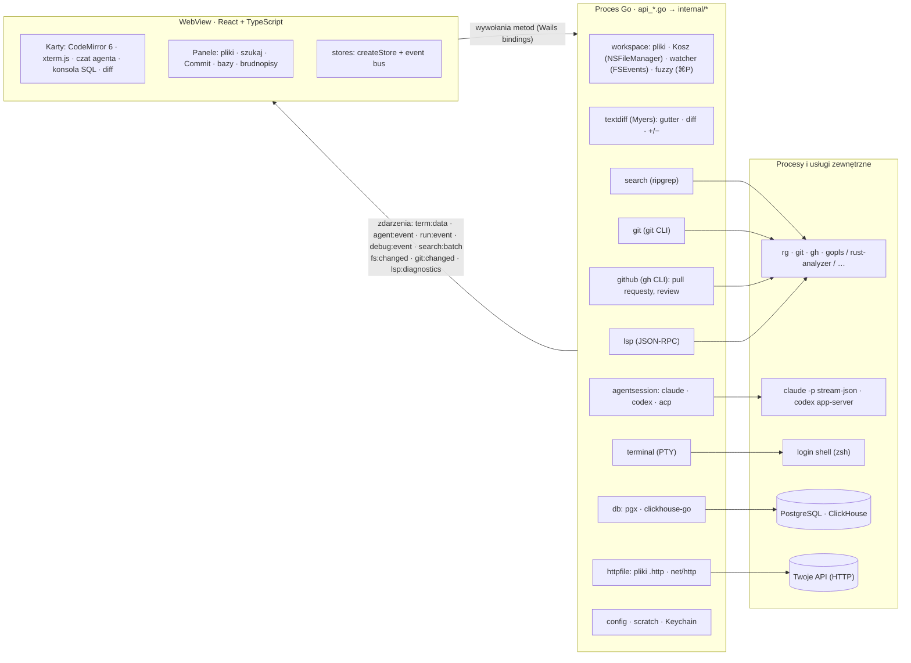

# flint

Szybkie, minimalistyczne IDE „AI-first” na macOS. Kod piszą agenci (claude, codex) w wbudowanym terminalu, a Flint służy do nawigacji, przeszukiwania projektu, podglądu zmian agenta oraz brudnopisów SQL podpiętych do Postgresa i ClickHouse.

**Stack:** Go + [Wails v3](https://v3.wails.io) (systemowy WebView, bez Electrona) · React 19 + TypeScript · CodeMirror 6 · xterm.js (WebGL)

## Co jest w MVP

| Obszar | Jak działa |
|---|---|
| Karty | Pliki, terminale, czaty z agentem, konsole SQL i diffy w jednym obszarze kart z ikonami typów plików. Plik otwarty z terminala pojawia się obok, a `⌘[` wraca do terminala (historia jak w IntelliJ). `⌘J` przełącza terminal ↔ ostatni plik, `+` otwiera terminal / czat / konsolę SQL. |
| Terminal | Prawdziwe PTY (`creack/pty`), login shell z Twoim `PATH`, renderowanie WebGL. Kilka zakładek. `⌘`+klik w `ścieżka:linia` z wyjścia agenta otwiera plik na danej linii. Shift+Enter wstawia nową linię w promptach claude/codex. Zaznaczone wyjście → `⌘L` albo prawy klik → *Send to agent* trafia do czatu z agentem jako blok kodu. |
| Drzewo plików | Wirtualizowane drzewo z zaznaczaniem (klik, `⌘`+klik, `⇧`+klik, strzałki). Prawy klik otwiera menu kontekstowe: New File / New Folder i Rename edytowane w miejscu (`F2` / `↵`), Move to Trash (`⌘⌫` / Delete, z potwierdzeniem, także dla wielu zaznaczonych), Copy Path / Copy Relative Path, Reveal in Finder, Open in Terminal, Find in Folder, Add to Agent Chat, przy plikach testów Run Tests (w Go także Debug Tests), w repozytorium Show History, a przy zmienionych plikach Show Diff i Rollback. Menu to to samo menu kontekstowe co w terminalu i na marginesie edytora (`openContextMenu`). Otwarte karty (także historia pliku) i breakpointy idą za zmianą nazwy, a po usunięciu pliku karty się zamykają. |
| Kilka projektów w oknie | Do otwartego projektu można dołączyć kolejne foldery (jak „Attach project” w IntelliJ): „Add Project to Workspace…” (`⇧⌘O`, menu File, ⌘O / Recent Projects z `⌥↵` albo `＋`). Drzewo ma wtedy sekcję na projekt z „Remove from Workspace”, ⌘P i Search obejmują wszystkie projekty (wyniki z prefiksem projektu, Find in Folder zawęża do jednego), panel Commit pokazuje repo projektu aktywnej karty i ma przełącznik z liczbą zmian, a nowe terminale i czaty startują w projekcie aktywnej karty (menu `+` ma sekcję na projekt). Za aktywną kartą idą też konfiguracje uruchomieniowe: selektor ▶ w pasku tytułu pokazuje konfiguracje (`.flint/run.json` i wykryte) projektu aktywnej karty z jego nazwą, każdy projekt pamięta swój wybór, a Run / Debug startują w tym projekcie. „Fix with agent”, ⌘L i wyniki testów trafiają do czatu projektu, którego dotyczy plik. Paleta akcji ma „Add Project to Workspace…” i „Remove <projekt> from Workspace”. LSP i watcher działają per projekt. Zestaw projektów wraca po restarcie razem z sesją projektu głównego. |
| Zmiany agenta na żywo | FSEvents (jedna rekurencyjna subskrypcja na cały projekt). Drzewo plików się odświeża, a otwarte pliki przeładowują się w miejscu z minimalnym diffem. Jeśli masz niezapisane zmiany, pojawi się ostrzeżenie. |
| Podgląd | **Markdown**: przełącznik Editor / Split / Preview w pliku `.md` (`⇧⌘V`), renderowanie w Go (goldmark, GFM: tabele, listy zadań, przekreślenia, autolinki), na żywo podczas pisania, w trybie Split podgląd podąża za nagłówkiem widocznym w edytorze. Surowy HTML i linki `javascript:` są pomijane; linki względne otwierają pliki w edytorze, zewnętrzne w przeglądarce, obrazki względne ładują się tylko z otwartych folderów. **Obrazki** (`png jpg gif webp svg ico bmp`) otwierają się w karcie podglądu: dopasowanie do okna, zoom `⌘+` / `⌘-` / `⌘0` i `⌘`+kółko, szachownica pod przezroczystością, wymiary i rozmiar; SVG można przełączyć na źródło. Limit 25 MB na obrazek. |
| Wyszukiwanie | `ripgrep --json`, wyniki przychodzą strumieniowo w paczkach i są renderowane wirtualnie. Bez rg działa wolniejszy fallback w czystym Go. **Zamiana w całym projekcie** (`⇧⌘R` albo ⇄ w panelu): podgląd przy każdym trafieniu (stary tekst przekreślony, nowy obok), checkboxy dla plików i linii, w regexach grupy `$1` / `${nazwa}`. Podgląd i zapis liczy ten sam matcher w Go, więc zapisuje się dokładnie to, co widać. Przy zapisie każdy plik jest czytany ponownie: pliki zmienione od wyszukiwania, binarne, zbyt duże i z niezapisanymi zmianami w edytorze są pomijane. Zapis jest atomowy z zachowaniem uprawnień i końców linii; ostatnią zamianę można cofnąć (*Undo*). |
| Lista TODO | Panel ☑ (paleta: „TODO List”): znaczniki `TODO`, `FIXME`, `HACK`, `XXX`, `BUG` (całe słowa, wielkimi literami) we wszystkich folderach przestrzeni roboczej, przez to samo wyszukiwanie co `⇧⌘F` (ripgrep, z `.gitignore`). Pogrupowane po plikach, z autorem z `TODO(kto)`, filtrem po znaczniku i tekście; klik otwiera plik na linii. Odświeża się po zmianach plików (z opóźnieniem), tylko gdy panel jest otwarty. |
| Docker / Compose | Panel ⛴ (paleta: „Docker”) przez CLI `docker` (Docker Desktop, Colima, OrbStack): projekty Compose (z etykiet działających kontenerów i plików `compose.yaml` / `docker-compose.yml` w folderach projektu i o poziom niżej) z usługami, pozostałe kontenery, status (działa / unhealthy / pauza / zatrzymany), porty klikalne do przeglądarki. Akcje: Logs (`docker logs -f` w karcie terminala), Shell (`docker exec -it` z bash albo sh), Start / Stop / Restart / Remove (z potwierdzeniem), dla projektu Up / Down (z potwierdzeniem) / Restart / Stop / Pull. Zmiany przychodzą z `docker events` tylko wtedy, gdy panel jest widoczny. Nazwy kontenerów są sprawdzane, zanim trafią do terminala. |
| Profile AWS | Panel ☁ (paleta: „AWS Profiles”): profile z `~/.aws/config` i `~/.aws/credentials` (z `AWS_CONFIG_FILE` / `AWS_SHARED_CREDENTIALS_FILE`) z rodzajem (SSO, klucze sesyjne z saml2aws i podobnych narzędzi, stałe klucze, rola, `credential_process`), kontem, rolą, regionem i ważnością: token SSO z `~/.aws/sso/cache`, klucze sesyjne z `x_security_token_expires` / `aws_expiration`; czas do wygaśnięcia odlicza się na żywo, lista odświeża się co 30 s i po powrocie do okna. **Terminal jako profil** (dwuklik albo `❯_`): shell z `AWS_PROFILE` i `AWS_REGION`, karta `aws:<profil> · …`, profil przetrwa restart. **Log In** uruchamia w terminalu `aws sso login` albo `saml2aws login --role …`; ustawienia wycofanego aws-azure-login (`azure_*`) są ignorowane. **Odśwież (↻)** robi to samo bez terminala: `aws sso login` (czeka do 5 min na zatwierdzenie w przeglądarce), saml2aws z `--skip-prompt --force` (zapisane hasło i rola), dla ról i `credential_process` wywołanie STS, które pobiera i cache'uje poświadczenia. Bez stdin: gdy narzędzie o coś pyta (np. kod MFA), odświeżanie od razu kończy się błędem z przyciskiem „Log In”; trwające odświeżanie można przerwać (■). **Check Identity** pyta STS (`aws sts get-caller-identity`). Sekrety (klucze, tokeny) są czytane tylko w Go, żeby stwierdzić, że istnieją, i nigdy nie trafiają do UI. |
| Go to file (`⌘P`) | Lista z `rg --files` (respektuje `.gitignore`) trzymana w Go; fuzzy matching też w Go, do WebView wraca tylko top 60 wyników. Brak indeksowania z góry. |
| Bazy danych | PostgreSQL (`pgx`) i ClickHouse (natywne TCP albo HTTP, do wyboru w profilu). Hasła trzymane są w Keychainie macOS, nie w plikach. Pod połączeniem węzeł „Databases (N)” ze wszystkimi bazami serwera, jak w pgAdmin: Postgres bez szablonów, bazy bez uprawnienia `CONNECT` z czerwonym krzyżykiem; ClickHouse jak `SHOW DATABASES`. Rozwinięcie bazy otwiera do niej osobną pulę (ten sam host, użytkownik i hasło) i pokazuje jej schematy i tabele. Pule niedomyślnych baz Flint zamyka po minucie bezczynności, a przed instrukcją modyfikującą (np. `DROP DATABASE`) od razu, żeby własne połączenia nie blokowały serwera. Konsola SQL ma select bazy obok połączenia, a wybór zapamiętuje brudnopis. Baza w profilu jest tylko domyślna i nieobowiązkowa: bez niej Flint łączy się do `postgres` (ClickHouse: `default`). Autouzupełnianie SQL ze schematu wybranej bazy, tryb read-only. |
| Git (jak w IntelliJ) | Panel Commit (`⌘K`) z checkboxami, Amend, Commit and Push i Rollback. Diff obok siebie w karcie. Znaczniki zmienionych linii na marginesie, które pokazują też, co ruszył agent. Widżet gałęzi w pasku stanu: checkout, nowa gałąź, fetch, pull, push (`⇧⌘K`). Commit podczas merge'a obejmuje cały index. **Annotate** (blame): kolumna z datą i autorem przy każdej linii (przycisk *Blame* w pasku stanu albo prawy klik na marginesie edytora), z podpowiedzią (pełny hash, autor, data, opis). Klik otwiera zmianę z tego commita, a linie niezacommitowane (także niezapisane) mają „Not committed”. **Show History** pliku (`git log --follow`, z rename'ami) w osobnej karcie: lista commitów, pod nią diff wybranego commita, *Compare with current*. **Stash** w panelu Commit: zapis z wiadomością (opcjonalnie z plikami nieśledzonymi), lista z Apply / Pop / Drop (z potwierdzeniem) i diffem każdego pliku. Działa też dla plików w zagnieżdżonych worktree. |
| Pull requesty (GitHub) | Przegląd PR-ów w IDE przez GitHub CLI (`gh`), bez własnej obsługi tokenów: `gh` loguje się tak jak w terminalu (keyring, `GH_TOKEN`, GitHub Enterprise). Widok **Pull Requests** (ikona ⇅ na pasku aktywności albo „Pull Requests…” w palecie) pokazuje PR-y repozytorium projektu aktywnej karty: filtry *All / Created by me / Review requested* i *Open / Closed / Merged / All states*, przy każdym stan CI (✓ / ✗ / ●, w podpowiedzi liczba udanych, nieudanych i trwających), decyzja review (Approved, Changes requested, Review required, Draft, Merged) i czas ostatniej zmiany. Bez `gh`, bez logowania albo bez zdalnego repozytorium na GitHubie widok wyjaśnia, co zrobić (`brew install gh`, `gh auth login`). Klik otwiera kartę PR: tytuł, gałęzie, autor, rozwijana lista checków z linkami, opis (Markdown renderowany w Go, bez surowego HTML), pliki z +/− i liczbą otwartych wątków, commity, review oraz *Check out* (`gh pr checkout`, odmawia przy niezacommitowanych zmianach w śledzonych plikach) i *Open on GitHub*. Klik w plik otwiera diff obok siebie (merge base ↔ head, jak na GitHubie) z **komentarzami w miejscu linii**: wątek pod linią z odpowiedzią (`⌘↵`) i *Resolve* / *Unresolve*, po drugiej stronie odstęp tej samej wysokości, więc strony się nie rozjeżdżają. `+` na marginesie przy liniach, które GitHub pozwala komentować (wewnątrz hunków), otwiera nowy komentarz: *Add single comment* (od razu) albo *Start a review* / *Add review comment* (oczekujący review widoczny tylko dla Ciebie). Wątki nieaktualne i komentarze do całego pliku są nad diffem. Pasek *Submit review* (w karcie PR i w diffie): podsumowanie oraz *Comment*, *Approve*, *Request changes*, a przy oczekującym review liczba komentarzy i *Discard*. Nic nie odświeża się w tle: lista ładuje się przy otwarciu widoku i powrocie do okna, PR przy otwarciu karty i powrocie do okna, oba także przyciskiem ↻ (odpowiedzi `gh` Go trzyma w pamięci ok. 30 s). |
| Worktree | Lista, tworzenie (`<repo>.worktrees/<gałąź>`), usuwanie, przełączanie, otwieranie w nowym oknie lub od razu z terminalem dla agenta. Checkout i commit zrobione w terminalu odświeżają UI, bo obserwowany jest też katalog git. |
| LSP | `gopls`, `rust-analyzer`, `vtsls`/`typescript-language-server`, `basedpyright`/`pyright`. Serwer startuje w tle przy pierwszym pliku danego języka. Podpowiedzi, hover, ⌘+klik / ⌘B / F12 → definicja, ⌥F7 / ⇧F12 → Find Usages, błędy na żywo (`⇧⌘M` lista problemów, `F8` następny). Przy błędzie i ostrzeżeniu przycisk *Fix with agent* (oraz *Fix all N in file*, także `⌥⇧⌘L`): do czatu trafia ścieżka, linia:kolumna, waga, źródło (np. gopls), komunikat i okoliczne linie jako załącznik. Stan serwera i podpowiedź instalacji w pasku stanu. |
| Czat z agentem | Natywne sterowniki **bez npm**: Claude Code (`claude -p` w trybie `stream-json` + `--permission-prompt-tool stdio`) i Codex (`codex app-server`), plus klient ACP dla agentów mówiących nim natywnie. Wspólny panel w doku po prawej (`+` → claude / codex): strumieniowana odpowiedź, wywołania narzędzi z mini-diffem, plan, lista zmienionych plików. Edycje i odczyty przechodzą bez pytania (polityka „auto: edits”), komendy pytają. `⌘L` dołącza zaznaczenie lub bieżący plik do rozmowy. „Wyślij do agenta” (problemy LSP, wyjście terminala) używa wspólnego `askAgent` (`frontend/src/lib/askAgent.ts`): aktywny lub ostatnio używany czat projektu, którego dotyczy (projekt pliku, a bez pliku — aktywnej karty), a gdy go nie ma — nowy w tym projekcie z preferowanym agentem. Treść trafia do szkicu, żeby można było coś dopisać; ⌥-klik wysyła od razu. W nagłówku czatu: zużycie (skumulowane tokeny wejścia/wyjścia, koszt w USD, o ile agent go raportuje — codex zwykle nie — oraz pasek wypełnienia kontekstu, np. „42% context”), ze szczegółami w podpowiedzi; suma dla projektu (przy kilku projektach dla całego workspace'u, z podziałem w podpowiedzi) w pasku stanu. Zużycie jest częścią zapisanej sesji. |
| Agent | ✦ *Generate message*: `claude -p` (albo `codex exec`) dostaje diff zaznaczonych plików i ostatnie wiadomości commitów, a wynik trafia do pola do poprawki. ✦ *Resolve with claude*: konflikty trafiają do interaktywnej sesji agenta w nowym terminalu; agent robi `git add`, ale nie commituje. Nic nie wymaga akceptowania diffów. |
| Uruchamianie (jak w IntelliJ) | Konfiguracje w `.flint/run.json` (do commitowania, jak `.idea/runConfigurations` / `.vscode/launch.json`): `command` (program z argumentami albo linia powłoki), `go` (build pakietu lub pliku + uruchomienie binarki), `npm` (skrypt z `package.json`, menedżer wg lockfile'a), `make`. Katalog roboczy, zmienne środowiskowe i krok „before launch”. Bez konfiguracji Flint sam wykrywa pakiety `main` w Go, cele `Makefile` i skrypty `package.json` (zapisuje je dopiero po edycji). Selektor z ▶ Run / ↻ Rerun / ■ Stop w pasku tytułu, wyjście w karcie z xterm.js i klikalnymi `ścieżka:linia`. Proces działa w PTY we własnej grupie procesów, więc Stop (SIGINT, po 3 s SIGKILL) kończy też dzieci (`go run`, `npm run`). Pole `debug` w konfiguracji jest zarezerwowane pod debugger DAP (`dlv dap`), a `profileURL` wskazuje endpoint `net/http/pprof` programu do profilowania (zob. *Profilowanie*). |
| Testy | ▶ na marginesie przy `func TestXxx`, podtestach `t.Run("…")`, `describe` / `it` / `test` w `*.test.ts(x)` / `*.spec.*`; ▶ przy `package` (lub w 1. linii pliku JS) uruchamia cały plik, ⌥-klik cały pakiet. Wynik przy teście: ✓ / ✗ / ↷. Karta *Tests*: drzewo pakietów i testów ze statusem i czasem, wyjście błędu z klikalnymi lokalizacjami, „Rerun failed”, ponowne uruchomienie pojedynczego testu. Go: `go test -json` parsowany w Go. JS: `node --test --test-reporter=tap` (także przez skrypt `test` tego repo, `webbuild --test`); inne runnery (jest, vitest) uruchamiają się przez skrypt `test` i raportują tylko kod wyjścia. |
| Debugger | Go przez Delve (`dlv dap`, klient DAP w Go: `internal/dap`). Przycisk z robakiem obok ▶ w pasku tytułu (`⌃D`) debuguje wybraną konfigurację `go`, a ⇧-klik w ▶ przy teście debuguje test. Breakpointy: klik na marginesie plików `.go` lub `⌘F8`; przesuwają się razem z edycją i są częścią zapisanej sesji. Po zatrzymaniu edytor pokazuje bieżącą linię, a karta *Debug* — ramki stosu, zmienne (rozwijane leniwie) i konsolę z wyjściem programu i ewaluacją wyrażeń. Krokowanie: `F9` wznów, `F8` przejdź, `F7` wejdź, `⇧F8` wyjdź, `⌘F2` zatrzymaj. Wymaga `dlv` (`go install github.com/go-delve/delve/cmd/dlv@latest`) i włączonego trybu deweloperskiego macOS (`sudo DevToolsSecurity -enable`). |
| Profilowanie (Go) | **Testy** (główna ścieżka): „Profile Tests in File” / „Profile Package Tests” w menu ▶ w pasku tytułu, w palecie, w menu drzewa plików (Profile Tests) i pod prawym klikiem na ▶ na marginesie (także pojedynczy test). Flint uruchamia `go test -cpuprofile … -memprofile … -o …` (jeden pakiet naraz) w karcie *Tests*, z profilami i binarką testów w katalogu tymczasowym, a po zakończeniu otwiera kartę profilu z CPU i pamięcią (`alloc_space`, do przełączenia na inne typy próbek). **Konfiguracje**: programy w Go same się nie profilują, więc „Profile '<konfiguracja>'” wymaga pola `profileURL` (endpoint `net/http/pprof`, np. `http://localhost:6060/debug/pprof/profile?seconds=10`, bez `seconds` 10 s; tylko localhost). Flint uruchamia konfigurację, jeśli nie działa, czeka, aż program zacznie słuchać, i pobiera profil; bez `profileURL` otwiera edycję konfiguracji. Można też otworzyć dowolny plik `.pprof` („Open Profile File…”). Profil parsuje Go (`github.com/google/pprof/profile`) i składa w drzewo wywołań z wartościami flat/cum, pomijając ramki poniżej 0,5% całości (do UI trafia kilkadziesiąt KB). Karta profilu (ładowana leniwie) rysuje flame graph na jednym `<canvas>`: podpowiedź z funkcją, `plik:linia`, flat/cum i %, klik przybliża ramkę (przodkowie zostają u góry i oddalają), `Esc` / Reset Zoom wraca, ⌘-klik lub dwuklik otwiera źródło na danej linii, wyszukiwarka podświetla funkcje i podaje ich udział. Widok *Top* to tabela funkcji (flat, cum, %, sortowanie), a „Raw .pprof” kopiuje ścieżkę lub pokazuje plik w Finderze (np. dla `go tool pprof`). Kolory z motywu (`--flame-*` w `style.css`). |
| Brudnopisy | Trwałe konsole SQL i notatki (MD/TXT) z autozapisem. `⌘↵` uruchamia zapytanie spod kursora lub zaznaczenie. Wyniki trafiają do wirtualizowanej tabeli (do 200k wierszy) z eksportem do TSV/JSON. |
| Klient HTTP (jak w IntelliJ) | Pliki `.http` / `.rest` z żądaniami do własnych API. Żądania rozdziela `###` (z opcjonalną nazwą). Linia żądania to `METODA URL [HTTP/1.1]` (bez metody: GET, bez schematu: `http://`), a długi URL można kontynuować we wciętych wierszach zaczynających się od `?` / `&`. Dalej nagłówki, pusta linia i treść: wprost albo z pliku `< ./body.json` (ścieżka względem pliku `.http`; `<@` podstawia w nim też zmienne). Komentarze `#` i `//`, dyrektywy `# @name nazwa`, `# @no-redirect`, `# @no-cookie-jar`, `# @timeout 60` (sekundy albo np. `2m`). Zmienne `{{nazwa}}`: z linii `@nazwa = wartość` (działają w żądaniach poniżej definicji i mają pierwszeństwo), ze środowiska w `http-client.env.json` i `http-client.private.env.json` obok pliku (sekcja `$shared` dla wszystkich środowisk, plik prywatny nadpisuje publiczny) oraz dynamiczne `{{$uuid}}`, `{{$timestamp}}`, `{{$isoTimestamp}}`, `{{$randomInt}}` (0–1000). Podświetlanie składni, ▶ na marginesie przy każdym żądaniu, błędy składni na żywo, a przy wysyłce także nieznane zmienne — zawsze z numerem linii. Żądanie wychodzi **tylko** na wyraźną akcję: `⌘↵` w pliku `.http` (w konsolach SQL `⌘↵` dalej uruchamia zapytanie), ▶ albo „Send Request”. Pasek nad edytorem: środowisko, „Follow redirects” i ▶ Send. Wysyła Go (`net/http`): limit czasu 30 s, Cancel, osobny cookie jar na plik, zrozumiałe błędy TLS. Odpowiedź otwiera się w karcie tuż za plikiem: status, czas, rozmiar, zwijane nagłówki i treść w edytorze tylko do odczytu z podświetlaniem JSON / XML / HTML (JSON formatuje Go, typ z `Content-Type` albo wykryty z treści). Z treści ponad 5 MB widać początek, a „Save to file” zapisuje całość. „Copy as curl” i historia kilku ostatnich odpowiedzi każdego żądania (tylko w pamięci, z limitem). Paleta: „Send Request”, „New HTTP Request File”, „Select HTTP Environment”, „Copy Request as curl”, „Toggle HTTP Follow Redirects”, „Clear HTTP Cookies”. **`http-client.private.env.json` dodaj do `.gitignore`** — trzyma sekrety (tokeny, hasła). Flint nie zapisuje nagłówków ani wartości zmiennych w logach. |
| Historia zapytań | Go zapisuje każdą wykonaną instrukcję (także nieudaną, EXPLAIN i edycje z tabeli wyników) per połączenie i bazę: tekst, czas startu, czas trwania, liczbę wierszy i błąd. Przycisk *History* w konsoli albo „Query History…” (`⇧⌘H`) otwiera listę od najnowszych z filtrem fuzzy (liczonym w Go, do WebView trafia maks. 300 pozycji), przełącznikiem „All databases” i akcjami: `↵` wstawia do edytora, `⌘↵` uruchamia ponownie, `⌘C` kopiuje. Trzymane jest ostatnie 5000 instrukcji na połączenie. Hasła w `CREATE/ALTER ROLE … PASSWORD '…'` i ClickHouse `IDENTIFIED … BY '…'` są maskowane, poza tym tekst zapisywany jest bez zmian (instrukcje dłuższe niż 256 KB są przycinane). |
| EXPLAIN | *Explain* (`⇧⌘E`) i *Analyze* (`⇧⌘A`) w pasku konsoli i w palecie. Postgres: `EXPLAIN (FORMAT JSON)`, a z Analyze `EXPLAIN (ANALYZE, BUFFERS, FORMAT JSON)`; JSON parsuje Go (`internal/db/explain.go`) do drzewa węzłów z typem, relacją, indeksem, kosztem, wierszami szacowanymi i faktycznymi, pętlami, czasem, buforami i filtrem. Widok to rozwijane drzewo z paskiem udziału każdego węzła w łącznym czasie własnym (Analyze) albo koszcie własnym (szacunek), klik w węzeł pokazuje szczegóły (warunki, klucze sortowania, bufory). Ostrzeżenia: Seq Scan czytający ≥ 10k wierszy (bez Analyze: ≥ 10k szacowanych lub koszt ≥ 2500), szacunek wierszy chybiony 10× i więcej, sortowanie albo hash wylewające się na dysk. ANALYZE wykonuje instrukcję zawsze w transakcji wycofywanej na końcu, a przed instrukcją inną niż SELECT (np. `DELETE`, `WITH … UPDATE`, `SELECT … INTO`) Flint pyta o zgodę (decyduje Go, `ExplainResult.needsConfirm`); w połączeniu read-only taka instrukcja jest odrzucana. EXPLAIN idzie protokołem rozszerzonym, więc przyjmuje tylko jedną instrukcję. ClickHouse: `EXPLAIN PLAN indexes = 1` albo (Analyze → *Pipeline*) `EXPLAIN PIPELINE` jako drzewo z wcięć (best effort); żadne z nich nie wykonuje zapytania. |
| Edycja wyników | Postgres: gdy wszystkie kolumny wyniku pochodzące z tabel pochodzą z jednej tabeli (OID tabeli z `FieldDescriptions` pgx, bez dodatkowego zapytania), konsola po wyświetleniu wyników pobiera w tle kolumny i klucz główny z `pg_attribute`/`pg_index`. Jeśli tabela ma klucz główny i wszystkie jego kolumny są w wyniku, komórki można edytować: dwuklik lub `↵`/`F2` otwiera edytor zależny od typu (tekst, liczba z walidacją, boolean jako lista, JSON w polu wielowierszowym z walidacją, przełącznik NULL), „+ Row” dodaje wiersz (niewypełnione kolumny dostają DEFAULT), „− Row” / `⌘⌫` oznacza wiersz do usunięcia. Zmiany są tylko lokalne i podświetlone, *Revert* je porzuca, a *Submit…* pokazuje wygenerowany SQL i po *Apply* wykonuje w jednej transakcji `UPDATE`/`INSERT`/`DELETE` po kluczu głównym. Identyfikatory są cytowane i sprawdzane z katalogiem, wartości idą wyłącznie jako parametry (`$n::text::typ`, więc serwer parsuje je jak literał), a `UPDATE`/`DELETE`, który nie trafi dokładnie w jeden wiersz, wycofuje całość. Kolumny wyliczane, `GENERATED ALWAYS AS IDENTITY`, tablice i `bytea` są tylko do odczytu; wynik złączenia, widoku bez klucza czy połączenie read-only — także. ClickHouse: tylko odczyt. |
| Ustawienia | `⌘,` (menu flint ▸ Settings… albo „Settings…” w palecie) otwiera kartę ustawień z sekcjami Appearance, Editor, Terminal, Agents i Keymap. Każda zmiana działa od razu, bez restartu, i zapisuje się sama. **Motyw**: Dark, Light albo System (za wyglądem macOS, `prefers-color-scheme`); kolory to zmienne CSS w `style.css` (`:root` i `[data-theme="light"]`), terminale mają własną paletę (`lib/terminalTheme.ts`), a pasek tytułu i przyciski okna przełącza Go (`NSApp.appearance`). Motyw z ostatniego uruchomienia jest stosowany przed pierwszym renderem (kopia w `localStorage` + wygląd okna ustawiany w Go przed jego utworzeniem), więc jasny motyw nie mignie ciemnym. **Edytor**: rodzina i rozmiar czcionki oraz interlinia wszystkich edytorów CodeMirror (pliki, diffy, brudnopisy), opcjonalny zapis plików przy utracie fokusu okna. **Terminal**: czcionka, rozmiar i interlinia terminali i konsol uruchomień (xterm dopasowuje się od razu, PTY dostaje nowy rozmiar). **Agents**: domyślny agent nowych czatów, opisów commitów i rozwiązywania konfliktów. **Keymap**: lista wszystkich komend z wyszukiwaniem (po nazwie albo skrócie, np. `⌘K`); klik w skrót i naciśnięcie nowej kombinacji zmienia go, konflikty z innymi komendami są pokazywane, `↺` przywraca domyślny, `✕` usuwa. Skróty obsługiwane przez CodeMirror (`⌘F`, `⌘S`, `⌘↵`…) są tylko wyświetlane. Nadpisania trafiają do warstwy w rejestrze komend (`lib/commands.ts`), więc paleta i dispatcher używają skutecznych skrótów. |
| Integracja z macOS (Wails v3) | **Przeciąganie z Findera**: folder upuszczony w oknie otwiera się jako projekt (albo dołącza do przestrzeni roboczej, gdy jakiś jest otwarty), plik otwiera się w karcie (do 20 naraz); podczas przeciągania okno pokazuje, co się stanie. **Jedna instancja**: `flint <folder>` przy działającym Flincie przekazuje mu folder (ścieżki względne od katalogu wywołania) i wyciąga okno na wierzch; Flint z innym `FLINT_CONFIG_DIR` (np. dev) jest osobną instancją. **Powiadomienia w tle**: gdy uruchomienie, testy albo tura agenta skończą się, a Flint nie jest aktywny, przychodzi powiadomienie macOS (klik pokazuje kartę) i licznik na ikonie w Docku, zerowany po powrocie do okna; wyłączane w Settings ▸ Agents. Menu aplikacji (z `Settings… ⌘,`) i kompaktowy pasek tytułu to natywne opcje v3, bez wstawek w Objective-C. |

## Skróty

`⇧⌘P` paleta akcji · `⌘,` ustawienia (także zmiana skrótów) · `⌘[` / `⌘]` wstecz / dalej · `⇧⌘O` dołącz projekt · `F2` / `↵` zmiana nazwy w drzewie · `⌘⌫` do Kosza · `⌘P` plik · `⇧⌘F` szukaj · `⇧⌘R` zamień w plikach · `⇧⌘V` podgląd Markdown · `⌘B`/`F12` definicja · `⌥F7` użycia · `⌘L` do agenta (zaznaczenie w edytorze lub terminalu) · `⌥⇧⌘L` napraw problemy pliku z agentem · `⇧⌘M` problemy · `⌘K` commit · `⇧⌘K` push · `⌘J` terminal · `⇧⌘T` nowy terminal · `⌘N` nowa konsola SQL · `⌘↵` uruchom zapytanie (SQL) / wyślij żądanie (`.http`) · `⌘S` zapisz · `⌘W` zamknij kartę · `⌘B` panel boczny · `⌘O` otwórz folder · `⌘K` w terminalu czyści ekran · `⌃R` uruchom wybraną konfigurację (ponownie, jeśli działa) · `⌃⇧R` uruchom test pod kursorem (poza plikiem testów: wybraną konfigurację) · `⌘F2` zatrzymaj · `⌃D` debuguj · `⌘F8` breakpoint · `F9` / `F8` / `F7` / `⇧F8` wznów / przejdź / wejdź / wyjdź (podczas debugowania) · `⇧⌘E` EXPLAIN · `⇧⌘A` EXPLAIN ANALYZE (ClickHouse: PIPELINE) · `⇧⌘H` historia zapytań

Paleta akcji (`⇧⌘P`, jak „Find Action” w IntelliJ) wyszukuje fuzzy wśród wszystkich komend aplikacji (nawigacja, projekty, git, GitHub, terminal, agent, uruchamianie, profilowanie, bazy, brudnopisy), pokazuje ich kategorię i skrót, a ostatnio użyte trzyma na górze. Komendy i globalne skróty pochodzą z jednego rejestru (`frontend/src/lib/commands.ts`); nowa funkcja dodaje swoje akcje przez `registerCommand`.

## Uruchomienie

Wymagania: Go 1.26+, Node 22+, Xcode CLT, `wails3` (`go install github.com/wailsapp/wails/v3/cmd/wails3@v3.0.0`), opcjonalnie `brew install ripgrep`.

```bash
make dev        # live reload (wails3 task dev)
make build      # build/bin/flint.app (wails3 task package, Taskfile.yml)
make server     # Flint jako serwer HTTP dla przeglądarki, bez okna (tryb serwerowy Wails v3)
make install    # /Applications + polecenie `flint` w ~/.local/bin
flint .         # otwiera bieżący katalog
```

## Testy

```bash
make test                                  # Go (race) + frontend (tsc + node --test)
make test-db-up && make test-integration   # Postgres + ClickHouse (TCP i HTTP) w Dockerze
make test-db-down
```

## Architektura

Flint to jeden proces Go z systemowym WebView (Wails v3, na macOS WKWebView). Cała logika — pliki, git, bazy, terminale, agenci, LSP — działa w Go. Frontend (React + TypeScript) tylko wyświetla i wysyła polecenia.



**Komunikacja UI ↔ Go.**
- **Wywołania:** frontend wywołuje metody `WorkspaceAPI`, `GitAPI`, `GitHubAPI`, `DatabaseAPI`, `LSPAPI`, `AgentChatAPI`, `HTTPAPI` itd. przez wygenerowane bindingi TypeScript (`frontend/bindings`, `wails3 generate bindings`; `src/wails/` daje im dawne nazwy przestrzeni modeli i funkcji runtime). Każde API to usługa Wails v3 (`application.NewService`), cykl życia `App` to usługa `lifecycle`. Wails wykonuje każde wywołanie w osobnej gorutynie, dlatego zapisy i wpisywanie do terminala są kolejkowane po stronie UI.
- **Zdarzenia:** strumienie płyną zdarzeniami (wyjście terminala, odpowiedzi agenta, wyniki wyszukiwania, zmiany plików i gita, diagnostyka LSP).
- **Workspace z kilkoma projektami:** `App` trzyma listę rootów (pierwszy to projekt główny) i watcher na każdy (`project.go`). `WorkspaceAPI.AddRoot` / `RemoveRoot` dołączają i odłączają foldery (zagnieżdżone i powtórzone są odrzucane, `workspace.CheckNewRoot`), a operacje na plikach szukają roota ścieżki (`workspace.RootOf`). `fuzzy.Index` trzyma listę plików per root, a przy kilku rootach szuka po wspólnej liście `etykieta/ścieżka` (etykiety: `workspace.Labels`, w UI `lib/workspaceRoots.ts`). `SearchAPI.Start` dostaje listę rootów (`search.RunRoots`, wspólny limit wyników) i każde trafienie ma swój root. `git:changed` niesie root, którego dotyczy. Konfiguracje uruchomieniowe, testy i debugger dostają root od frontendu (`RunAPI.Configs(root)`, `Start(id, root, …)`), więc Go nie ma pojęcia „bieżącego” projektu.
- **Operacje na plikach:** tworzenie, zmianę nazwy i usuwanie z drzewa robi Go (`internal/workspace/fileops.go`, `WorkspaceAPI.CreateFile` / `CreateFolder` / `RenamePath` / `TrashPaths` / `RevealInFinder`). Każda ścieżka musi leżeć wewnątrz otwartego folderu (sam folder projektu nie da się usunąć ani przemianować), zmiana nazwy nigdy nie nadpisuje innego pliku, a usuwanie przenosi do Kosza macOS przez `NSFileManager trashItemAtURL` (cgo, `trash_darwin.go`), więc plik można przywrócić z Findera. Frontend (`store/fileOps.ts`) przenosi karty na nową ścieżkę (`useEditor.renamePath`) albo je zamyka (`closePaths`); niezapisane zmiany w przemianowywanym pliku są najpierw zapisywane.
- **Pull requesty:** `GitHubAPI` (`api_github.go` → `internal/github`) uruchamia `gh` z limitem czasu (30 s odczyt, 60 s zapis, 3 min checkout), bez promptów, pagera i kolorów. Repozytorium projektu ustala `gh repo view` (zdalne repozytoria, `gh repo set-default`, hosty Enterprise), stan logowania `gh auth status`; brak `gh`, brak logowania i brak zdalnego repozytorium na GitHubie to osobne błędy z podpowiedzią. Lista: `gh pr list --json …` (status checków zliczany w Go), szczegóły: równolegle `gh pr view --json …`, `gh api --paginate repos/…/pulls/N/files` (pliki z patchami) i zapytanie GraphQL o wątki review (`gh api graphql --input -`, stronicowane). Diff pliku: head z lokalnego klona, jeśli ma ten blob (`git cat-file`), inaczej `gh api …/git/blobs/<sha>`; base odtwarzany przez odwrotne nałożenie patcha GitHuba na head (z kontrolą zgodności), a dla plików bez patcha (binarne, ogromne) z merge base (`git merge-base` lokalnie albo `gh api …/compare`). Zapisy idą tylko na wyraźną akcję: odpowiedź (`addPullRequestReviewThreadReply`), resolve/unresolve (`resolveReviewThread` / `unresolveReviewThread`), pojedynczy komentarz (REST `POST …/pulls/N/comments`), komentarz do review (`addPullRequestReview` bez zdarzenia tworzy oczekujący review, potem `addPullRequestReviewThread`), wysłanie review (`submitPullRequestReview` albo `addPullRequestReview` ze zdarzeniem), porzucenie (`deletePullRequestReview`). Treść użytkownika trafia do `gh` tylko przez stdin (JSON), nigdy jako argument. Odpowiedzi są cache'owane w Go (lista i PR ok. 30 s, repozytorium 10 min), a każdy zapis unieważnia PR. Frontend: `store/pullRequests.ts`, leniwie ładowane `components/github/*`; wątki w diffie to widżety blokowe CodeMirror (`lib/prThreadWidgets.ts`) renderowane przez portale Reacta, a ich miejsce i odstępy po drugiej stronie liczy `lib/prReview.ts`.
- **Kolejność:** zdarzenia terminala, agenta i uruchomień (wyjście, wyniki testów i kod wyjścia w jednym strumieniu `run:event`) mają numery sekwencyjne, a UI układa je z powrotem w kolejności, bo transport nie gwarantuje kolejności (np. dev server Wails).

**Frontend bez łańcucha narzędzi npm.**
- **Build:** `cmd/webbuild` (Go, `github.com/evanw/esbuild/pkg/api`) bundluje TSX i CSS do `frontend/dist` w ~0,1 s, z podziałem na chunki: przy starcie ładuje się ok. 350 KB JS, a edytor (CodeMirror), terminal (xterm.js), języki, czat i panele dopiero przy pierwszym użyciu. `wails3 task build` (Taskfile.yml) wywołuje go z `--typecheck` (najpierw `tsc --noEmit`, bo esbuild tylko usuwa typy). `wails3 task dev` uruchamia `webbuild --watch`: przebudowa po każdej zmianie i przeładowanie strony przez strumień SSE esbuild (`/esbuild`), bez HMR. Serwer dev działa na `localhost:5173` (`FRONTEND_DEVSERVER_URL`), Go przebudowuje się po zmianie (`build/config.yml`).
- **Testy:** `webbuild --test` kompiluje `src/**/*.test.ts(x)` do katalogu tymczasowego i uruchamia `node --test`. Testy używają `node:test` i `node:assert`. Typy sprawdza `tsc --noEmit`, a typy `node:test` są opisane lokalnie w `src/testing/node.d.ts` (bez `@types/node`).
- **Stan:** `src/lib/store.ts` (`createStore`) to mały kontener na `useSyncExternalStore`. `setState` emituje zdarzenie `change` na event busie (`src/lib/bus.ts`). API jak wcześniej: `useX(selector)`, `useX.getState()`, `useX.setState()`, `useX.subscribe()`. Wynik selektora jest zapamiętywany i porównywany przez `Object.is`, więc selektor budujący nową tablicę nie zapętla renderów.
- **Komendy:** rejestr `src/lib/commands.ts` (`registerCommand({ id, title, category, keys, when, run })`) zasila paletę `⇧⌘P` i jedyny globalny listener `keydown` (faza capture, przed CodeMirror i xterm). Skróty należące do edytora (np. `⌘B`, `⌘S`) paleta tylko wyświetla, a uruchamia je przez keymapę aktywnego edytora.
- **Własny kod zamiast bibliotek:** wirtualizacja list o stałej wysokości wiersza (`src/lib/virtualList.ts`), dopasowanie terminala do kontenera (`terminalFit.ts`) oraz klikalne URL-e w terminalu, także zawinięte na kilka wierszy (`terminalLinks.ts`).
- **Obliczenia w Go:** diffy liczy `internal/textdiff` (Myers w pamięci liniowej, limit czasu, potem zastępuje cały region; słowa zmienione wewnątrz linii jako offsety UTF-16). Przez `DiffAPI` dostają je: znaczniki na marginesie edytora (`Marks`), statystyki +/− i mini-diffy w czacie agenta (`Hunks`) oraz karta diffu (`Compare`). Kartę diffu rysują dwa zwykłe edytory CodeMirror z własnymi dekoracjami: tło zmienionych linii, zmienione słowa, odstępy wyrównujące obie strony i zwinięte niezmienione fragmenty. Lista plików dla ⌘P jest trzymana w `fuzzy.Index` po stronie Go (`WorkspaceAPI.IndexFiles` / `FindFiles`), więc WebView nigdy nie dostaje pełnej listy.

**Zasady projektowe.**
- **Szybkość ponad wszystko:**
  - brak indeksowania z góry: wyszukiwanie przez `rg` na żywo, lista plików dla ⌘P z `rg --files` (dopasowanie w Go, 200k ścieżek ≈ 25 ms);
  - serwery LSP i agenci startują leniwie, w tle;
  - CodeMirror i czat agenta ładują się dopiero przy pierwszym użyciu;
  - długie listy (drzewo, wyniki, tabele SQL) są wirtualizowane.
- **Natywne narzędzia zamiast reimplementacji:** git, ripgrep, serwery LSP i agenci to Twoje zainstalowane binarki, uruchamiane z `PATH` login shella (`internal/shellenv`), więc działają hooki, konfiguracja i uwierzytelnianie dokładnie jak w terminalu.
- **AI-first bez blokowania:**
  - agenci edytują pliki bez okien „Akceptuj/Odrzuć” (w obrębie projektu);
  - Flint pokazuje zmiany przez watcher, znaczniki gita na marginesie i panel Commit;
  - komendy agenta i wyjścia poza projekt wymagają zgody.
- **Bez npm w runtime:**
  - klienci LSP/ACP i sterowniki agentów są napisani w Go na bibliotece standardowej;
  - zależności frontendu są przypięte i instalowane z `--ignore-scripts`;
  - bundler i runner testów to Go (`cmd/webbuild`), a nie pakiety npm.

### Gdzie Flint trzyma dane

| Co | Gdzie | Uwagi |
|---|---|---|
| Ostatnie foldery, polityka zgód agenta | `~/Library/Application Support/flint/state.json` | preferowany agent sprzed `settings.json` jest stąd czytany, dopóki nie wybierzesz domyślnego w ustawieniach |
| Ustawienia: motyw, czcionki edytora i terminala, domyślny agent, autozapis, nadpisane skróty (`keymap`: id komendy → skrót, `""` = brak) | `~/Library/Application Support/flint/settings.json` | z numerem wersji schematu; brakujące klucze dostają wartości domyślne, nieznane są pomijane, błędne wartości przy wczytaniu zastępuje domyślna (zapis waliduje ściśle); `0600`; **bez sekretów**. Kopia do pierwszego renderu w `localStorage` (`flint.settings`) |
| Profile połączeń z bazami (host, port, użytkownik, domyślna baza — opcjonalna, protokół ClickHouse `native`/`http`, TLS, read-only) | `~/Library/Application Support/flint/connections.json` | **bez haseł**, plik z uprawnieniami `0600` |
| Hasła do baz | Pęk kluczy macOS (Keychain), usługa `flint-db`, konto = id połączenia | usuwane razem z profilem |
| Brudnopisy (konsole SQL, notatki) | `~/Library/Application Support/flint/scratch/` — `index.json` (m.in. wybrane połączenie `connId` i baza `database`, pusta = domyślna z profilu) + `<id>.sql/.md/.txt` | autozapis |
| Historia zapytań | `~/Library/Application Support/flint/history/<id połączenia>.jsonl` — linia JSON na instrukcję (baza, SQL, czas, czas trwania, wiersze, błąd, rodzaj: zapytanie / explain / edycja) | ostatnie 5000 na połączenie, `0600`; dopisywanie jednym `write` z `O_APPEND`, a gdy plik urośnie o 25% ponad limit, Go przepisuje go atomowo bez najstarszych wpisów (urwana ostatnia linia jest pomijana przy wczytaniu); bez profili i haseł połączeń, hasła w instrukcjach maskowane; usuwana razem z profilem lub przyciskiem „Clear History…” |
| Szerokość panelu bocznego | `localStorage` WebView | tylko ustawienia wyglądu |
| Otwarte karty, terminale, rozmowy z agentem i dołączone projekty (sesja projektu) | `~/Library/Application Support/flint/sessions/<hash ścieżki projektu głównego>.json`, jeden plik na projekt | zapis po zmianach (debounce) i przy wyjściu, `0600`, maks. 4 MB |
| Historia rozmów z agentem | sam CLI agenta: `~/.claude/projects/…`, `~/.codex/sessions/…` | Flint wznawia je po restarcie (`claude --resume`, codex `thread/resume`) |
| „Always allow” dla komend Claude | `.claude/settings.local.json` w projekcie | zapisuje Claude Code, jak w terminalu |
| Konfiguracje uruchomieniowe | `.flint/run.json` w projekcie | do commitowania; wersja formatu, walidacja w Go (nieznane pola i typy są błędem) |
| Wybrana konfiguracja uruchomieniowa (osobno dla każdego projektu workspace'u) | sesja projektu (`sessions/<hash ścieżki>.json`) | uruchomione procesy nie są przywracane |
| Binarki konfiguracji `go` | `$TMPDIR/flint-run/<hash>/` | nadpisywane przy każdym uruchomieniu |
| Profile (CPU, pamięć) i binarki profilowanych testów | `$TMPDIR/flint-profile-*/` | usuwane po zamknięciu karty profilu i przy wyjściu; katalogi starsze niż doba (po awarii) przy następnym profilowaniu. Pliki otwarte z dysku zostają |
| Pliki usunięte z drzewa | Kosz macOS (`~/.Trash`) | „Put Back” w Finderze przywraca je na miejsce |
| Cache serwerów LSP | ich własne katalogi, np. `~/Library/Caches/gopls` | |
| Środowiska klienta HTTP | `http-client.env.json` (do commitowania) i `http-client.private.env.json` (sekrety — do `.gitignore`) obok pliku `.http` | wybrane środowisko Flint pamięta tylko do zamknięcia aplikacji |
| Logowanie do GitHuba | sam `gh` (keyring macOS albo `GH_TOKEN`) | Flint nie widzi tokenu, tylko uruchamia `gh` |
| Pull requesty, pliki, wątki review | tylko pamięć procesu Go (lista i PR ok. 30 s, diffy plików 2 min, repozytorium projektu 10 min) | nic nie trafia na dysk; karty PR nie są częścią sesji |
| Odpowiedzi i ciasteczka klienta HTTP | tylko pamięć procesu Go: do 5 odpowiedzi na żądanie, 50 żądań i 256 MB treści; cookie jar osobno dla każdego pliku `.http` | nic nie trafia na dysk ani do logów; „Save to file” zapisuje treść tam, gdzie wskażesz |

Sesja projektu zawiera:
- dołączone projekty (`roots`, gdy jest ich więcej niż jeden). Otwarcie projektu głównego dołącza je z powrotem (pominięte zostają foldery, których już nie ma), a ten sam folder otwarty osobno ma własną, jednoprojektową sesję. Sesje zapisane przed wprowadzeniem workspace'ów wczytują się bez zmian;
- karty plików z pozycją kursora, brudnopisy i diffy;
- terminale: projekt, do którego należą, ostatni katalog powłoki (podąża za `cd`) i ostatnie ~400 linii wyjścia. Po restarcie startuje nowa powłoka w tym katalogu, a stary output widać nad nią przyciemniony. Programy pełnoekranowe (np. TUI claude) nie są zapisywane;
- rozmowy z agentem: transcript (ostatnie 200 wpisów, długie wyjścia narzędzi przycięte), zużycie tokenów i koszt. Agent dostaje połączenie przy pierwszej nowej wiadomości. Gdy rozmowy nie da się wznowić, Flint zaczyna nową i to zaznacza;
- wybrana konfiguracja uruchomieniowa każdego projektu i breakpointy debuggera w plikach wszystkich projektów workspace'u.

Wyjście terminala może zawierać dane wrażliwe, dlatego plik ma uprawnienia `0600`. Usunięcie pliku z `sessions/` czyści sesję projektu.

Katalog `~/Library/Application Support/flint` można zmienić zmienną `FLINT_CONFIG_DIR` (używają jej testy i tryb deweloperski). Pliki JSON są zapisywane atomowo: zapis do pliku tymczasowego, potem rename.

## Struktura

```
main.go, app.go, api_*.go   wiązania Wails (cienka warstwa)
cmd/webbuild                bundler frontendu (esbuild Go API), --watch, --test
internal/workspace          drzewo, odczyt/zapis plików, lista plików, tworzenie/rename/Kosz, rooty workspace'u
internal/fuzzy              fuzzy matching ⌘P i indeks plików folderów workspace'u
internal/textdiff           diffy linii i słów (Myers) dla gutter, karty diffu i czatu
internal/search             ripgrep + fallback, streaming wyników
internal/httpfile           pliki .http: parser, zmienne i środowiska, wysyłanie (net/http), historia odpowiedzi, curl
internal/db                 profile połączeń, Keychain, pgx/clickhouse, normalizacja typów, historia zapytań,
                            EXPLAIN (parser planu Postgresa, ostrzeżenia), edycja wierszy po kluczu głównym
internal/scratch            trwałe brudnopisy
internal/settings           settings.json: ustawienia, wartości domyślne, walidacja, wersja schematu
internal/terminal           PTY, koalescencja wyjścia, cwd powłoki (proc_pidinfo)
internal/runconfig          .flint/run.json: schemat, walidacja, zapis, wykrywanie (Go main, make, npm)
internal/runner             procesy konfiguracji i testów: kroki, PTY lub pipe'y, grupa procesów, Stop
internal/testrun            plan uruchomienia testów, parsery go test -json i TAP, testy w pliku (gutter)
internal/dap                klient Debug Adapter Protocol, sesje Delve (dlv dap)
internal/profiling          profile pprof: drzewo wywołań i top dla flame graphu, pobieranie z net/http/pprof, katalogi tymczasowe
internal/restore            zapis sesji projektu (karty, terminale, czaty) między uruchomieniami
internal/git                status, commit, rollback, gałęzie, worktree, log, blame, historia pliku, stash, obiekty i merge base (CLI gita)
internal/github             pull requesty przez gh: lista, szczegóły, wątki review (GraphQL), diff pliku, odpowiedzi, resolve, review, checkout
internal/agent              claude / codex: tryb bez interakcji i polecenia interaktywne
internal/shellenv           PATH z login shell (hooki gita, brew, nvm w aplikacji GUI)
internal/watcher            FSEvents + debounce
internal/lsp                klient LSP (JSON-RPC, Content-Length), menedżer serwerów
internal/acp                klient Agent Client Protocol (JSON-RPC rozdzielany \n)
internal/agentsession       wspólny model zdarzeń agenta, polityka akceptacji, menedżer sesji
  claude/ codex/ acpdriver/ natywne sterowniki agentów
frontend/src                React: store (createStore + event bus), components, lib
```

Szczegóły przechowywania danych: sekcja [Gdzie Flint trzyma dane](#gdzie-flint-trzyma-dane).

## Bezpieczeństwo zależności

- Flint w trakcie działania nie pobiera nic z npm (żadnego `npx`). Agenci i serwery LSP to Twoje zainstalowane binarki.
- GitHub obsługuje Twój `gh` (bez bibliotek klienckich GitHuba i bez tokenów we Flincie). Testy używają atrapy `gh` na `PATH` (skrypt z odpowiedziami z `internal/github/testdata`, zapisujący argumenty i stdin), więc nigdy nie łączą się z GitHubem.
- Profile pprof czyta `github.com/google/pprof/profile` (moduł Go, sama biblioteka standardowa); flame graph i jego układ są własne, bez zależności npm.
- Frontend: `frontend/.npmrc` wyłącza skrypty instalacyjne (`ignore-scripts=true`) i wymusza dokładne wersje, a build używa `npm ci --ignore-scripts`.
- Zależności frontendu ograniczone do: React, CodeMirror (jeden autor, bez `@codemirror/merge`), xterm.js (rdzeń + renderer WebGL) oraz TypeScript i typy Reacta do sprawdzania typów. Razem 43 pakiety w `node_modules` (wcześniej 145). Bundler (esbuild przez Go API) i runner testów (`node --test`) nie pochodzą z npm. Stan, wirtualizacja list, dopasowanie terminala, linki w terminalu, diffy i fuzzy matching są własne.
