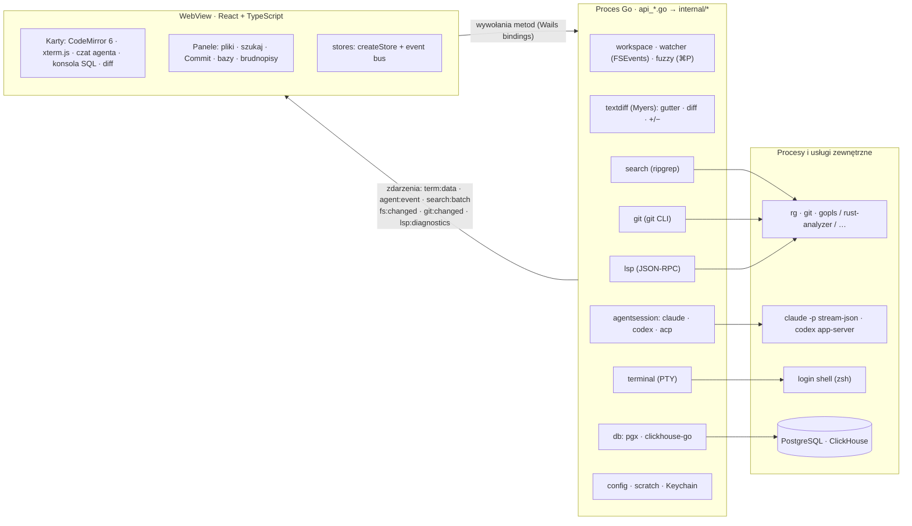

# flint

Szybkie, minimalistyczne IDE „AI-first” na macOS. Kod piszą agenci (claude, codex) w wbudowanym terminalu, a Flint służy do nawigacji, przeszukiwania projektu, podglądu zmian agenta oraz brudnopisów SQL podpiętych do Postgresa i ClickHouse.

**Stack:** Go + [Wails v2](https://wails.io) (systemowy WebView, bez Electrona) · React 19 + TypeScript · CodeMirror 6 · xterm.js (WebGL)

## Co jest w MVP

| Obszar | Jak działa |
|---|---|
| Karty | Pliki, terminale, czaty z agentem, konsole SQL i diffy w jednym obszarze kart z ikonami typów plików. Plik otwarty z terminala pojawia się obok, a `⌘[` wraca do terminala (historia jak w IntelliJ). `⌘J` przełącza terminal ↔ ostatni plik, `+` otwiera terminal / czat / konsolę SQL. |
| Terminal | Prawdziwe PTY (`creack/pty`), login shell z Twoim `PATH`, renderowanie WebGL. Kilka zakładek. `⌘`+klik w `ścieżka:linia` z wyjścia agenta otwiera plik na danej linii. Shift+Enter wstawia nową linię w promptach claude/codex. |
| Zmiany agenta na żywo | FSEvents (jedna rekurencyjna subskrypcja na cały projekt). Drzewo plików się odświeża, a otwarte pliki przeładowują się w miejscu z minimalnym diffem. Jeśli masz niezapisane zmiany, pojawi się ostrzeżenie. |
| Wyszukiwanie | `ripgrep --json`, wyniki przychodzą strumieniowo w paczkach i są renderowane wirtualnie. Bez rg działa wolniejszy fallback w czystym Go. |
| Go to file (`⌘P`) | Lista z `rg --files` (respektuje `.gitignore`) trzymana w Go; fuzzy matching też w Go, do WebView wraca tylko top 60 wyników. Brak indeksowania z góry. |
| Bazy danych | PostgreSQL (`pgx`) i ClickHouse (natywny protokół). Hasła trzymane są w Keychainie macOS, nie w plikach. Przeglądarka schematu, autouzupełnianie SQL ze schematu, tryb read-only. |
| Git (jak w IntelliJ) | Panel Commit (`⌘K`) z checkboxami, Amend, Commit and Push i Rollback. Diff obok siebie w karcie. Znaczniki zmienionych linii na marginesie, które pokazują też, co ruszył agent. Widżet gałęzi w pasku stanu: checkout, nowa gałąź, fetch, pull, push (`⇧⌘K`). Commit podczas merge'a obejmuje cały index. |
| Worktree | Lista, tworzenie (`<repo>.worktrees/<gałąź>`), usuwanie, przełączanie, otwieranie w nowym oknie lub od razu z terminalem dla agenta. Checkout i commit zrobione w terminalu odświeżają UI, bo obserwowany jest też katalog git. |
| LSP | `gopls`, `rust-analyzer`, `vtsls`/`typescript-language-server`, `basedpyright`/`pyright`. Serwer startuje w tle przy pierwszym pliku danego języka. Podpowiedzi, hover, ⌘+klik / ⌘B / F12 → definicja, ⌥F7 / ⇧F12 → Find Usages, błędy na żywo. Stan serwera i podpowiedź instalacji w pasku stanu. |
| Czat z agentem | Natywne sterowniki **bez npm**: Claude Code (`claude -p` w trybie `stream-json` + `--permission-prompt-tool stdio`) i Codex (`codex app-server`), plus klient ACP dla agentów mówiących nim natywnie. Wspólny panel w doku po prawej (`+` → claude / codex): strumieniowana odpowiedź, wywołania narzędzi z mini-diffem, plan, lista zmienionych plików. Edycje i odczyty przechodzą bez pytania (polityka „auto: edits”), komendy pytają. `⌘L` dołącza zaznaczenie lub bieżący plik do rozmowy. |
| Agent | ✦ *Generate message*: `claude -p` (albo `codex exec`) dostaje diff zaznaczonych plików i ostatnie wiadomości commitów, a wynik trafia do pola do poprawki. ✦ *Resolve with claude*: konflikty trafiają do interaktywnej sesji agenta w nowym terminalu; agent robi `git add`, ale nie commituje. Nic nie wymaga akceptowania diffów. |
| Brudnopisy | Trwałe konsole SQL i notatki (MD/TXT) z autozapisem. `⌘↵` uruchamia zapytanie spod kursora lub zaznaczenie. Wyniki trafiają do wirtualizowanej tabeli (do 200k wierszy) z eksportem do TSV/JSON. |

## Skróty

`⌘[` / `⌘]` wstecz / dalej · `⌘P` plik · `⇧⌘F` szukaj · `⌘B`/`F12` definicja · `⌥F7` użycia · `⌘L` do agenta · `⌘K` commit · `⇧⌘K` push · `⌘J` terminal · `⇧⌘T` nowy terminal · `⌘N` nowa konsola SQL · `⌘↵` uruchom zapytanie · `⌘S` zapisz · `⌘W` zamknij kartę · `⌘B` panel boczny · `⌘O` otwórz folder · `⌘K` w terminalu czyści ekran

## Uruchomienie

Wymagania: Go 1.25+, Node 22+, Xcode CLT, `wails` (`go install github.com/wailsapp/wails/v2/cmd/wails@latest`), opcjonalnie `brew install ripgrep`.

```bash
make dev        # hot reload
make build      # build/bin/flint.app
make install    # /Applications + polecenie `flint` w ~/.local/bin
flint .         # otwiera bieżący katalog
```

## Testy

```bash
make test                                  # Go (race) + frontend (tsc + node --test)
make test-db-up && make test-integration   # Postgres + ClickHouse w Dockerze
make test-db-down
```

## Architektura

Flint to jeden proces Go z systemowym WebView (Wails v2, na macOS WKWebView). Cała logika — pliki, git, bazy, terminale, agenci, LSP — działa w Go. Frontend (React + TypeScript) tylko wyświetla i wysyła polecenia.



**Komunikacja UI ↔ Go.**
- **Wywołania:** frontend wywołuje metody `WorkspaceAPI`, `GitAPI`, `DatabaseAPI`, `LSPAPI`, `AgentChatAPI` itd. przez wygenerowane bindingi (`frontend/wailsjs`). Wails wykonuje każde wywołanie w osobnej gorutynie, dlatego zapisy i wpisywanie do terminala są kolejkowane po stronie UI.
- **Zdarzenia:** strumienie płyną zdarzeniami (wyjście terminala, odpowiedzi agenta, wyniki wyszukiwania, zmiany plików i gita, diagnostyka LSP).
- **Kolejność:** zdarzenia terminala i agenta mają numery sekwencyjne, a UI układa je z powrotem w kolejności, bo transport nie gwarantuje kolejności (np. dev server Wails).

**Frontend bez łańcucha narzędzi npm.**
- **Build:** `cmd/webbuild` (Go, `github.com/evanw/esbuild/pkg/api`) bundluje TSX i CSS do `frontend/dist` w ~0,1 s. `wails build` wywołuje go jako `frontend:build` z `--typecheck` (najpierw `tsc --noEmit`, bo esbuild tylko usuwa typy). `wails dev` uruchamia `webbuild --watch`: przebudowa po każdej zmianie i przeładowanie strony przez strumień SSE esbuild (`/esbuild`), bez HMR. Serwer dev działa na `localhost:5173` (`frontend:dev:serverUrl`).
- **Testy:** `webbuild --test` kompiluje `src/**/*.test.ts(x)` do katalogu tymczasowego i uruchamia `node --test`. Testy używają `node:test` i `node:assert`. Typy sprawdza `tsc --noEmit`, a typy `node:test` są opisane lokalnie w `src/testing/node.d.ts` (bez `@types/node`).
- **Stan:** `src/lib/store.ts` (`createStore`) to mały kontener na `useSyncExternalStore`. `setState` emituje zdarzenie `change` na event busie (`src/lib/bus.ts`). API jak wcześniej: `useX(selector)`, `useX.getState()`, `useX.setState()`, `useX.subscribe()`. Wynik selektora jest zapamiętywany i porównywany przez `Object.is`, więc selektor budujący nową tablicę nie zapętla renderów.
- **Własny kod zamiast bibliotek:** wirtualizacja list o stałej wysokości wiersza (`src/lib/virtualList.ts`), dopasowanie terminala do kontenera (`terminalFit.ts`) oraz klikalne URL-e w terminalu, także zawinięte na kilka wierszy (`terminalLinks.ts`).
- **Obliczenia w Go:** diffy liczy `internal/textdiff` (Myers w pamięci liniowej, limit czasu, potem zastępuje cały region; słowa zmienione wewnątrz linii jako offsety UTF-16). Przez `DiffAPI` dostają je: znaczniki na marginesie edytora (`Marks`), statystyki +/− i mini-diffy w czacie agenta (`Hunks`) oraz karta diffu (`Compare`). Kartę diffu rysują dwa zwykłe edytory CodeMirror z własnymi dekoracjami: tło zmienionych linii, zmienione słowa, odstępy wyrównujące obie strony i zwinięte niezmienione fragmenty. Lista plików dla ⌘P jest trzymana w `fuzzy.Index` po stronie Go (`WorkspaceAPI.IndexFiles` / `FindFiles`), więc WebView nigdy nie dostaje pełnej listy.

**Zasady projektowe.**
- **Szybkość ponad wszystko:**
  - brak indeksowania z góry: wyszukiwanie przez `rg` na żywo, lista plików dla ⌘P z `rg --files` (dopasowanie w Go, 200k ścieżek ≈ 25 ms);
  - serwery LSP i agenci startują leniwie, w tle;
  - CodeMirror i czat agenta ładują się dopiero przy pierwszym użyciu;
  - długie listy (drzewo, wyniki, tabele SQL) są wirtualizowane.
- **Natywne narzędzia zamiast reimplementacji:** git, ripgrep, serwery LSP i agenci to Twoje zainstalowane binarki, uruchamiane z `PATH` login shella (`internal/shellenv`), więc działają hooki, konfiguracja i uwierzytelnianie dokładnie jak w terminalu.
- **AI-first bez blokowania:**
  - agenci edytują pliki bez okien „Akceptuj/Odrzuć” (w obrębie projektu);
  - Flint pokazuje zmiany przez watcher, znaczniki gita na marginesie i panel Commit;
  - komendy agenta i wyjścia poza projekt wymagają zgody.
- **Bez npm w runtime:**
  - klienci LSP/ACP i sterowniki agentów są napisani w Go na bibliotece standardowej;
  - zależności frontendu są przypięte i instalowane z `--ignore-scripts`;
  - bundler i runner testów to Go (`cmd/webbuild`), a nie pakiety npm.

### Gdzie Flint trzyma dane

| Co | Gdzie | Uwagi |
|---|---|---|
| Ostatnie foldery, preferowany agent, polityka zgód agenta | `~/Library/Application Support/flint/state.json` | |
| Profile połączeń z bazami (host, port, użytkownik, baza, TLS, read-only) | `~/Library/Application Support/flint/connections.json` | **bez haseł**, plik z uprawnieniami `0600` |
| Hasła do baz | Pęk kluczy macOS (Keychain), usługa `flint-db`, konto = id połączenia | usuwane razem z profilem |
| Brudnopisy (konsole SQL, notatki) | `~/Library/Application Support/flint/scratch/` — `index.json` + `<id>.sql/.md/.txt` | autozapis |
| Szerokość panelu bocznego | `localStorage` WebView | tylko ustawienia wyglądu |
| Otwarte karty, terminale, rozmowy z agentem | tylko w pamięci | znikają po zamknięciu |
| Historia rozmów z agentem | sam CLI agenta: `~/.claude/projects/…`, `~/.codex/sessions/…` | Flint jej nie kopiuje |
| „Always allow” dla komend Claude | `.claude/settings.local.json` w projekcie | zapisuje Claude Code, jak w terminalu |
| Cache serwerów LSP | ich własne katalogi, np. `~/Library/Caches/gopls` | |

Katalog `~/Library/Application Support/flint` można zmienić zmienną `FLINT_CONFIG_DIR` (używają jej testy i tryb deweloperski). Pliki JSON są zapisywane atomowo: zapis do pliku tymczasowego, potem rename.

## Struktura

```
main.go, app.go, api_*.go   wiązania Wails (cienka warstwa)
cmd/webbuild                bundler frontendu (esbuild Go API), --watch, --test
internal/workspace          drzewo, odczyt/zapis plików, lista plików
internal/fuzzy              fuzzy matching ⌘P i indeks plików otwartego folderu
internal/textdiff           diffy linii i słów (Myers) dla gutter, karty diffu i czatu
internal/search             ripgrep + fallback, streaming wyników
internal/db                 profile połączeń, Keychain, pgx/clickhouse, normalizacja typów
internal/scratch            trwałe brudnopisy
internal/terminal           PTY, koalescencja wyjścia
internal/git                status, commit, rollback, gałęzie, worktree, log (CLI gita)
internal/agent              claude / codex: tryb bez interakcji i polecenia interaktywne
internal/shellenv           PATH z login shell (hooki gita, brew, nvm w aplikacji GUI)
internal/watcher            FSEvents + debounce
internal/lsp                klient LSP (JSON-RPC, Content-Length), menedżer serwerów
internal/acp                klient Agent Client Protocol (JSON-RPC rozdzielany \n)
internal/agentsession       wspólny model zdarzeń agenta, polityka akceptacji, menedżer sesji
  claude/ codex/ acpdriver/ natywne sterowniki agentów
frontend/src                React: store (createStore + event bus), components, lib
```

Szczegóły przechowywania danych: sekcja [Gdzie Flint trzyma dane](#gdzie-flint-trzyma-dane).

## Bezpieczeństwo zależności

- Flint w trakcie działania nie pobiera nic z npm (żadnego `npx`). Agenci i serwery LSP to Twoje zainstalowane binarki.
- Frontend: `frontend/.npmrc` wyłącza skrypty instalacyjne (`ignore-scripts=true`) i wymusza dokładne wersje, a build używa `npm ci --ignore-scripts`.
- Zależności frontendu ograniczone do: React, CodeMirror (jeden autor, bez `@codemirror/merge`), xterm.js (rdzeń + renderer WebGL) oraz TypeScript i typy Reacta do sprawdzania typów. Razem 43 pakiety w `node_modules` (wcześniej 145). Bundler (esbuild przez Go API) i runner testów (`node --test`) nie pochodzą z npm. Stan, wirtualizacja list, dopasowanie terminala, linki w terminalu, diffy i fuzzy matching są własne.
