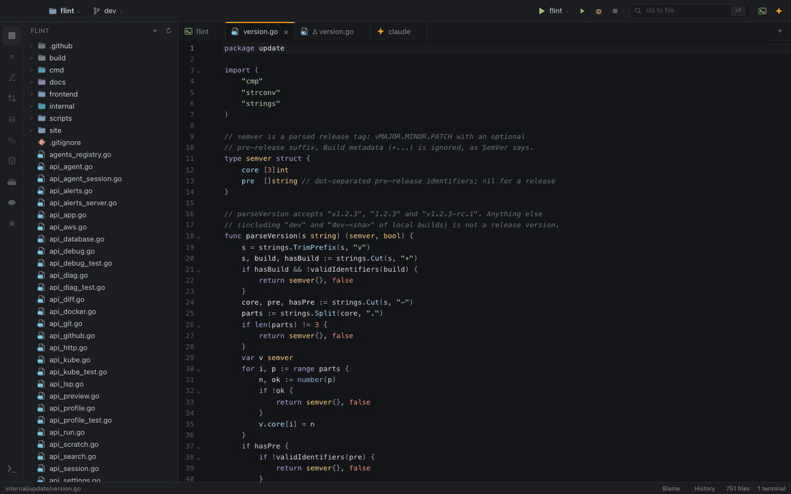

# Flint

[](https://github.com/ODudek/flint/actions/workflows/ci.yml)
[](LICENSE)

Flint is a fast, minimal, AI-first IDE for macOS. Coding agents (Claude Code, Codex) write the code in a built-in chat or terminal, and Flint is where you navigate, search the project, review what the agent changed, run and debug, and work with your databases, APIs and clusters. It is a single Go process with the native WKWebView (Wails v3), not Electron, so it starts quickly and stays light on CPU and memory.

**Stack:** Go + [Wails v3](https://v3.wails.io) (system WebView, no Electron) · React 19 + TypeScript · CodeMirror 6 · xterm.js (WebGL)



## Fast and light

Opening the Go standard library source (12,000 files) with a fresh profile on an Apple M4 Pro:

| Editor | First window | Memory after 30 s idle |
|---|---|---|
| **Flint** | **0.29 s** | **120 MB** |
| Visual Studio Code 1.115 | 0.48 s | 592 MB |
| Zed 1.27 | 0.32 s | 134 MB |

Memory is the physical footprint of all of the editor's processes, including the WebKit processes that render Flint's window. How it was measured, and how to repeat it on your machine with `go run ./cmd/bench`, is in [docs/BENCHMARK.md](docs/BENCHMARK.md).

## Why another IDE?

Coding agents now write much of the code; the work around them is giving them context, reviewing what they changed, running and debugging it, and handing back what broke. Today's editors were built for the person typing, with AI added on the side, so that work is spread over a terminal, an editor, a git client, a database client and a browser tab. Flint is built the other way round:

- **Bring your own agent:** Claude Code, Codex or any ACP agent, with your own subscriptions; Flint has no model or AI plan of its own.
- **Agents see what the IDE sees:** language server problems, the selection, test results, through Flint's own read-only MCP server.
- **Every failure is one step from the agent:** a test, a build, a crashing pod, a query, a merge conflict, with the context gathered and redacted for you to review.
- **Built for reviewing:** IntelliJ-style Git and pull request review, parallel agent tasks in their own worktrees.
- **Everything in one window, and light:** databases, HTTP, Docker, Kubernetes, AWS, debugging, in about 120 MB.

The full comparison with VS Code, Cursor, Zed, JetBrains and terminal agents, and when Flint is *not* the right choice yet, is in [Why Flint](site/why-flint.md).

## Features

The full reference, with every detail and all keyboard shortcuts, is in [docs/FEATURES.md](docs/FEATURES.md).

**Editor and navigation**
- One tab area for files, terminals, agent chats, SQL consoles and diffs, with IntelliJ-style back/forward history
- File tree with in-place rename, Move to Trash and a full context menu; several projects in one window
- `⌘P` go to file and project-wide search and replace, powered by ripgrep, with no up-front indexing
- Language servers (gopls, rust-analyzer, vtsls / typescript-language-server, basedpyright / pyright): completion, hover, go to definition, find usages, live diagnostics
- Files edited by agents reload in place as they change
- `⌘I` *Edit with Agent* on the selection, optional ghost-text completions from a local model (Ollama or any OpenAI-compatible server), and a Vim mode

**AI agents**
- Native Claude Code and Codex chat drivers, no npm: streamed responses, tool calls with mini diffs, plan, changed files, token usage and cost
- Any other agent with an Agent Client Protocol mode (Gemini CLI, OpenCode, …), added in Settings with no code
- *Fix with agent* on any LSP problem, `⌘L` to send a selection or terminal output to the chat
- Generated commit messages and agent-assisted merge conflict resolution
- Agents see what Flint sees through its own MCP server: language server problems, open files and the selection, the last test results
- Agent tasks: one click gives an agent its own branch and worktree, so several work in parallel; a panel shows their state and diff, with Merge and Create PR

**Git and GitHub**
- IntelliJ-style Commit panel, side-by-side diffs, gutter markers, blame, file history, stash, branches and worktrees
- Pull request review through `gh`: PR list with CI and review state, inline comment threads in the diff, replies, resolve, and submitting reviews

**Run, debug, test and profile**
- Run configurations in `.flint/run.json` (command, go, npm, make), with auto-detection
- Gutter ▶ for Go and JS tests, a test tree with rerun of failed tests
- Go debugger through Delve (`dlv dap`)
- Go CPU and memory profiling with a flame graph

**Databases**
- PostgreSQL and ClickHouse with passwords in the macOS Keychain, schema browsing and SQL autocompletion
- Query history per connection, visual EXPLAIN / EXPLAIN ANALYZE with warnings, and editing Postgres results by primary key

**HTTP client**
- IntelliJ-compatible `.http` / `.rest` files with variables, environments and `Copy as curl`

**Terminals**
- Real PTYs with your login shell, WebGL rendering, clickable `path:line`, and terminals that come back after a restart

**Infrastructure**
- Docker / Compose: projects, services and containers with logs, shell and lifecycle actions
- Kubernetes: context and namespace picker that never changes your global context; apps grouped by Flux, Argo CD, Helm or labels, with rollout state, pod problems, events, and *Diagnose with AI*
- AWS profiles: SSO and session credential status and expiry, one-click refresh, terminals per profile

**Everything else**
- Markdown preview (rendered in Go, no raw HTML) and image preview
- TODO / FIXME list across the workspace
- Settings tab with theme (Dark, Light, System), fonts and a fully editable keymap; a command palette for every action
- Import your settings, shortcuts and color theme from VS Code, Cursor or VSCodium
- Restricted Mode for folders you have not trusted yet
- Local diagnostics log and a Report an Issue command; no telemetry
- A notice when a new release is out (one anonymous request to GitHub a day, can be turned off; nothing is downloaded or installed for you)

## Install

### Download

Download the latest `.dmg` (or `.zip`) from [GitHub Releases](https://github.com/ODudek/flint/releases) and drag Flint to Applications. Release builds are universal (Apple silicon and Intel) and come with SHA-256 checksums.

Release builds are ad-hoc signed unless they are notarized. On first launch macOS may refuse to open the app: right-click Flint in Applications, choose **Open**, then confirm. You only need to do this once.

### Build from source

See [Requirements](#requirements), then:

```bash
git clone https://github.com/ODudek/flint.git
cd flint
cd frontend && npm ci --ignore-scripts && cd ..
make install    # builds build/bin/flint.app, copies it to /Applications, installs `flint` in ~/.local/bin
```

## Requirements

To run Flint:

- macOS 12 or later

To build Flint:

- Go 1.27.3+
- Node 22+
- Xcode Command Line Tools
- `wails3` v3.0.0: `go install github.com/wailsapp/wails/v3/cmd/wails3@v3.0.0`

Optional tools, used by the features that need them:

- `ripgrep` (`brew install ripgrep`): fast search and `⌘P` (a slower Go fallback is used without it)
- `gh`: pull request review
- `kubectl`: Kubernetes panel
- `docker`: Docker / Compose panel
- `aws` (and `saml2aws` if you use it): AWS profiles panel
- `dlv`, language servers, `claude` / `codex`: debugging, LSP and agents

Flint uses the tools already installed on your machine and launches them with your login shell's `PATH`, so authentication and configuration work the same as in your terminal.

## Quick start

```bash
make dev        # run with live reload (Go rebuilds on change, the page reloads)
make build      # build build/bin/flint.app
make install    # copy to /Applications and add the `flint` command to ~/.local/bin
flint .         # open the current directory
```

Useful first shortcuts: `⇧⌘P` command palette, `⌘P` go to file, `⇧⌘F` search, `⌘K` commit, `⌘J` terminal, `⌘,` settings. See [docs/FEATURES.md](docs/FEATURES.md#keyboard-shortcuts) for the full list.

Development details (tests, bindings, server mode, releases) are in [docs/DEVELOPMENT.md](docs/DEVELOPMENT.md).

## Reporting bugs

Use **Help ▸ Report an Issue…** in Flint. It opens a prefilled GitHub issue in your browser with the versions of Flint, macOS, Go and Wails, the versions of installed tools, and the last 150 lines of Flint's log, all with secrets and your home path redacted. It also copies the full report to the clipboard. Review the issue before you submit it; nothing is sent automatically.

You can also open an issue directly on [GitHub](https://github.com/ODudek/flint/issues). **Help ▸ Copy Diagnostics** copies the same redacted report, and **Help ▸ Show Logs in Finder** shows the log file (`~/Library/Logs/Flint/flint.log`).

Report security vulnerabilities privately, as described in [SECURITY.md](SECURITY.md).

## Documentation

**User guide:** https://odudek.github.io/flint/ — getting started, use cases, how-to recipes, feature guides and reference (built from `site/` with `make docs`).

- [docs/PRINCIPLES.md](docs/PRINCIPLES.md): the five architectural principles every change is held to
- [docs/FEATURES.md](docs/FEATURES.md): full feature reference and keyboard shortcuts
- [docs/ARCHITECTURE.md](docs/ARCHITECTURE.md): process model, Go/UI communication, security model, where data is stored, project layout
- [docs/DEVELOPMENT.md](docs/DEVELOPMENT.md): building, testing, bindings, releases
- [CONTRIBUTING.md](CONTRIBUTING.md): how to propose changes
- [SECURITY.md](SECURITY.md): reporting vulnerabilities
- [CODE_OF_CONDUCT.md](CODE_OF_CONDUCT.md)

## License

MIT. Copyright (c) 2026 Aleksander Dudek. See [LICENSE](LICENSE).
