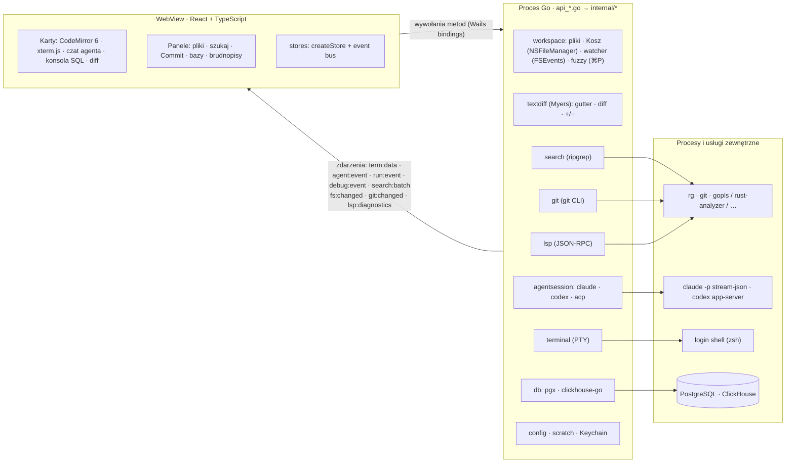

# flint

Szybkie, minimalistyczne IDE „AI-first” na macOS. Kod piszą agenci (claude, codex) w wbudowanym terminalu, a Flint służy do nawigacji, przeszukiwania projektu, podglądu zmian agenta oraz brudnopisów SQL podpiętych do Postgresa i ClickHouse.

**Stack:** Go + [Wails v2](https://wails.io) (systemowy WebView, bez Electrona) · React 19 + TypeScript · CodeMirror 6 · xterm.js (WebGL)

## Co jest w MVP

| Obszar | Jak działa |
|---|---|
| Karty | Pliki, terminale, czaty z agentem, konsole SQL i diffy w jednym obszarze kart z ikonami typów plików. Plik otwarty z terminala pojawia się obok, a `⌘[` wraca do terminala (historia jak w IntelliJ). `⌘J` przełącza terminal ↔ ostatni plik, `+` otwiera terminal / czat / konsolę SQL. |
| Terminal | Prawdziwe PTY (`creack/pty`), login shell z Twoim `PATH`, renderowanie WebGL. Kilka zakładek. `⌘`+klik w `ścieżka:linia` z wyjścia agenta otwiera plik na danej linii. Shift+Enter wstawia nową linię w promptach claude/codex. Zaznaczone wyjście → `⌘L` albo prawy klik → *Send to agent* trafia do czatu z agentem jako blok kodu. |
| Drzewo plików | Wirtualizowane drzewo z zaznaczaniem (klik, `⌘`+klik, `⇧`+klik, strzałki). Prawy klik otwiera menu kontekstowe: New File / New Folder i Rename edytowane w miejscu (`F2` / `↵`), Move to Trash (`⌘⌫` / Delete, z potwierdzeniem, także dla wielu zaznaczonych), Copy Path / Copy Relative Path, Reveal in Finder, Open in Terminal, Find in Folder, Add to Agent Chat, przy plikach testów Run Tests (w Go także Debug Tests), w repozytorium Show History, a przy zmienionych plikach Show Diff i Rollback. Menu to to samo menu kontekstowe co w terminalu i na marginesie edytora (`openContextMenu`). Otwarte karty (także historia pliku) i breakpointy idą za zmianą nazwy, a po usunięciu pliku karty się zamykają. |
| Kilka projektów w oknie | Do otwartego projektu można dołączyć kolejne foldery (jak „Attach project” w IntelliJ): „Add Project to Workspace…” (`⇧⌘O`, menu File, ⌘O / Recent Projects z `⌥↵` albo `＋`). Drzewo ma wtedy sekcję na projekt z „Remove from Workspace”, ⌘P i Search obejmują wszystkie projekty (wyniki z prefiksem projektu, Find in Folder zawęża do jednego), panel Commit pokazuje repo projektu aktywnej karty i ma przełącznik z liczbą zmian, a nowe terminale i czaty startują w projekcie aktywnej karty (menu `+` ma sekcję na projekt). Za aktywną kartą idą też konfiguracje uruchomieniowe: selektor ▶ w pasku tytułu pokazuje konfiguracje (`.flint/run.json` i wykryte) projektu aktywnej karty z jego nazwą, każdy projekt pamięta swój wybór, a Run / Debug startują w tym projekcie. „Fix with agent”, ⌘L i wyniki testów trafiają do czatu projektu, którego dotyczy plik. Paleta akcji ma „Add Project to Workspace…” i „Remove <projekt> from Workspace”. LSP i watcher działają per projekt. Zestaw projektów wraca po restarcie razem z sesją projektu głównego. |
| Zmiany agenta na żywo | FSEvents (jedna rekurencyjna subskrypcja na cały projekt). Drzewo plików się odświeża, a otwarte pliki przeładowują się w miejscu z minimalnym diffem. Jeśli masz niezapisane zmiany, pojawi się ostrzeżenie. |
| Wyszukiwanie | `ripgrep --json`, wyniki przychodzą strumieniowo w paczkach i są renderowane wirtualnie. Bez rg działa wolniejszy fallback w czystym Go. |
| Go to file (`⌘P`) | Lista z `rg --files` (respektuje `.gitignore`) trzymana w Go; fuzzy matching też w Go, do WebView wraca tylko top 60 wyników. Brak indeksowania z góry. |
| Bazy danych | PostgreSQL (`pgx`) i ClickHouse (natywne TCP albo HTTP, do wyboru w profilu). Hasła trzymane są w Keychainie macOS, nie w plikach. Pod połączeniem węzeł „Databases (N)” ze wszystkimi bazami serwera, jak w pgAdmin: Postgres bez szablonów, bazy bez uprawnienia `CONNECT` z czerwonym krzyżykiem; ClickHouse jak `SHOW DATABASES`. Rozwinięcie bazy otwiera do niej osobną pulę (ten sam host, użytkownik i hasło) i pokazuje jej schematy i tabele. Pule niedomyślnych baz Flint zamyka po minucie bezczynności, a przed instrukcją modyfikującą (np. `DROP DATABASE`) od razu, żeby własne połączenia nie blokowały serwera. Konsola SQL ma select bazy obok połączenia, a wybór zapamiętuje brudnopis. Baza w profilu jest tylko domyślna i nieobowiązkowa: bez niej Flint łączy się do `postgres` (ClickHouse: `default`). Autouzupełnianie SQL ze schematu wybranej bazy, tryb read-only. |
| Git (jak w IntelliJ) | Panel Commit (`⌘K`) z checkboxami, Amend, Commit and Push i Rollback. Diff obok siebie w karcie. Znaczniki zmienionych linii na marginesie, które pokazują też, co ruszył agent. Widżet gałęzi w pasku stanu: checkout, nowa gałąź, fetch, pull, push (`⇧⌘K`). Commit podczas merge'a obejmuje cały index. **Annotate** (blame): kolumna z datą i autorem przy każdej linii (przycisk *Blame* w pasku stanu albo prawy klik na marginesie edytora), z podpowiedzią (pełny hash, autor, data, opis). Klik otwiera zmianę z tego commita, a linie niezacommitowane (także niezapisane) mają „Not committed”. **Show History** pliku (`git log --follow`, z rename'ami) w osobnej karcie: lista commitów, pod nią diff wybranego commita, *Compare with current*. **Stash** w panelu Commit: zapis z wiadomością (opcjonalnie z plikami nieśledzonymi), lista z Apply / Pop / Drop (z potwierdzeniem) i diffem każdego pliku. Działa też dla plików w zagnieżdżonych worktree. |
| Worktree | Lista, tworzenie (`<repo>.worktrees/<gałąź>`), usuwanie, przełączanie, otwieranie w nowym oknie lub od razu z terminalem dla agenta. Checkout i commit zrobione w terminalu odświeżają UI, bo obserwowany jest też katalog git. |
| LSP | `gopls`, `rust-analyzer`, `vtsls`/`typescript-language-server`, `basedpyright`/`pyright`. Serwer startuje w tle przy pierwszym pliku danego języka. Podpowiedzi, hover, ⌘+klik / ⌘B / F12 → definicja, ⌥F7 / ⇧F12 → Find Usages, błędy na żywo (`⇧⌘M` lista problemów, `F8` następny). Przy błędzie i ostrzeżeniu przycisk *Fix with agent* (oraz *Fix all N in file*, także `⌥⇧⌘L`): do czatu trafia ścieżka, linia:kolumna, waga, źródło (np. gopls), komunikat i okoliczne linie jako załącznik. Stan serwera i podpowiedź instalacji w pasku stanu. |
| Czat z agentem | Natywne sterowniki **bez npm**: Claude Code (`claude -p` w trybie `stream-json` + `--permission-prompt-tool stdio`) i Codex (`codex app-server`), plus klient ACP dla agentów mówiących nim natywnie. Wspólny panel w doku po prawej (`+` → claude / codex): strumieniowana odpowiedź, wywołania narzędzi z mini-diffem, plan, lista zmienionych plików. Edycje i odczyty przechodzą bez pytania (polityka „auto: edits”), komendy pytają. `⌘L` dołącza zaznaczenie lub bieżący plik do rozmowy. „Wyślij do agenta” (problemy LSP, wyjście terminala) używa wspólnego `askAgent` (`frontend/src/lib/askAgent.ts`): aktywny lub ostatnio używany czat projektu, którego dotyczy (projekt pliku, a bez pliku — aktywnej karty), a gdy go nie ma — nowy w tym projekcie z preferowanym agentem. Treść trafia do szkicu, żeby można było coś dopisać; ⌥-klik wysyła od razu. W nagłówku czatu: zużycie (skumulowane tokeny wejścia/wyjścia, koszt w USD, o ile agent go raportuje — codex zwykle nie — oraz pasek wypełnienia kontekstu, np. „42% context”), ze szczegółami w podpowiedzi; suma dla projektu (przy kilku projektach dla całego workspace'u, z podziałem w podpowiedzi) w pasku stanu. Zużycie jest częścią zapisanej sesji. |
| Agent | ✦ *Generate message*: `claude -p` (albo `codex exec`) dostaje diff zaznaczonych plików i ostatnie wiadomości commitów, a wynik trafia do pola do poprawki. ✦ *Resolve with claude*: konflikty trafiają do interaktywnej sesji agenta w nowym terminalu; agent robi `git add`, ale nie commituje. Nic nie wymaga akceptowania diffów. |
| Uruchamianie (jak w IntelliJ) | Konfiguracje w `.flint/run.json` (do commitowania, jak `.idea/runConfigurations` / `.vscode/launch.json`): `command` (program z argumentami albo linia powłoki), `go` (build pakietu lub pliku + uruchomienie binarki), `npm` (skrypt z `package.json`, menedżer wg lockfile'a), `make`. Katalog roboczy, zmienne środowiskowe i krok „before launch”. Bez konfiguracji Flint sam wykrywa pakiety `main` w Go, cele `Makefile` i skrypty `package.json` (zapisuje je dopiero po edycji). Selektor z ▶ Run / ↻ Rerun / ■ Stop w pasku tytułu, wyjście w karcie z xterm.js i klikalnymi `ścieżka:linia`. Proces działa w PTY we własnej grupie procesów, więc Stop (SIGINT, po 3 s SIGKILL) kończy też dzieci (`go run`, `npm run`). Pole `debug` w konfiguracji jest zarezerwowane pod debugger DAP (`dlv dap`). |
| Testy | ▶ na marginesie przy `func TestXxx`, podtestach `t.Run("…")`, `describe` / `it` / `test` w `*.test.ts(x)` / `*.spec.*`; ▶ przy `package` (lub w 1. linii pliku JS) uruchamia cały plik, ⌥-klik cały pakiet. Wynik przy teście: ✓ / ✗ / ↷. Karta *Tests*: drzewo pakietów i testów ze statusem i czasem, wyjście błędu z klikalnymi lokalizacjami, „Rerun failed”, ponowne uruchomienie pojedynczego testu. Go: `go test -json` parsowany w Go. JS: `node --test --test-reporter=tap` (także przez skrypt `test` tego repo, `webbuild --test`); inne runnery (jest, vitest) uruchamiają się przez skrypt `test` i raportują tylko kod wyjścia. |
| Debugger | Go przez Delve (`dlv dap`, klient DAP w Go: `internal/dap`). Przycisk z robakiem obok ▶ w pasku tytułu (`⌃D`) debuguje wybraną konfigurację `go`, a ⇧-klik w ▶ przy teście debuguje test. Breakpointy: klik na marginesie plików `.go` lub `⌘F8`; przesuwają się razem z edycją i są częścią zapisanej sesji. Po zatrzymaniu edytor pokazuje bieżącą linię, a karta *Debug* — ramki stosu, zmienne (rozwijane leniwie) i konsolę z wyjściem programu i ewaluacją wyrażeń. Krokowanie: `F9` wznów, `F8` przejdź, `F7` wejdź, `⇧F8` wyjdź, `⌘F2` zatrzymaj. Wymaga `dlv` (`go install github.com/go-delve/delve/cmd/dlv@latest`) i włączonego trybu deweloperskiego macOS (`sudo DevToolsSecurity -enable`). |
| Brudnopisy | Trwałe konsole SQL i notatki (MD/TXT) z autozapisem. `⌘↵` uruchamia zapytanie spod kursora lub zaznaczenie. Wyniki trafiają do wirtualizowanej tabeli (do 200k wierszy) z eksportem do TSV/JSON. |

## Skróty

`⇧⌘P` paleta akcji · `⌘[` / `⌘]` wstecz / dalej · `⇧⌘O` dołącz projekt · `F2` / `↵` zmiana nazwy w drzewie · `⌘⌫` do Kosza · `⌘P` plik · `⇧⌘F` szukaj · `⌘B`/`F12` definicja · `⌥F7` użycia · `⌘L` do agenta (zaznaczenie w edytorze lub terminalu) · `⌥⇧⌘L` napraw problemy pliku z agentem · `⇧⌘M` problemy · `⌘K` commit · `⇧⌘K` push · `⌘J` terminal · `⇧⌘T` nowy terminal · `⌘N` nowa konsola SQL · `⌘↵` uruchom zapytanie · `⌘S` zapisz · `⌘W` zamknij kartę · `⌘B` panel boczny · `⌘O` otwórz folder · `⌘K` w terminalu czyści ekran · `⌃R` uruchom wybraną konfigurację (ponownie, jeśli działa) · `⌃⇧R` uruchom test pod kursorem (poza plikiem testów: wybraną konfigurację) · `⌘F2` zatrzymaj · `⌃D` debuguj · `⌘F8` breakpoint · `F9` / `F8` / `F7` / `⇧F8` wznów / przejdź / wejdź / wyjdź (podczas debugowania)

Paleta akcji (`⇧⌘P`, jak „Find Action” w IntelliJ) wyszukuje fuzzy wśród wszystkich komend aplikacji (nawigacja, projekty, git, terminal, agent, uruchamianie, bazy, brudnopisy), pokazuje ich kategorię i skrót, a ostatnio użyte trzyma na górze. Komendy i globalne skróty pochodzą z jednego rejestru (`frontend/src/lib/commands.ts`); nowa funkcja dodaje swoje akcje przez `registerCommand`.

## Uruchomienie

Wymagania: Go 1.25+, Node 22+, Xcode CLT, `wails` (`go install github.com/wailsapp/wails/v2/cmd/wails@latest`), opcjonalnie `brew install ripgrep`.

```bash
make dev        # hot reload
make build      # build/bin/flint.app
make install    # /Applications + polecenie `flint` w ~/.local/bin
flint .         # otwiera bieżący katalog
```

## Testy

```bash
make test                                  # Go (race) + frontend (tsc + node --test)
make test-db-up && make test-integration   # Postgres + ClickHouse (TCP i HTTP) w Dockerze
make test-db-down
```

## Architektura

Flint to jeden proces Go z systemowym WebView (Wails v2, na macOS WKWebView). Cała logika — pliki, git, bazy, terminale, agenci, LSP — działa w Go. Frontend (React + TypeScript) tylko wyświetla i wysyła polecenia.



**Komunikacja UI ↔ Go.**
- **Wywołania:** frontend wywołuje metody `WorkspaceAPI`, `GitAPI`, `DatabaseAPI`, `LSPAPI`, `AgentChatAPI` itd. przez wygenerowane bindingi (`frontend/wailsjs`). Wails wykonuje każde wywołanie w osobnej gorutynie, dlatego zapisy i wpisywanie do terminala są kolejkowane po stronie UI.
- **Zdarzenia:** strumienie płyną zdarzeniami (wyjście terminala, odpowiedzi agenta, wyniki wyszukiwania, zmiany plików i gita, diagnostyka LSP).
- **Workspace z kilkoma projektami:** `App` trzyma listę rootów (pierwszy to projekt główny) i watcher na każdy (`project.go`). `WorkspaceAPI.AddRoot` / `RemoveRoot` dołączają i odłączają foldery (zagnieżdżone i powtórzone są odrzucane, `workspace.CheckNewRoot`), a operacje na plikach szukają roota ścieżki (`workspace.RootOf`). `fuzzy.Index` trzyma listę plików per root, a przy kilku rootach szuka po wspólnej liście `etykieta/ścieżka` (etykiety: `workspace.Labels`, w UI `lib/workspaceRoots.ts`). `SearchAPI.Start` dostaje listę rootów (`search.RunRoots`, wspólny limit wyników) i każde trafienie ma swój root. `git:changed` niesie root, którego dotyczy. Konfiguracje uruchomieniowe, testy i debugger dostają root od frontendu (`RunAPI.Configs(root)`, `Start(id, root, …)`), więc Go nie ma pojęcia „bieżącego” projektu.
- **Operacje na plikach:** tworzenie, zmianę nazwy i usuwanie z drzewa robi Go (`internal/workspace/fileops.go`, `WorkspaceAPI.CreateFile` / `CreateFolder` / `RenamePath` / `TrashPaths` / `RevealInFinder`). Każda ścieżka musi leżeć wewnątrz otwartego folderu (sam folder projektu nie da się usunąć ani przemianować), zmiana nazwy nigdy nie nadpisuje innego pliku, a usuwanie przenosi do Kosza macOS przez `NSFileManager trashItemAtURL` (cgo, `trash_darwin.go`), więc plik można przywrócić z Findera. Frontend (`store/fileOps.ts`) przenosi karty na nową ścieżkę (`useEditor.renamePath`) albo je zamyka (`closePaths`); niezapisane zmiany w przemianowywanym pliku są najpierw zapisywane.
- **Kolejność:** zdarzenia terminala, agenta i uruchomień (wyjście, wyniki testów i kod wyjścia w jednym strumieniu `run:event`) mają numery sekwencyjne, a UI układa je z powrotem w kolejności, bo transport nie gwarantuje kolejności (np. dev server Wails).

**Frontend bez łańcucha narzędzi npm.**
- **Build:** `cmd/webbuild` (Go, `github.com/evanw/esbuild/pkg/api`) bundluje TSX i CSS do `frontend/dist` w ~0,1 s, z podziałem na chunki: przy starcie ładuje się ok. 350 KB JS, a edytor (CodeMirror), terminal (xterm.js), języki, czat i panele dopiero przy pierwszym użyciu. `wails build` wywołuje go jako `frontend:build` z `--typecheck` (najpierw `tsc --noEmit`, bo esbuild tylko usuwa typy). `wails dev` uruchamia `webbuild --watch`: przebudowa po każdej zmianie i przeładowanie strony przez strumień SSE esbuild (`/esbuild`), bez HMR. Serwer dev działa na `localhost:5173` (`frontend:dev:serverUrl`).
- **Testy:** `webbuild --test` kompiluje `src/**/*.test.ts(x)` do katalogu tymczasowego i uruchamia `node --test`. Testy używają `node:test` i `node:assert`. Typy sprawdza `tsc --noEmit`, a typy `node:test` są opisane lokalnie w `src/testing/node.d.ts` (bez `@types/node`).
- **Stan:** `src/lib/store.ts` (`createStore`) to mały kontener na `useSyncExternalStore`. `setState` emituje zdarzenie `change` na event busie (`src/lib/bus.ts`). API jak wcześniej: `useX(selector)`, `useX.getState()`, `useX.setState()`, `useX.subscribe()`. Wynik selektora jest zapamiętywany i porównywany przez `Object.is`, więc selektor budujący nową tablicę nie zapętla renderów.
- **Komendy:** rejestr `src/lib/commands.ts` (`registerCommand({ id, title, category, keys, when, run })`) zasila paletę `⇧⌘P` i jedyny globalny listener `keydown` (faza capture, przed CodeMirror i xterm). Skróty należące do edytora (np. `⌘B`, `⌘S`) paleta tylko wyświetla, a uruchamia je przez keymapę aktywnego edytora.
- **Własny kod zamiast bibliotek:** wirtualizacja list o stałej wysokości wiersza (`src/lib/virtualList.ts`), dopasowanie terminala do kontenera (`terminalFit.ts`) oraz klikalne URL-e w terminalu, także zawinięte na kilka wierszy (`terminalLinks.ts`).
- **Obliczenia w Go:** diffy liczy `internal/textdiff` (Myers w pamięci liniowej, limit czasu, potem zastępuje cały region; słowa zmienione wewnątrz linii jako offsety UTF-16). Przez `DiffAPI` dostają je: znaczniki na marginesie edytora (`Marks`), statystyki +/− i mini-diffy w czacie agenta (`Hunks`) oraz karta diffu (`Compare`). Kartę diffu rysują dwa zwykłe edytory CodeMirror z własnymi dekoracjami: tło zmienionych linii, zmienione słowa, odstępy wyrównujące obie strony i zwinięte niezmienione fragmenty. Lista plików dla ⌘P jest trzymana w `fuzzy.Index` po stronie Go (`WorkspaceAPI.IndexFiles` / `FindFiles`), więc WebView nigdy nie dostaje pełnej listy.

**Zasady projektowe.**
- **Szybkość ponad wszystko:**
  - brak indeksowania z góry: wyszukiwanie przez `rg` na żywo, lista plików dla ⌘P z `rg --files` (dopasowanie w Go, 200k ścieżek ≈ 25 ms);
  - serwery LSP i agenci startują leniwie, w tle;
  - CodeMirror i czat agenta ładują się dopiero przy pierwszym użyciu;
  - długie listy (drzewo, wyniki, tabele SQL) są wirtualizowane.
- **Natywne narzędzia zamiast reimplementacji:** git, ripgrep, serwery LSP i agenci to Twoje zainstalowane binarki, uruchamiane z `PATH` login shella (`internal/shellenv`), więc działają hooki, konfiguracja i uwierzytelnianie dokładnie jak w terminalu.
- **AI-first bez blokowania:**
  - agenci edytują pliki bez okien „Akceptuj/Odrzuć” (w obrębie projektu);
  - Flint pokazuje zmiany przez watcher, znaczniki gita na marginesie i panel Commit;
  - komendy agenta i wyjścia poza projekt wymagają zgody.
- **Bez npm w runtime:**
  - klienci LSP/ACP i sterowniki agentów są napisani w Go na bibliotece standardowej;
  - zależności frontendu są przypięte i instalowane z `--ignore-scripts`;
  - bundler i runner testów to Go (`cmd/webbuild`), a nie pakiety npm.

### Gdzie Flint trzyma dane

| Co | Gdzie | Uwagi |
|---|---|---|
| Ostatnie foldery, preferowany agent, polityka zgód agenta | `~/Library/Application Support/flint/state.json` | |
| Profile połączeń z bazami (host, port, użytkownik, domyślna baza — opcjonalna, protokół ClickHouse `native`/`http`, TLS, read-only) | `~/Library/Application Support/flint/connections.json` | **bez haseł**, plik z uprawnieniami `0600` |
| Hasła do baz | Pęk kluczy macOS (Keychain), usługa `flint-db`, konto = id połączenia | usuwane razem z profilem |
| Brudnopisy (konsole SQL, notatki) | `~/Library/Application Support/flint/scratch/` — `index.json` (m.in. wybrane połączenie `connId` i baza `database`, pusta = domyślna z profilu) + `<id>.sql/.md/.txt` | autozapis |
| Szerokość panelu bocznego | `localStorage` WebView | tylko ustawienia wyglądu |
| Otwarte karty, terminale, rozmowy z agentem i dołączone projekty (sesja projektu) | `~/Library/Application Support/flint/sessions/<hash ścieżki projektu głównego>.json`, jeden plik na projekt | zapis po zmianach (debounce) i przy wyjściu, `0600`, maks. 4 MB |
| Historia rozmów z agentem | sam CLI agenta: `~/.claude/projects/…`, `~/.codex/sessions/…` | Flint wznawia je po restarcie (`claude --resume`, codex `thread/resume`) |
| „Always allow” dla komend Claude | `.claude/settings.local.json` w projekcie | zapisuje Claude Code, jak w terminalu |
| Konfiguracje uruchomieniowe | `.flint/run.json` w projekcie | do commitowania; wersja formatu, walidacja w Go (nieznane pola i typy są błędem) |
| Wybrana konfiguracja uruchomieniowa (osobno dla każdego projektu workspace'u) | sesja projektu (`sessions/<hash ścieżki>.json`) | uruchomione procesy nie są przywracane |
| Binarki konfiguracji `go` | `$TMPDIR/flint-run/<hash>/` | nadpisywane przy każdym uruchomieniu |
| Pliki usunięte z drzewa | Kosz macOS (`~/.Trash`) | „Put Back” w Finderze przywraca je na miejsce |
| Cache serwerów LSP | ich własne katalogi, np. `~/Library/Caches/gopls` | |

Sesja projektu zawiera:
- dołączone projekty (`roots`, gdy jest ich więcej niż jeden). Otwarcie projektu głównego dołącza je z powrotem (pominięte zostają foldery, których już nie ma), a ten sam folder otwarty osobno ma własną, jednoprojektową sesję. Sesje zapisane przed wprowadzeniem workspace'ów wczytują się bez zmian;
- karty plików z pozycją kursora, brudnopisy i diffy;
- terminale: projekt, do którego należą, ostatni katalog powłoki (podąża za `cd`) i ostatnie ~400 linii wyjścia. Po restarcie startuje nowa powłoka w tym katalogu, a stary output widać nad nią przyciemniony. Programy pełnoekranowe (np. TUI claude) nie są zapisywane;
- rozmowy z agentem: transcript (ostatnie 200 wpisów, długie wyjścia narzędzi przycięte), zużycie tokenów i koszt. Agent dostaje połączenie przy pierwszej nowej wiadomości. Gdy rozmowy nie da się wznowić, Flint zaczyna nową i to zaznacza;
- wybrana konfiguracja uruchomieniowa każdego projektu i breakpointy debuggera w plikach wszystkich projektów workspace'u.

Wyjście terminala może zawierać dane wrażliwe, dlatego plik ma uprawnienia `0600`. Usunięcie pliku z `sessions/` czyści sesję projektu.

Katalog `~/Library/Application Support/flint` można zmienić zmienną `FLINT_CONFIG_DIR` (używają jej testy i tryb deweloperski). Pliki JSON są zapisywane atomowo: zapis do pliku tymczasowego, potem rename.

## Struktura

```
main.go, app.go, api_*.go   wiązania Wails (cienka warstwa)
cmd/webbuild                bundler frontendu (esbuild Go API), --watch, --test
internal/workspace          drzewo, odczyt/zapis plików, lista plików, tworzenie/rename/Kosz, rooty workspace'u
internal/fuzzy              fuzzy matching ⌘P i indeks plików folderów workspace'u
internal/textdiff           diffy linii i słów (Myers) dla gutter, karty diffu i czatu
internal/search             ripgrep + fallback, streaming wyników
internal/db                 profile połączeń, Keychain, pgx/clickhouse, normalizacja typów
internal/scratch            trwałe brudnopisy
internal/terminal           PTY, koalescencja wyjścia, cwd powłoki (proc_pidinfo)
internal/runconfig          .flint/run.json: schemat, walidacja, zapis, wykrywanie (Go main, make, npm)
internal/runner             procesy konfiguracji i testów: kroki, PTY lub pipe'y, grupa procesów, Stop
internal/testrun            plan uruchomienia testów, parsery go test -json i TAP, testy w pliku (gutter)
internal/dap                klient Debug Adapter Protocol, sesje Delve (dlv dap)
internal/restore            zapis sesji projektu (karty, terminale, czaty) między uruchomieniami
internal/git                status, commit, rollback, gałęzie, worktree, log, blame, historia pliku, stash (CLI gita)
internal/agent              claude / codex: tryb bez interakcji i polecenia interaktywne
internal/shellenv           PATH z login shell (hooki gita, brew, nvm w aplikacji GUI)
internal/watcher            FSEvents + debounce
internal/lsp                klient LSP (JSON-RPC, Content-Length), menedżer serwerów
internal/acp                klient Agent Client Protocol (JSON-RPC rozdzielany \n)
internal/agentsession       wspólny model zdarzeń agenta, polityka akceptacji, menedżer sesji
  claude/ codex/ acpdriver/ natywne sterowniki agentów
frontend/src                React: store (createStore + event bus), components, lib
```

Szczegóły przechowywania danych: sekcja [Gdzie Flint trzyma dane](#gdzie-flint-trzyma-dane).

## Bezpieczeństwo zależności

- Flint w trakcie działania nie pobiera nic z npm (żadnego `npx`). Agenci i serwery LSP to Twoje zainstalowane binarki.
- Frontend: `frontend/.npmrc` wyłącza skrypty instalacyjne (`ignore-scripts=true`) i wymusza dokładne wersje, a build używa `npm ci --ignore-scripts`.
- Zależności frontendu ograniczone do: React, CodeMirror (jeden autor, bez `@codemirror/merge`), xterm.js (rdzeń + renderer WebGL) oraz TypeScript i typy Reacta do sprawdzania typów. Razem 43 pakiety w `node_modules` (wcześniej 145). Bundler (esbuild przez Go API) i runner testów (`node --test`) nie pochodzą z npm. Stan, wirtualizacja list, dopasowanie terminala, linki w terminalu, diffy i fuzzy matching są własne.
