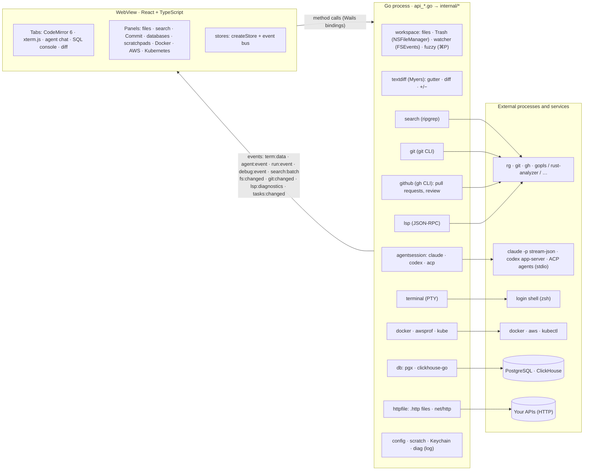

# Flint architecture

Flint is a single Go process with the system WebView (Wails v3; on macOS that is WKWebView). All the logic (files, git, databases, terminals, agents, LSP) runs in Go. The frontend (React + TypeScript) only renders and sends commands.

Contents:

- [Overview](#overview)
- [UI and Go communication](#ui-and-go-communication)
- [Frontend without an npm toolchain](#frontend-without-an-npm-toolchain)
- [Design principles](#design-principles)
- [Security model](#security-model)
- [Where Flint stores data](#where-flint-stores-data)
- [Project layout](#project-layout)
- [Dependency hygiene](#dependency-hygiene)

## Overview



## UI and Go communication

### Calls

- The frontend calls methods on `WorkspaceAPI`, `GitAPI`, `GitHubAPI`, `DatabaseAPI`, `LSPAPI`, `AgentChatAPI`, `HTTPAPI` and the other services through generated TypeScript bindings in `frontend/bindings` (`wails3 generate bindings`). `frontend/src/wails/` is a compatibility layer that gives them the older model namespace and runtime function names.
- Every API is a Wails v3 service (`application.NewService`, registered in `main.go`). The `App` lifecycle is the `lifecycle` service, registered first because the others use its context.
- Wails runs each call on its own goroutine, so file writes and terminal input are queued on the UI side.

### Events

- Streams flow as events: terminal output, agent responses, search results, file and git changes, LSP diagnostics.
- **Ordering**: terminal, agent and run events (output, test results and exit code share one `run:event` stream) carry sequence numbers, and the UI puts them back in order, because the transport does not guarantee ordering (for example the Wails dev server).

### Multi-project workspace

- `App` holds a list of roots (the first is the main project) and one watcher per root (`project.go`).
- `WorkspaceAPI.AddRoot` / `RemoveRoot` attach and detach folders (nested and duplicate folders are rejected by `workspace.CheckNewRoot`), and file operations look up the root of a path (`workspace.RootOf`).
- `fuzzy.Index` keeps a file list per root; with several roots it searches a combined `label/path` list (labels: `workspace.Labels`; in the UI, `lib/workspaceRoots.ts`).
- `SearchAPI.Start` receives the list of roots (`search.RunRoots`, with a shared result limit), and every match carries its root. `git:changed` carries the root it concerns.
- Run configurations, tests and the debugger receive the root from the frontend (`RunAPI.Configs(root)`, `Start(id, root, …)`), so Go has no notion of a "current" project.

### Agents

- `AgentChatAPI` runs chats through `agentsession.Manager`, which routes each session to a registered driver and applies the approval policy to its permission requests (`agents_registry.go`).
- Native drivers (`agentsession/claude`, `agentsession/codex`) are registered once and read their settings on every start.
- Custom agents (`customAgents` in settings.json) are ACP agents: each gets one `acpdriver.Driver`, registered at startup and again whenever settings are saved (`syncCustomAgents`). A replaced or removed driver keeps the sessions it runs until they stop, and is still closed on quit. Adding an agent CLI with an ACP mode needs no code.
- The agent lists (chat menus, default-agent pickers, `AgentAPI.Info`) are the native CLIs found on the login PATH, then the custom agents whose command resolves.
- One-shot work goes through `AgentAPI`: commit messages run `agent.Headless` (`claude -p`, `codex exec`) or, for a custom agent, `acpdriver.Headless` (a fresh ACP session that declines every permission request and refuses writes). Conflict resolution types an interactive command into a terminal, so it always uses a native agent (`AgentInfo.conflictAgent`).
- Flint's own MCP server (`api_mcp.go` → `internal/mcpserver`, `internal/mcptools`) gives chat agents read-only tools: LSP diagnostics, the editor snapshot, terminal and run output, the last test run and the Kubernetes status. `mcpserver` is MCP's Streamable HTTP transport on the standard library (JSON-RPC over POST, protocol 2025-06-18, no SSE, stateless), listening on `127.0.0.1` from the first session that gets it until quit. `mcptools` keeps bounded stores fed by events (`LSPAPI.wire`, `terminalEvents`, `runEvents`, and `EditorContextAPI.Update`, which the frontend calls debounced and only on change); nothing polls. Drivers receive an `agentsession.MCPProvider`: Claude Code gets an inline `--mcp-config` whose header expands `${FLINT_MCP_TOKEN}` from its environment, Codex `-c mcp_servers.flint.*` with `bearer_token_env_var`, ACP agents an `http` McpServer in `session/new` when they advertise `mcpCapabilities.http`.
- `SettingsAPI.ProbeCustomAgent` runs only the ACP `initialize` handshake of a saved custom agent, in an empty temporary folder, for the Check button. Settings are written by the web view, so before a command line runs for the first time in a session Go shows a native dialog with that exact command line; the UI cannot answer or skip it.

### File operations

- Go creates, renames and deletes files from the tree (`internal/workspace/fileops.go`; `WorkspaceAPI.CreateFile` / `CreateFolder` / `RenamePath` / `TrashPaths` / `RevealInFinder`).
- Every path must be inside an open folder (the project folder itself cannot be deleted or renamed), and a rename never overwrites another file.
- Deleting moves items to the macOS Trash through `NSFileManager trashItemAtURL` (cgo, `trash_darwin.go`), so files can be restored from Finder.
- The frontend (`store/fileOps.ts`) moves tabs to the new path (`useEditor.renamePath`) or closes them (`closePaths`); unsaved changes in a file being renamed are saved first.

### Pull requests

- `GitHubAPI` (`api_github.go` → `internal/github`) runs `gh` with timeouts (30 s for reads, 60 s for writes, 3 minutes for checkout), with no prompts, pager or colors.
- The project's repository is resolved with `gh repo view` (remotes, `gh repo set-default`, Enterprise hosts), and the login state with `gh auth status`. A missing `gh`, a missing login and a missing GitHub remote are distinct errors with a hint.
- List: `gh pr list --json …` (check status counted in Go). Details, in parallel: `gh pr view --json …`, `gh api --paginate repos/…/pulls/N/files` (files with patches), and a GraphQL query for review threads (`gh api graphql --input -`, paginated).
- File diff: the head comes from the local clone if it has the blob (`git cat-file`), otherwise from `gh api …/git/blobs/<sha>`. The base is reconstructed by reverse-applying GitHub's patch to the head (with a consistency check); for files without a patch (binary, huge) it comes from the merge base (`git merge-base` locally, or `gh api …/compare`).
- Writes happen only on an explicit action: reply (`addPullRequestReviewThreadReply`), resolve / unresolve (`resolveReviewThread` / `unresolveReviewThread`), single comment (REST `POST …/pulls/N/comments`), review comment (`addPullRequestReview` without an event creates a pending review, then `addPullRequestReviewThread`), submit review (`submitPullRequestReview`, or `addPullRequestReview` with an event), discard (`deletePullRequestReview`).
- User text reaches `gh` only through stdin (JSON), never as an argument.
- Responses are cached in Go (list and PR for about 30 s, repository for 10 minutes), and every write invalidates the PR.
- Frontend: `store/pullRequests.ts` and lazily loaded `components/github/*`. Threads in the diff are CodeMirror block widgets (`lib/prThreadWidgets.ts`) rendered through React portals; their positions and the spacers on the other side are computed by `lib/prReview.ts`.

## Frontend without an npm toolchain

### Build

- `cmd/webbuild` (Go, `github.com/evanw/esbuild/pkg/api`) bundles TSX and CSS into `frontend/dist` in about 0.1 s, with code splitting. About 350 KB of JS loads at startup; the editor (CodeMirror), terminal (xterm.js), languages, chat and panels load on first use.
- Sidebar panels (Commit, Databases, Docker, AWS, Kubernetes, TODO, Pull Requests), dialogs and the heavier tab views are `React.lazy` components, so their code is fetched only when first opened.
- `wails3 task build` (`Taskfile.yml`) runs it with `--typecheck` (first `tsc --noEmit`, because esbuild only strips types).
- `wails3 task dev` runs `webbuild --watch`: a rebuild after every change and a page reload through esbuild's SSE stream (`/esbuild`), with no HMR. The dev server listens on `localhost:5173` (`FRONTEND_DEVSERVER_URL`), and Go rebuilds on change (`build/config.yml`).
- `cmd/webbuild` also writes the Content Security Policy into `index.html` (see [Security model](#security-model)).

### Tests

`webbuild --test` compiles `src/**/*.test.ts(x)` into a temporary directory and runs `node --test`. Tests use `node:test` and `node:assert`. Types are checked by `tsc --noEmit`, and the `node:test` types are declared locally in `src/testing/node.d.ts` (no `@types/node`).

### State

`src/lib/store.ts` (`createStore`) is a small container built on `useSyncExternalStore`. `setState` emits a `change` event on the event bus (`src/lib/bus.ts`). The API is `useX(selector)`, `useX.getState()`, `useX.setState()`, `useX.subscribe()`. The selector result is memoized and compared with `Object.is`, so a selector that builds a new array does not cause a render loop.

### Commands

The registry in `src/lib/commands.ts` (`registerCommand({ id, title, category, keys, when, run })`) feeds the `⇧⌘P` palette and the only global `keydown` listener (capture phase, ahead of CodeMirror and xterm). Shortcuts owned by the editor (for example `⌘B`, `⌘S`) are only displayed by the palette, which runs them through the active editor's keymap.

### Sidebar panels

`src/panels/index.ts` lists the sidebar panels; the activity bar, the sidebar, the `SidebarView` type and one palette command per panel are derived from that list (`src/panels/registry.ts`). To add a panel:

1. Write the component (for example `components/sidebar/GcpPanel.tsx`). It receives `focusToken`, which `focusPanel(id)` bumps when a command asks the panel to focus its input.
2. Add one entry to `PANELS`: `{ id: 'gcp', title: 'Google Cloud', icon: '◇', order: 95, component: GcpPanel }`. Wrap the component in `React.lazy` unless it is small, so its code is fetched on first open rather than at startup.

That entry also registers "Show Google Cloud" (`view.gcp`) in the palette. Optional fields: `command` (another id, title, keywords or a default shortcut, or `false` for no command), `shortcutCommand` (a command whose shortcut the tooltip shows, read on hover so it follows rebinding) and `when` (hides the button and the command). Panel ids are not persisted today; an unknown id still falls back to the Files panel. Keep the command id of an existing panel when you edit it, since keymap overrides are stored by command id.

### Own code instead of libraries

Virtualization of fixed-row-height lists (`src/lib/virtualList.ts`), fitting the terminal to its container (`terminalFit.ts`), and clickable URLs in the terminal, including ones wrapped across several rows (`terminalLinks.ts`).

### Computation in Go

- Diffs are computed by `internal/textdiff` (Myers in linear memory, with a time limit after which the whole region is replaced; changed words within a line are reported as UTF-16 offsets). Through `DiffAPI` they feed the editor gutter markers (`Marks`), the +/− stats and mini diffs in the agent chat (`Hunks`), and the diff tab (`Compare`).
- The diff tab is drawn by two plain CodeMirror editors with custom decorations: changed-line backgrounds, changed words, spacers that align both sides, and collapsed unchanged regions.
- The `⌘P` file list lives in `fuzzy.Index` on the Go side (`WorkspaceAPI.IndexFiles` / `FindFiles`), so the WebView never receives the full list.

## Design principles

- **Speed above all**:
  - no up-front indexing: search runs `rg` live, and the `⌘P` file list comes from `rg --files` (matching in Go; 200k paths in about 25 ms);
  - LSP servers and agents start lazily, in the background;
  - CodeMirror and the agent chat load only on first use;
  - long lists (tree, results, SQL tables) are virtualized.
- **Native tools instead of reimplementations**: git, ripgrep, LSP servers and agents are your installed binaries, launched with the login shell's `PATH` (`internal/shellenv`), so hooks, configuration and authentication behave exactly as in your terminal.
- **AI-first without blocking**:
  - agents edit files without "Accept/Reject" dialogs (within the project);
  - Flint shows changes through the watcher, git gutter markers and the Commit panel;
  - agent commands and access outside the project require approval.
- **No npm at runtime**:
  - LSP/ACP clients and agent drivers are written in Go on the standard library;
  - frontend dependencies are pinned and installed with `--ignore-scripts`;
  - the bundler and test runner are Go (`cmd/webbuild`), not npm packages.

## Security model

Flint is a local desktop app that opens arbitrary folders, runs CLIs on your behalf, and renders content it did not write. The threat model assumes that the content is hostile, not the user.

### Untrusted repositories

A cloned repository can contain configuration that executes code: git filters and hooks, language-server settings, agent settings and hooks.

- A folder opened for the first time is in **Restricted Mode** until the user trusts it. Trust is enforced in Go, not only in the UI: the LSP manager refuses code-running servers (rust-analyzer, Python) for untrusted roots, agent runs get `--setting-sources user`, custom ACP agents refuse to start (`acpdriver.ErrRestricted`: Flint can't make them ignore the project's configuration), and git calls in untrusted folders run with `core.hooksPath=/dev/null`; the frontend only adds the banner and holds back the automatic terminal. Trusted folders are stored in `state.json` and can be revoked from the command palette. See [FEATURES.md](FEATURES.md#restricted-mode-workspace-trust).
- Regardless of trust, every git call Flint makes switches off the clean/smudge filters and textconv drivers defined in the repository's own config (including included files) with `-c key=` overrides, and disables fsmonitor (`internal/git`). typescript-language-server fails closed unless it can be pinned to its own TypeScript.

### Agents over ACP

A custom agent is a binary the user configured, so it runs with the user's rights like the native CLIs; Flint limits what it hands the agent on top of that:

- It starts with Flint's environment (the login shell's `PATH`); settings have no environment field, so no keys are stored in `settings.json`.
- The client offers file reads and writes (`fs/read_text_file`, `fs/write_text_file`) but no terminal. Paths must be absolute and stay inside the session folder after resolving symlinks (checked again right before the file is opened). Reads take regular files up to 10 MB. Writes into a `.git` directory or file at any depth are refused, writes into the other protected folders (`.claude`, `.codex`, `.vscode`, `.idea`) are shown to the user as a permission request, and every write goes through a temporary file and a rename, so a hard link never carries it out of the project.
- Every `session/request_permission` goes through `agentsession.Manager`: the user's approval policy answers what it allows (by default edits and reads of known paths inside the project, outside `.git` and agent config folders) and the chat asks about the rest, exactly as for Claude Code and Codex. One-shot runs (commit messages) decline every request.
- The agent runs in its own process group (`Setpgid`), which also holds the processes it starts (gemini-cli relaunches itself as a child that shares its stdio); stopping a chat, a one-shot run or Flint sends SIGTERM to the group and SIGKILL after a grace period. An agent that misses the `initialize` handshake gets SIGKILL at once, so the Check returns right after its timeout.

### Flint's MCP server

Any local process can reach a loopback port, and a web page can try through DNS rebinding, so the server trusts nothing but its tokens:

- One random 256-bit bearer token per project root; a request only ever reads the root its token maps to. Tokens live in memory (hashed for lookup) and reach agents through an environment variable or the ACP pipe, never argv.
- `Host` must be `127.0.0.1:<port>` or `localhost:<port>` and an `Origin`, if any, the same; bodies are capped at 1 MiB; at most four tool calls run at once, each with a 30 s timeout, cancelled on quit.
- Every request re-checks the setting and the folder's trust: untrusted folders get no token, and a token stops working when the server is switched off or trust is revoked.
- Every tool only reads; answers are cut at 64 KiB and passed through `redact.Secrets`. Paths a tool accepts must stay inside the project.

### Untrusted rendered content

Markdown files, PR descriptions and comments, HTTP responses and terminal output are untrusted. With Wails, any script running in the page can call every bound Go method, so injected markup must never execute.

- `cmd/webbuild` writes a Content Security Policy into `index.html`: only the app's own scripts run (no inline scripts, no `eval`), nothing is framed, forms post nowhere, `object-src` and `base-uri` are disabled. Inline styles are allowed (CodeMirror and xterm set them), and images may come from `https:`, `data:` and `blob:` URLs (avatars, Markdown). In dev mode the policy additionally allows the live-reload script by hash and its event stream.
- Markdown is rendered in Go without raw HTML, and `javascript:` links are dropped. Relative images load only from open folders.
- HTTP response bodies are shown in a read-only editor, never as HTML.

### CLI argument validation

Flint drives many CLIs (git, gh, docker, kubectl, aws, saml2aws, claude, codex). Names and identifiers that come from the UI or from external output (container names, contexts, namespaces, pod names) are validated before they are passed to a command, and user strings are never passed in a position where they could be read as a flag. User-written text for `gh` (comments, reviews) goes through stdin as JSON, never as an argument. Every kubectl call passes explicit `--context` and `--namespace`.

### Secrets

- Database passwords are stored only in the macOS Keychain (service `flint-db`). Profile files hold no passwords.
- AWS keys and tokens are read only in Go to check that they exist and never reach the UI.
- GitHub authentication stays inside `gh`; Flint never sees the token.
- Kubernetes terminals use an override kubeconfig that holds only `current-context` and the namespace; credentials are not copied.
- Settings, connections, query history, sessions and the log file are written with mode `0600`.

### Network requests Flint makes on its own

Every other connection is the result of a user action or of a CLI the user runs. The one exception is the update check (`internal/update`, `api_update.go`): an anonymous `GET https://api.github.com/repos/ODudek/flint/releases/latest` (no token, no cookie jar, `User-Agent: Flint/<version>`, 10 s timeout, 1 MB body limit, redirects only within the same host), a few seconds after launch and then at most once per 24 hours, only in release builds and only while the `checkForUpdates` setting is on. The response is treated as untrusted: the tag must be a SemVer version, the title is stripped of control characters and capped, and the release link is opened only if it is an `https://github.com/ODudek/flint/` URL (otherwise the releases page). The browser is opened from Go (`UpdateAPI.OpenRelease`), so the UI cannot pass it a URL. Flint never downloads or installs a release.

### Redaction

`internal/redact` removes credentials (private keys, AWS key IDs, GitHub and Slack tokens, API keys, JWTs, bearer/basic auth, credentials in URLs, `password=`-style assignments) and replaces the home directory with `~`. It is applied to the log file, to bug reports and diagnostics, and to context sent to AI agents (for example Diagnose with AI). Query history masks passwords in `CREATE/ALTER ROLE … PASSWORD` and ClickHouse `IDENTIFIED … BY`. Flint does not log HTTP client headers or variable values.

### Dev-only server mode

`make server` / `wails3 task server` builds Flint with the `server` tag and serves the UI to a browser over HTTP. It exposes every binding on localhost **with no authentication**. It is a development tool only and must never run on a shared machine. It has no native dialogs, so confirmations that guard a binding against the web view (the custom agent Check) are skipped there: anyone who can reach it can already open a terminal. See [DEVELOPMENT.md](DEVELOPMENT.md#server-mode-dev-only).

## Where Flint stores data

| What | Where | Notes |
|---|---|---|
| Recent folders, agent permission policy, trusted folders, whether the first-run tool check was shown, update check (last check time, the latest release found, the skipped version) | `~/Library/Application Support/flint/state.json` | the preferred agent stored here before `settings.json` existed is read from it until you pick a default in Settings |
| Settings: theme, editor and terminal fonts, default agent, autosave, shortcut overrides (`keymap`: command id → shortcut, `""` = none), agent CLIs (`agents`), custom ACP agents (`customAgents`: id, name, command, arguments), language servers (`languageServers`), panel refresh intervals (`refresh`) | `~/Library/Application Support/flint/settings.json` | has a schema version; missing keys get defaults, unknown keys are ignored, invalid values are replaced with defaults on load (writes validate strictly); `0600`; **no secrets**. A copy for the first render lives in `localStorage` (`flint.settings`) |
| Database connection profiles (host, port, user, optional default database, ClickHouse protocol `native`/`http`, TLS, read-only) | `~/Library/Application Support/flint/connections.json` | **no passwords**, mode `0600` |
| Database passwords | macOS Keychain, service `flint-db`, account = connection id | deleted together with the profile |
| Scratchpads (SQL consoles, notes) | `~/Library/Application Support/flint/scratch/`: `index.json` (including the selected connection `connId` and database `database`; empty = the profile default) plus `<id>.sql/.md/.txt` | autosaved |
| Query history | `~/Library/Application Support/flint/history/<connection id>.jsonl`: one JSON line per statement (database, SQL, time, duration, rows, error, kind: query / explain / edit) | last 5000 per connection, `0600`. Appended with a single `write` using `O_APPEND`; when the file grows 25% past the limit, Go rewrites it atomically without the oldest entries (a truncated last line is skipped on load). No connection profiles or passwords; passwords in statements are masked. Deleted with the profile or with "Clear History…" |
| Sidebar width | WebView `localStorage` | appearance settings only |
| Open tabs, terminals, agent conversations and attached projects (project session) | `~/Library/Application Support/flint/sessions/<hash of the main project path>.json`, one file per project | written after changes (debounced) and on exit, `0600`, max 4 MB |
| Agent conversation history | the agent CLI itself: `~/.claude/projects/…`, `~/.codex/sessions/…` | Flint resumes them after a restart (`claude --resume`, codex `thread/resume`) |
| "Always allow" for Claude commands | `.claude/settings.local.json` in the project | written by Claude Code, as in the terminal |
| Run configurations | `.flint/run.json` in the project | meant to be committed; format version, validated in Go (unknown fields and types are errors) |
| Selected run configuration (separately for each workspace project) | the project session (`sessions/<path hash>.json`) | running processes are not restored |
| Binaries of `go` configurations | `$TMPDIR/flint-run/<hash>/` | overwritten on every run |
| Profiles (CPU, memory) and profiled test binaries | `$TMPDIR/flint-profile-*/` | removed when the profile tab closes and on exit; directories older than a day (after a crash) are removed on the next profiling run. Files opened from disk are left alone |
| Files deleted from the tree | macOS Trash (`~/.Trash`) | "Put Back" in Finder restores them |
| LSP server caches | the servers' own directories, for example `~/Library/Caches/gopls` | |
| HTTP client environments | `http-client.env.json` (commit it) and `http-client.private.env.json` (secrets; add to `.gitignore`) next to the `.http` file | the selected environment is remembered only until Flint quits |
| GitHub login | `gh` itself (macOS keyring or `GH_TOKEN`) | Flint does not see the token; it only runs `gh` |
| Pull requests, files, review threads | Go process memory only (list and PR about 30 s, file diffs 2 minutes, project repository 10 minutes) | nothing is written to disk; PR tabs are not part of the session |
| HTTP client responses and cookies | Go process memory only: up to 5 responses per request, 50 requests and 256 MB of bodies; a separate cookie jar per `.http` file | nothing goes to disk or to logs; "Save to file" writes the body where you choose |
| Flint's log | `~/Library/Logs/Flint/flint.log` (and `flint.log.1`) | rotated at 5 MB, one old file kept, secrets and home path redacted, `0600` |

A project session contains:

- Attached projects (`roots`, when there is more than one). Opening the main project attaches them again (folders that no longer exist are skipped), and the same folder opened on its own has its own single-project session. Sessions saved before workspaces existed load unchanged.
- File tabs with cursor positions, scratchpads and diffs.
- Terminals: the project they belong to, the shell's last directory (it follows `cd`) and the last ~400 lines of output. After a restart a new shell starts in that directory, with the old output shown dimmed above it. Full-screen programs (for example the claude TUI) are not saved.
- Agent conversations: the transcript (last 200 entries, long tool outputs truncated), token usage and cost. The agent is reconnected on the first new message. If a conversation cannot be resumed, Flint starts a new one and says so.
- The selected run configuration of each project, and debugger breakpoints in the files of all workspace projects.

Terminal output can contain sensitive data, which is why the session file has mode `0600`. Deleting a file from `sessions/` clears that project's session.

The `~/Library/Application Support/flint` directory can be changed with the `FLINT_CONFIG_DIR` environment variable (used by tests and dev mode). JSON files are written atomically: write to a temporary file, then rename.

## Project layout

```
main.go, app.go, api_*.go   Wails services (thin layer over internal/*)
menu.go, wails_app.go       application menu, window and event wiring
cmd/webbuild                frontend bundler (esbuild Go API), --watch, --test, CSP
build/                      Wails config (config.yml), Info.plist, app icon
scripts/flint               the `flint [folder]` command installed by `make install`
packaging/homebrew          Homebrew cask template, rendered and pushed to the tap by the release workflow
internal/workspace          tree, file read/write, file list, create/rename/Trash, workspace roots
internal/fuzzy              ⌘P fuzzy matching and the file index of workspace folders
internal/textdiff           line and word diffs (Myers) for the gutter, diff tab and chat
internal/search             ripgrep + fallback, streaming results
internal/ripgrep            locating the rg binary
internal/preview            Markdown rendering (goldmark) and image reading for preview tabs
internal/todo               TODO / FIXME / HACK / XXX / BUG markers
internal/httpfile           .http files: parser, variables and environments, sending (net/http), response history, curl
internal/db                 connection profiles, Keychain, pgx/clickhouse, type normalization, query history,
                            EXPLAIN (Postgres plan parser, warnings), row editing by primary key
internal/scratch            persistent scratchpads
internal/config             on-disk locations, atomic JSON writes
internal/settings           settings.json: settings, defaults, validation, schema version, custom theme
internal/vscodeimport       Import from VS Code / Cursor / VSCodium: JSONC, settings, keybindings and color theme
                            mapped onto settings (read-only; ImportAPI previews, then saves through settings)
internal/terminal           PTY, output coalescing, shell cwd (proc_pidinfo)
internal/runconfig          .flint/run.json: schema, validation, save, detection (Go main, make, npm)
internal/runner             configuration and test processes: steps, PTY or pipes, process group, Stop
internal/testrun            test run plans, go test -json and TAP parsers, tests in a file (gutter)
internal/dap                Debug Adapter Protocol client, Delve (dlv dap) sessions
internal/profiling          pprof profiles: call tree and top for the flame graph, fetching from net/http/pprof, temp dirs
internal/restore            project session persistence (tabs, terminals, chats) across runs
internal/git                status, commit, rollback, branches, worktrees, log, blame, file history, stash, objects and merge base (git CLI)
internal/github             pull requests through gh: list, details, review threads (GraphQL), file diff, replies, resolve, review, checkout
internal/docker             docker CLI: Compose projects, containers, events
internal/awsprof            AWS CLI profiles, credential status, login and refresh
internal/kube               kubectl: contexts, namespaces, resources, apps, rollout state, diagnosis
internal/diag               Flint's log file, bug report and diagnostics
internal/tools              external tools Flint drives: one table (feature, install command, docs) and the installed-version check
internal/update             new-release check: GitHub's latest-release API (net/http), SemVer compare, link allow-list
internal/redact             removes credentials and the home path from logs, reports and agent context
internal/agent              claude / codex: headless runs and interactive commands
internal/shellenv           PATH from the login shell (git hooks, brew, nvm inside a GUI app)
internal/watcher            FSEvents + debounce
internal/lsp                LSP client (JSON-RPC, Content-Length), server manager
internal/acp                Agent Client Protocol client (newline-delimited JSON-RPC); acptest: a fake agent for tests
internal/agentsession       shared agent event model, approval policy, session manager
  claude/ codex/            native agent drivers
  acpdriver/                ACP agents from settings: chat sessions, one-shot runs, the Check handshake
frontend/bindings           generated TypeScript bindings of the Go services (do not edit)
frontend/src/wails          compatibility layer over the bindings and the Wails runtime
frontend/src                React: store (createStore + event bus), components, lib, commands, panels (sidebar registry)
```

For data storage details see [Where Flint stores data](#where-flint-stores-data).

## Dependency hygiene

- At runtime Flint downloads nothing from npm (no `npx`). Agents and LSP servers are your installed binaries.
- GitHub is handled by your `gh` (no GitHub client libraries and no tokens inside Flint). Tests use a fake `gh` on `PATH` (a script that answers from `internal/github/testdata` and records its arguments and stdin), so they never connect to GitHub.
- pprof profiles are read with `github.com/google/pprof/profile` (a Go module that uses only the standard library). The flame graph and its layout are Flint's own code, with no npm dependency.
- Frontend: `frontend/.npmrc` disables install scripts (`ignore-scripts=true`) and enforces exact versions, and the build uses `npm ci --ignore-scripts`.
- Frontend dependencies are limited to React, CodeMirror (single author, no `@codemirror/merge`), xterm.js (core + WebGL renderer), the Wails runtime, and TypeScript plus React types for type checking: 43 packages in `node_modules` in total (down from 145). The bundler (esbuild through its Go API) and the test runner (`node --test`) do not come from npm. State management, list virtualization, terminal fitting, terminal links, diffs and fuzzy matching are Flint's own code.
