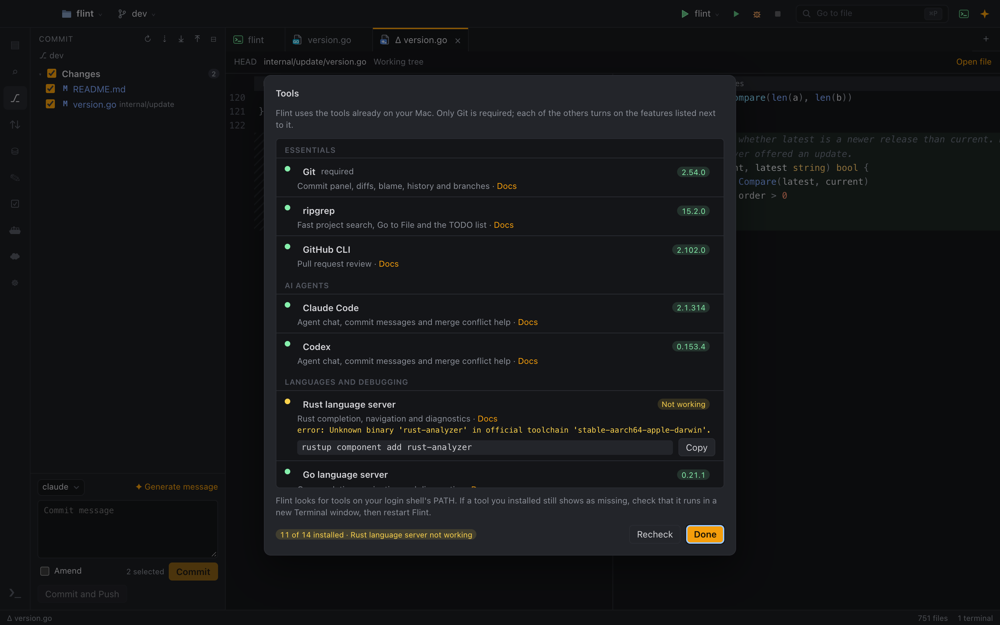

# First steps

This tour takes about ten minutes. It walks you through opening a project, finding your way around the window, and the handful of shortcuts you will use all the time.

## Check your tools

The first time Flint starts, it opens the **Tools** window: which of the tools Flint drives (Git, ripgrep, Claude Code, Codex, language servers, Delve, Node.js) are installed, and what each one enables. A panel that stays empty usually means its tool is missing. Copy the install command of anything you need, run it in Terminal and click **Recheck**. Open the window again later with **Help ▸ Check Tools…**.

Learn more: [Recommended tools](installation.md#recommended-tools).

## Open a folder

Flint works on folders. Open one in any of these ways:

- Press `⌘O` to open **Recent Projects**. Pick a folder from the list, or choose **Browse…** to select a new one.
- Drag a folder from Finder onto the Flint window.
- Run `flint .` in a terminal (see [the flint command](installation.md#the-flint-command)).

The window then shows the file tree on the left, the tab area in the middle and the status bar at the bottom. The icons on the far left (the activity bar) switch the sidebar between Files, Search, Commit, Pull Requests, Databases, Scratchpads and TODO, plus the panels of the extensions you installed. `⌘B` hides or shows the sidebar when you are not in an editor.

Learn more: [Open projects](how-to/open-projects.md).

## The Restricted Mode banner

The first time you open a folder, a **Restricted Mode** banner appears above the tabs. Until you trust the folder, Flint doesn't run its code on its own: no terminal starts automatically, the Rust and Python language servers stay off, agents ignore the project's own hooks and settings, and Git hooks are disabled.

- If this is your own project or you trust its authors, click **Trust Folder**.
- If you just cloned or downloaded something you don't know yet, leave it restricted while you look around. You can trust it later from the command palette ("Trust Folder").

Learn more: [Restricted Mode](guides/restricted-mode.md).

## The tab area

Files, terminals, agent chats, SQL consoles and diffs all open as tabs in the same area. The `+` button at the end of the tab bar opens a new terminal, an agent chat or a SQL console.

- `⌘[` and `⌘]` go back and forward through the tabs and places you visited, like a browser.
- `⌘W` closes the current tab.

Learn more: [Editor and navigation](guides/editor-and-navigation.md).

## Go to a file

Press `⌘P` and type a few letters of a file name. Matching is fuzzy, so `usrsvc` finds `user_service.go`. Press `↵` to open the file.

There is no indexing step: the list is ready as soon as the folder opens, and it respects `.gitignore`.

## Search the project

Press `⇧⌘F` to open the Search panel. Type your query; results stream in grouped by file. Toggle match case, whole word and regular expressions next to the field, and use the file filters to include or exclude paths. Click a result to jump to it.

Learn more: [Search and replace](how-to/search-and-replace.md).

## Open the terminal

Press `⌘J`. The first time, Flint opens a terminal running your login shell in the project folder. Press `⌘J` again to go back to the file you were editing; it toggles between the terminal and your last file. `⇧⌘T` always opens a new terminal.

`⌘`-click a `path:line` in the output to open that file at that line.

Learn more: [Terminals](guides/terminals.md).

## Start an agent chat

If you have the `claude` or `codex` CLI installed:

1. Click `+` in the tab bar and choose **claude chat** or **codex chat**.
2. Type a question, for example "Explain how requests are routed in this project", and press `↵`.
3. Watch the answer stream in, with the tools the agent uses and any files it changes.

Select some code and press `⌘L` to attach it to the chat. Edits the agent makes appear in the editor as they happen; review them in the Commit panel (`⌘K`).

Learn more: [Work with agents](how-to/work-with-agents.md) and [AI agents](guides/ai-agents.md).

## Find any command

Press `⇧⌘P` to open the command palette. It searches every action in Flint by name, shows each action's shortcut, and keeps the ones you used recently at the top. If you don't remember where something is, start here.

## Adjust settings

Press `⌘,` to open Settings in a tab. Choose a theme (Dark, Light or System), editor and terminal fonts, the default agent, and change any keyboard shortcut. Changes apply immediately.

Learn more: [Customize Flint](how-to/customize-flint.md) and [Settings](guides/settings.md).

## Shortcuts to remember

| Shortcut | Action |
|---|---|
| `⇧⌘P` | Command palette |
| `⌘P` | Go to file |
| `⇧⌘F` | Find in files |
| `⌘J` | Toggle terminal / last file |
| `⌘L` | Send selection to the agent |
| `⌘K` | Commit |
| `⌘[` / `⌘]` | Back / forward |
| `⌘,` | Settings |

The complete list is in [Keyboard shortcuts](reference/keyboard-shortcuts.md).
