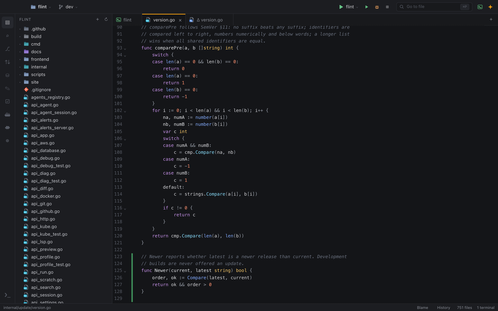

# Editor and navigation

This guide explains how the tab area, the file tree, search and the language servers work, and how to keep several projects in one window.

## Tabs

Files, terminals, agent chats, SQL consoles and diffs share one tab area. Each tab has an icon for its file type or kind.

- The `+` button at the end of the tab bar opens a terminal, an agent chat, a SQL console or a Markdown note.
- `⌘W` closes the active tab.
- A file you open from a terminal (for example by `⌘`-clicking `path:line`) opens next to that terminal.

### Back and forward

`⌘[` and `⌘]` move through your navigation history, like in IntelliJ. After you jump from a terminal into a file, `⌘[` takes you straight back to the terminal.

`⌘J` toggles between the terminal and the last file you worked in.

## File tree

The Files view (`▤` on the activity bar) shows a tree of the project.

- Select with click, `⌘`-click and `⇧`-click, or move with the arrow keys.
- `F2` or `↵` renames the selected item in place.
- `⌘⌫` moves the selection to the Trash, after a confirmation. Use Finder's **Put Back** to restore it.

Right-click an item for the context menu:

| Item | What it does |
|---|---|
| New File / New Folder | Creates the item in place, ready to be named |
| Rename | Edits the name in place |
| Move to Trash | Moves the selected items to the macOS Trash |
| Copy Path / Copy Relative Path | Copies the path to the clipboard |
| Reveal in Finder | Shows the item in Finder |
| Open in Terminal | Opens a terminal in that folder |
| Find in Folder | Searches only inside that folder |
| Add to Agent Chat | Attaches the file to the agent chat |
| Run Tests / Debug Tests | On test files (Debug Tests for Go) |
| Show History | Inside a Git repository: the file's commit history |
| Show Diff / Rollback | On changed files |

Open tabs and breakpoints follow a renamed file. Tabs of deleted files close.

## Changes made by agents

Flint watches the project folders. When an agent (or any other program) changes files, the tree refreshes and open files reload in place, keeping your position. If you have unsaved changes in a file that changed on disk, Flint warns you instead of overwriting them.

## Go to file

`⌘P` opens a fuzzy file finder over every project in the window. It uses `ripgrep` to list files, so it respects `.gitignore`, and there is no up-front indexing. When several projects are open, results are prefixed with the project name.

## Search and replace

`⇧⌘F` opens the Search panel; `⇧⌘R` opens it with replace turned on.

- Options: **Match case**, **Whole word**, **Regular expression** and **File filters** (include and exclude globs such as `*.go, src/**` or `*_test.go, vendor/**`).
- Results stream in as they are found. Without `ripgrep`, a slower built-in search is used.
- Replace shows a preview at every match, with the old text struck through and the new text next to it. Tick or untick whole files or single lines. In regular expressions you can use groups such as `$1` or `${name}`.
- What you see in the preview is exactly what is written.
- When you apply, each file is read again. Files changed since the search, binary files, very large files and files with unsaved changes in the editor are skipped.
- Writes keep file permissions and line endings. You can undo the last replace with **Undo** in the panel or "Undo Last Replace in Files" in the command palette.

See [Search and replace](../how-to/search-and-replace.md) for step-by-step instructions.

## Language servers

Flint starts a language server in the background when you open the first file of its language:

| Language | Server |
|---|---|
| Go | `gopls` |
| Rust | `rust-analyzer` |
| TypeScript / JavaScript | `vtsls` or `typescript-language-server` |
| Python | `basedpyright` or `pyright` |

You get completion, hover information, go to definition (`⌘`-click, `⌘B` or `F12`), find usages (`⌥F7` or `⇧F12`) and live diagnostics. `⇧⌘M` opens the problems list and `F8` jumps to the next problem.

The status bar shows each server's state. If a server isn't installed, it shows the command to install it.

On any error or warning, **Fix with agent** sends the problem (file, position, severity, source, message and the surrounding lines) to the agent chat. **Fix all N in file** (`⌥⇧⌘L`) sends every problem in the file at once.

> **Note:** In [Restricted Mode](restricted-mode.md), rust-analyzer and the Python servers don't start, because they run code from the project. They start as soon as you trust the folder.

## AI in the editor

- **Edit with Agent** (`⌘I`): type an instruction for the selection or the current line; the default agent's answer replaces it in place, and one `⌘Z` undoes it. See [Edit with Agent in the editor](ai-agents.md#edit-with-agent-in-the-editor).
- **Inline completions** (off by default): after a short typing pause, a local code model suggests the code at the cursor as faint ghost text. `Tab` accepts it (without a suggestion, `Tab` indents as usual); `Esc`, moving the cursor or typing something else dismisses it, and typing its next characters keeps the rest. Suggestions are not asked for with a selection, with several cursors, or in the middle of a word.

To turn completions on, install [Ollama](https://ollama.com), pull a small fill-in-the-middle model (for example `ollama pull qwen2.5-coder:1.5b-base`), and tick **Suggest code as I type** in Settings ▸ AI in the Editor (or run "Toggle Inline Completions"). An OpenAI-compatible server with `/v1/completions` (llama.cpp, vLLM, LM Studio or a hosted one) works too. Plain `http` is allowed only for `localhost`; any other endpoint needs `https`, and secrets in the code are redacted before they are sent there. An API key, if the endpoint needs one, is kept in the macOS Keychain. While completions are on, the status bar shows **✦ Completions**, or **⚠ Completions** with the last error (for example "Ollama is not running") in its tooltip. See [Settings](../reference/settings.md#completions) for the options.

## Several projects in one window

You can attach more folders to the window, like "Attach project" in IntelliJ.

- Add one with "Add Project to Workspace…" (`⇧⌘O`, the File menu, or `⌥↵` / `＋` in Recent Projects).
- The file tree shows one section per project; each has **Remove from Workspace**.
- `⌘P` and Search cover all projects. **Find in Folder** narrows the search to one.
- The Commit panel shows the repository of the active tab's project, with a switcher that shows the number of changes per project.
- New terminals and chats start in the active tab's project. The `+` menu has a section for each project.
- The run configuration selector follows the active tab's project, and each project remembers its own selection.
- **Fix with agent**, `⌘L` and test results go to the chat of the project the file belongs to.
- Language servers and file watching run per project.

The set of projects is restored the next time you open the main project.

## Scratchpads

Scratchpads are persistent SQL consoles and notes (Markdown or plain text) that save automatically. They live in the Scratchpads view (`✎`) and are not part of any project. `⌘N` opens a new SQL console. See [Databases](databases.md) for running queries.

## Command palette

`⇧⌘P` fuzzy-searches every command in Flint (navigation, projects, Git, GitHub, terminal, agents, run, profiling, databases, scratchpads). Each entry shows its category and shortcut, and recently used commands are listed first.

## Related

- [Preview and TODO list](preview-and-todo.md)
- [Keyboard shortcuts](../reference/keyboard-shortcuts.md)
