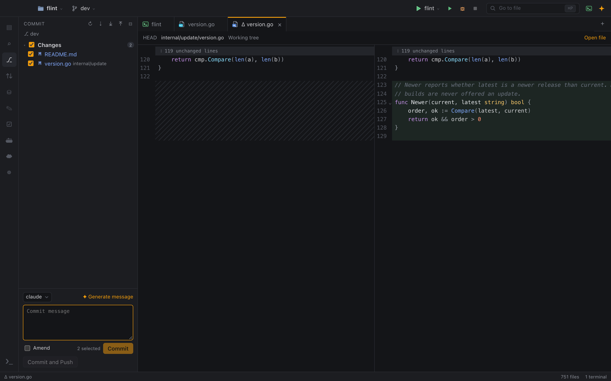

# Git and GitHub

Flint's Git support follows IntelliJ: a Commit panel with checkboxes, side-by-side diffs, gutter markers, blame and history. Pull request review and CI talk to GitHub's API with your GitHub account. This guide covers both.

## Commit panel

Open it with `⌘K` or the `⎇` icon on the activity bar. (In a terminal, `⌘K` clears the screen instead.)

- Changed files are listed with checkboxes. Tick the files to include in the commit.
- Click a file to open a side-by-side diff in a tab; double-click to open the file itself.
- **↶ Rollback** on a file discards its changes.
- Write a message, or click **✦ Generate message** to let your agent write one from the ticked changes.
- **✦ Review** lets an agent review the ticked changes before you commit; its findings appear in the panel and under their lines in the diff. See [Review Changes with Agent](ai-agents.md#review-changes-with-agent).
- **Amend** changes the last commit instead of creating a new one.
- **Commit** (`⌘↵` in the message field) or **Commit and Push** (`⌥⌘↵`).

The header has Refresh, Fetch, Update project (pull), Push (`⇧⌘K`) and Stash.

A commit made during a merge includes the whole index. When there are merge conflicts, the panel lists them separately, with the number of conflicts left in each file. **Resolve…** (or a click on the file) opens it in the [merge editor](#merge-conflicts); **✦ Resolve with** hands them to your default agent instead (see [AI agents](ai-agents.md#commit-messages-and-merge-conflicts)).

With several projects in the window, the panel shows the repository of the active tab's project. A switcher lets you pick another one and shows the number of changes in each.

## Merge conflicts

A merge, rebase, cherry-pick or `git stash pop` that conflicts leaves the files with conflict markers. The merge editor resolves them one conflict at a time:

- The file is shown as git left it: changes that didn't conflict are already merged. Each conflict is a block with the **current** side (green) above and the **incoming** side (blue) below, and the base in between when your `merge.conflictStyle` is `diff3` or `zdiff3`.
- The header says what current and incoming are. In a merge, current is your branch (`HEAD`) and incoming is the branch being merged. **In a rebase they are the other way round**: current is the branch you are rebasing onto (with your commits replayed so far), and incoming is your own commit being replayed. In a cherry-pick, incoming is the picked commit; after `git stash pop`, it is the stashed changes.
- Above each conflict: **Accept Current**, **Accept Incoming**, **Accept Both** (current first) and **Both, Incoming First**. Or edit the text yourself: delete the marker lines and the conflict is gone. `⌘Z` undoes an action.
- **✦ Ask Agent** puts the conflict, both sides and the base (from the index) into the agent chat draft for you to review and send.
- **‹ ›** move between conflicts; the header counts the ones left. **Δ Current** and **Δ Incoming** show what each side changed since the base.
- Nothing is written until you click **Save** (`⌘S`) or **Mark as Resolved**. Mark as Resolved saves the file and stages it (`git add`); with conflict markers left it asks first. Then finish the operation as usual (commit the merge, `git rebase --continue`).

Files deleted on one side and binary files can't be merged line by line; the editor says so, and you resolve them with `git add` or `git rm` in a terminal, or with the agent. Keyboard shortcuts are listed in [Keyboard shortcuts](../reference/keyboard-shortcuts.md#in-the-merge-editor).

## Gutter markers

The editor gutter marks added, changed and deleted lines. This is also the quickest way to see what an agent just touched.

## Branches

The branch widget in the status bar lets you check out a branch, create a new branch, fetch, pull and push. The command palette has "Branches & Worktrees…", "New Branch…", "Fetch", "Update Project (Pull)" and "Push".

## Worktrees

From the branch widget you can list, create, remove and switch worktrees, open one in a new window, or open it directly with a terminal for an agent. New worktrees are created in `<repo>.worktrees/<branch>`.

Checkouts and commits you make in a terminal refresh the UI, because Flint watches the Git directory too.

## Blame

**Annotate** shows a column with the date and author next to every line. Turn it on with the **Blame** button in the status bar, by right-clicking the editor gutter, or with "Annotate with Git Blame" in the command palette.

- Hover a line for the full hash, author, date and message.
- Click to open the change from that commit.
- Uncommitted lines, including unsaved ones, show "Not committed".

"Close Annotations" hides the column.

## File history

**Show History** (file tree context menu, or "Show File History" in the palette) opens the file's commits in a tab, following renames. Select a commit to see its diff below the list, or use **Compare with current**.

## Stash

The Stash button in the Commit panel (or "Stash Changes…" in the palette) saves your changes with a message, optionally including untracked files. The **Stashes** list in the panel shows each stash with a diff of each file, and these actions:

| Action | Effect |
|---|---|
| Apply | Applies the stash and keeps it |
| Pop | Applies the stash and drops it |
| Drop | Deletes the stash (after a confirmation) |

## Pull requests

Pull request review and CI talk to GitHub's API directly: Flint needs a GitHub account, but not the GitHub CLI.

### Signing in

Open **Settings ▸ Accounts** (or click **Sign in with GitHub** wherever a GitHub feature needs an account: the Pull Requests view, a pull request tab, the **CI: Sign in** item in the status bar). There are three ways to give Flint a token:

- **Sign in with GitHub**: Flint shows a code, **Copy Code & Open GitHub** opens GitHub's device page, you paste the code and approve. This is GitHub's device flow: no password goes through Flint, and there is no local web server. It needs the client ID of an OAuth App with Device Flow enabled in **Settings ▸ Accounts** (until Flint ships its own, register one: GitHub ▸ Settings ▸ Developer settings ▸ OAuth Apps ▸ New OAuth App, tick **Enable Device Flow**, and paste the client ID).
- **Use the GitHub CLI's Token**: if you already use `gh`, this runs `gh auth token` once (after you confirm in a dialog), checks the token with GitHub and keeps it. After that `gh` is no longer needed.
- **`GH_TOKEN` or `GITHUB_TOKEN`** in Flint's environment (for example when you start Flint from a terminal on Linux): used as it is while no account is signed in, never stored. For a GitHub Enterprise Server, `GH_ENTERPRISE_TOKEN` or `GITHUB_ENTERPRISE_TOKEN`.

A signed-in token is kept in the Keychain on macOS (the Secret Service on Linux) and sent only to the GitHub API of the configured host. **Settings ▸ Accounts** shows the account (avatar, login, host, scopes) and **Sign Out**, which deletes the token from the keyring. Revoking the token at GitHub needs the OAuth App's secret, which Flint doesn't have: do it on GitHub's **authorized apps** page (linked there).

Flint asks for the scopes `repo` (pull requests, reviews, checks, re-runs), `read:org` (organization repositories) and `workflow`; you can change them in Settings.

### GitHub Enterprise

Set **Settings ▸ Accounts ▸ Host** to your server (`ghe.example.com`): Flint then uses `https://ghe.example.com/api/v3` and `/api/graphql`, signs in there (each host has its own account, and an OAuth App registered on that server) and matches the project's remotes against that host. GitHub Enterprise Cloud with data residency (`<name>.ghe.com`) works the same way.

### The Pull Requests view

Open it with the `⇅` icon on the activity bar or "Pull Requests…" in the palette. It lists the pull requests of the active tab's project repository: the remote marked with `gh repo set-default` if there is one, else `upstream`, `github`, `origin`, then the others.

- Filter by **All / Created by me / Review requested** and by **Open / Closed / Merged / All states**.
- Each entry shows the CI state (✓ passed, ✗ failed, ● running; hover for the counts), the review decision (Approved, Changes requested, Review required, Draft, Merged) and when it was last updated.

If you are not signed in, the view offers **Sign in with GitHub**; if the repository has no remote on the configured GitHub host, it says so.

### A pull request tab

Click a pull request to open it in a tab. It shows the title, branches and author, an expandable list of checks with links, the description, the changed files with added and removed line counts and the number of open threads, the commits and the reviews.

- **Check out** fetches the pull request (`git fetch <remote> pull/N/head`) and switches to its branch: the branch's own name for a branch of this repository (tracking it), `<owner>/<branch>` for a fork's. An existing branch is fast-forwarded, and one that has diverged is left alone. It refuses when tracked files have uncommitted changes.
- **Open on GitHub** opens the pull request in your browser.

### Diffs and inline comments

Click a file to open a side-by-side diff against the merge base, as on GitHub.

- Review threads appear under their lines. Reply with `⌘↵`, and **Resolve** or **Unresolve** a thread.
- `+` in the gutter, on lines GitHub allows comments on, opens a new comment. Choose **Add single comment** to post it right away, or **Start a review** / **Add review comment** to add it to a pending review that only you can see.
- Outdated threads and file-level comments are shown above the diff.

### Submitting a review

The review bar, in the pull request tab and in the diff, takes a summary and has **Comment**, **Approve** and **Request changes**. While you have a pending review, it shows the number of comments and a **Discard** button.

### When CI fails

Flint follows the checks of your current branch's pull request, and of the pull requests of [agent tasks](ai-agents.md#agent-tasks-agents-in-parallel). When a check fails:

- the status bar shows a red **✗ CI** badge (click it to open the pull request) with **Fix with agent**;
- the Pull Requests view shows **Your branch** on top, with each failed check;
- the task's row in the Agent Tasks panel shows **✗ CI** and **✦ Fix CI**.

**Fix with agent** reads the failed jobs' logs (the failed steps of each job's log), keeps the failing step's last lines plus its error lines (test failures, compiler errors, `file:line` references), removes secrets and your home folder from them, and puts a draft in the agent chat of that project (for a task, the task's chat and worktree): which workflow, job and step failed, the excerpt, the files of your workspace the log points at, links to the run and job, and the branch and commit. Names and log lines from GitHub go in blocks the draft marks as untrusted data; on a pull request from a fork, the draft also warns that they were written by the fork's author and doesn't suggest running the failing step's command. Nothing is sent until you press Send.

Each failed check (in the pull request tab under **Checks**, and in the Pull Requests view) also has:

- **Log**: the failed steps' log in a tab (the last 1,000 lines first, earlier ones on request), with `file:line` references that open the file at that line, even when CI printed a runner path (`/home/runner/work/…`) or a bare test file name (`review_test.go:316`). Links only open files inside the project folder.
- **Rerun**: re-runs the run's failed jobs on GitHub, after you confirm in a dialog that names the repository and the workflow.

GitHub can't notify a desktop app, so Flint reads the checks when you open the folder, switch branches, push or fetch, and return to the window, and polls only while some check is still running, with conditional requests that cost none of your API rate limit while nothing changed (every 30 seconds by default, less often while nothing changes or reading fails, and not at all after three failures in a row until you return to the window). When CI fails or turns green while Flint is in the background, you get a notification. The interval, the size of the excerpt and the notification are in [Settings ▸ CI](settings.md#ci).

### Refreshing

Nothing refreshes in the background except running CI checks (see above). The list loads when you open the view, a pull request loads when you open its tab, and both reload when you return to the Flint window or click ↻. Responses are cached for about 30 seconds.

When GitHub asks Flint to slow down (a secondary rate limit), a read waits as long as GitHub says, up to **Settings ▸ Accounts ▸ Wait for GitHub's retry-after** (60 seconds), and tries once more; a longer wait, or a used-up hourly quota, is reported with the time to try again.

## Git in Restricted Mode

In a folder you haven't trusted, Git runs without hooks, even on commit and push. Regardless of trust, Flint's own background Git calls (status, blame, diff) never run filters, textconv drivers or fsmonitor defined in the repository; filters from your global configuration, such as Git LFS, still work. See [Restricted Mode](restricted-mode.md).

## Related

- [Review a pull request](../use-cases/review-a-pull-request.md)
- [Build a feature with an agent](../use-cases/build-a-feature-with-an-agent.md)
