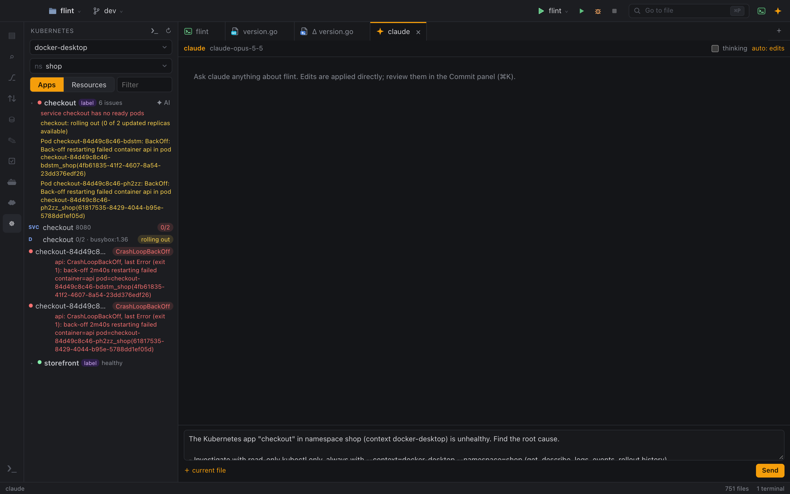

# Kubernetes

The Kubernetes panel shows what is running in a cluster, grouped the way you deploy it, and tells you what is wrong when a rollout fails. It uses `kubectl` with your kubeconfig, so any sign-in method works: `aws eks get-token`, GKE, OIDC and others.

Open it with the `☸` icon on the activity bar or "Kubernetes" in the command palette.

## Context and namespace

Pick a context from your kubeconfig and a namespace at the top of the panel. EKS context names are shortened to "cluster (account)". Flint remembers your choice between runs.

Flint never changes your kubeconfig's current context on its own. Every command it runs passes an explicit `--context` and `--namespace`, so the panel and your terminals can point at different clusters safely. If you do want to make the selected context the global current context, click ★.

## Apps view

The Apps view is the default. It groups objects into apps using the first of these that applies:

1. the Flux Kustomization label `kustomize.toolkit.fluxcd.io/name`;
2. the Argo CD label `argocd.argoproj.io/instance`;
3. the Helm release annotation `meta.helm.sh/release-name`;
4. the `app.kubernetes.io/instance` or `app.kubernetes.io/name` label, or the `app` label;
5. otherwise, each workload is its own app.

For each app you see:

- Flux Kustomization readiness and revision;
- the path from Ingress routes to Services (with ready and total backing pods) to Deployments, StatefulSets and DaemonSets;
- the rollout state, computed like `kubectl rollout status`: complete (with the revision), rolling out (with the reason), failed (when the progress deadline is exceeded), paused or scaled down, plus the images;
- pods with status and restarts, with pods of the previous revision marked, and the concrete problem, such as "CrashLoopBackOff, last OOMKilled (exit 137)" or an image pull error;
- recent Warning events for the app.

Unhealthy apps are sorted to the top and expanded.

## Resources view

The Resources view shows flat lists, with a filter:

- workloads (Deployments, StatefulSets, DaemonSets) with ready and desired counts;
- pods with status (as in `kubectl get pods`, for example CrashLoopBackOff or Terminating), readiness, restarts and age;
- services with their ports;
- jobs.

The panel refreshes every 5 seconds while it is visible.

## Actions

Right-click an item for its actions. Double-clicking an item opens its logs.

| Item | Actions |
|---|---|
| Workload | Diagnose with AI (unhealthy apps), Rollout Status, Rollout History, Logs, Describe, Rollout Restart, Undo Rollout, Scale |
| Pod | Logs, Shell (with a choice of container when there are several), Describe, Port Forward, Delete Pod |
| Service | Port Forward, Describe |
| Flux Kustomization | Reconcile, Describe |

Logs (`kubectl logs -f`), shells, port forwards and rollout status open in terminal tabs. Destructive actions ask for confirmation, including scaling to 0.

## Diagnose with AI

On an unhealthy app, **✦ AI** (or **Diagnose with AI** in the menu) gathers:

- the rollout state and the detected problems;
- the app's recent events;
- the last 60 log lines, and those of the previous crashed run, of up to 4 failing pods.

Flint removes secrets and your home path from this text and puts it into the agent chat draft together with a request for a read-only investigation. Nothing is sent until you review the draft and press Send.

## Terminal in a context

`❯_` opens a terminal where `kubectl` uses the selected context and namespace, without changing your global kubeconfig. Flint puts a small override file first in `KUBECONFIG`, holding only the current context and namespace, followed by your own kubeconfig. No credentials are copied. The tab is named `k8s:<cluster>/<namespace>`.

## EKS and AWS credentials

For EKS contexts, the panel shows the AWS profile named in the kubeconfig (`AWS_PROFILE`) and whether its credentials are still valid. Refresh them with one click; when the login has expired, a **Log In** button appears. See [AWS](aws.md).

## Related

- [Debug a failing deployment](../use-cases/debug-a-failing-deployment.md)
