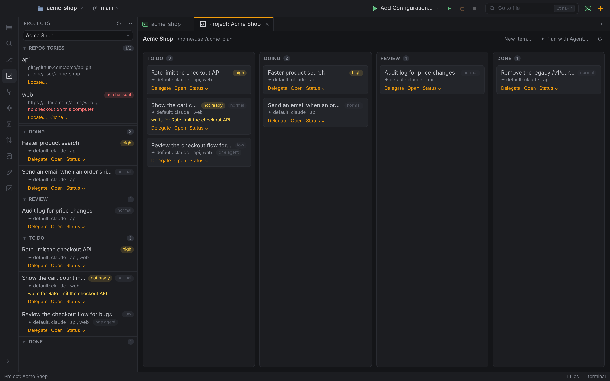

# Projects

A project holds work that is planned but not started: a folder of work items, its **backlog**, for one or more repositories, that Flint shows as a list and as a board. **Delegate** turns an item into [agent tasks](ai-agents.md#agent-tasks-agents-in-parallel), one per repository the item names (or one agent for all of them), run by the agent the item names, and the item's status follows them. An item can wait for other items, an agent can plan the items for you, and a repository you don't have yet can be cloned. You can have several projects at once. This guide explains the folder and its files, how repositories are matched to your checkouts and cloned, what Delegate does and refuses, how items wait for each other, how one agent works across repositories, how an agent plans a project, how the status moves, and what is shared with a team.

**Two meanings of "project".** Elsewhere in Flint, and in [Open projects](../how-to/open-projects.md), a project is a folder you open in the window ("Open Folder…", "Recent Projects…"). This guide says "project" only for the folder of work items described here, and calls the folders open in the window *folders*, *workspace folders* or *checkouts*; the one you are working in is the *active folder*. A project's folder may also be open in the window, but it doesn't have to be.



## When to use it

Use a project when you:

- plan work before anyone starts it, and want it in files next to the code rather than in another tool;
- have work that spans several repositories, such as an API and its client, and want one item to start one agent task in each, or one agent that works in all of them;
- have work that must happen in an order, and want an item to start by itself when the one before it is done;
- want an agent to split a goal into items for you to review;
- hand work to agents and want to see at a glance which items are waiting, running, in review or done.

For one task in one repository that you start right now, [New Agent Task…](ai-agents.md#agent-tasks-agents-in-parallel) is shorter. A project adds a place to keep the work before it starts and a status that follows the agent tasks. It does not replace an issue tracker: Flint does not import from or synchronize with Jira or GitHub Issues.

Nothing in a project runs by itself. Opening a project only reads its files. Agents start when you click **Delegate**. The one other way is an item you asked to [start when it is ready](#start-when-ready): Flint starts it when the items it waits for are done, and only because you said so.

## Create and open a project

Open the **Projects** panel from the activity bar or with "Show Projects" in the command palette (`⇧⌘P`). The `⋯` menu in its header holds:

- **Open Project…** picks a folder that already has a `flint-project.json`, for example one you cloned from your team.
- **New Project…** makes a folder you pick into a project: it asks for a name, then writes `flint-project.json` and an empty `items/` folder. It never overwrites a `flint-project.json` that is already there.
- **Show Board** opens the project's [board](#the-board).
- **Close Project** removes the project from Flint's list of projects. The files stay where they are. It is disabled, and marked "workspace folder", for a project listed because it is a folder open in the window.

The same commands are in the command palette, listed under **Projects** (not under **Project**, which holds the commands for the folders open in the window): Open Project…, New Project…, New Project Item…, Plan with Agent… and Show Project Board.

Flint remembers the projects you opened or created, most recent first, up to 20. A folder open in the window whose top level holds `flint-project.json` is listed without being opened. It can't be closed there; remove the folder from the window instead.

The project folder can be its own git repository, a folder inside one of your repositories, or a plain folder. A project is known by its real path, with symbolic links resolved.

The panel shows one project at a time: the picker under its header lists your projects and chooses the one shown. Below it come the [Repositories](#the-repositories-group) group and the project's backlog: its items, grouped by status: **Doing**, **Review**, **To do** and **Done** (Done starts collapsed). Each group header opens and closes with a click, or with Enter or Space when it has the keyboard focus. A row shows what an item [waits for](#dependencies), and marks an item that runs as [one agent across its repositories](#one-agent-across-repositories). Problem files are listed at the end.

## The folder

```text
acme-plan/
  flint-project.json
  items/
    rate-limit-checkout.md
    cart-badge.md
```

### flint-project.json

```json
{
  "name": "Acme Shop",
  "repositories": [
    { "name": "api", "url": "git@github.com:acme/api.git" },
    { "name": "web", "url": "https://github.com/acme/web.git" }
  ]
}
```

| Field | Rule |
|---|---|
| `name` | Shown in the panel. At most 80 characters, one line. Default: the folder's name. |
| `repositories` | Optional, at most 50. A project without repositories is valid: its items run in the folder that is active in the window. |
| `repositories[].name` | How items refer to the repository. Lowercase letters, digits and `-`, starting with a letter or digit, at most 40 characters, and unique in the file. |
| `repositories[].url` | A git remote URL, at most 1,000 characters. It identifies the repository on every teammate's machine, wherever their checkout is. See [How repositories are matched](#how-repositories-are-matched). |

Unknown fields are ignored. There is no form for the repositories: edit the file in the editor, then refresh the panel. If the file can't be used (it isn't valid JSON, a name or URL breaks a rule), the picker shows the reason and the project has no items until you fix it.

### Items

Each item is one Markdown file in `items/`. The front matter between the `---` lines is one `key: value` per line, as for [prompts](ai-agents.md#your-own-prompts) (`#` starts a comment, keys are not case-sensitive).

```markdown
---
title: Rate limit the checkout API
status: todo
priority: high
agent: backend
repos: api, web
---
Limit POST /checkout to 10 requests a minute per customer.

Done when:
- the API answers 429 with Retry-After past the limit
- the web client shows "Try again in a moment" on 429
```

| Part | Rule |
|---|---|
| Id | The file name without `.md`: letters, digits, `-` and `_`, at most 64 characters. Only `.md` files directly in `items/` count; files that start with a `.` are skipped, and files in subfolders are not read. |
| `title` | Required, at most 120 characters. |
| `status` | `todo` (default), `doing`, `review` or `done`. |
| `priority` | `low`, `normal` (default) or `high`. Orders the items inside a status, high first, then by title. |
| `agent` | Optional. The name of any agent: `claude`, `codex`, a custom agent's id or a [defined agent](ai-agents.md#defined-agents). Empty means the default agent (Settings ▸ Agents). |
| `repos` | Optional, comma-separated names from `flint-project.json`, each at most once. Empty means the folder that is active in the window. |
| `after` | Optional, comma-separated ids of items of the same project that must be `done` first: at most 20, each at most once. See [Dependencies](#dependencies). A value that isn't an id, more than 20 ids, or an id twice makes the file a problem. |
| `together` | Optional, `true` or `false` (default `false`). `true` starts one agent that works in all the item's repositories instead of one agent per repository. It needs 2 to 10 names in `repos`. See [One agent across repositories](#one-agent-across-repositories). Any other value, and `true` with fewer than two or more than 10 repositories, makes the file a problem. |
| Text after the front matter | What to do and how to tell it is done. |

The title and the text together become the agent task's description, the first message the agent gets. They may be at most 8,000 bytes, as for New Agent Task (a letter outside ASCII takes two to four bytes). With several repositories, Delegate adds a note naming them, and the note counts too. With `together: true` there is no note: the agent is told which folder is which repository in its first message, and that text doesn't count.

The title and the text can't contain characters you don't see but the agent reads: control characters other than tab and line breaks, Unicode tag characters, bidirectional controls, zero-width spaces, word joiners and byte order marks. Such a file is listed as a problem. Zero-width joiners, which emoji and several scripts need, are fine.

Unknown keys are kept when Flint rewrites the file and are otherwise ignored.

**New Item…** (the **＋** button in the panel's header or the board's, or "New Project Item…" in the command palette) asks for a title, makes the id from it (lowercase letters, digits and `-`, at most 40 characters; `-2`, `-3`… when the name is taken), writes the file from this template and opens it:

```markdown
---
title: Rate limit the checkout API
status: todo
priority: normal
# agent: backend     the agent that works on it (default: the default agent)
# repos: api, web    repositories from flint-project.json (default: the active folder)
# together: true     with several repos: one agent works in all of them (default: one per repository)
---
What to do.

Done when:
- 
```

### Problems

A file that breaks a rule is not shown as an item, except the problems that are about the item's agent or its `after` line, which keep it listed. It is listed under the items as a problem, with the file and the reason, and **Ask the agent** puts the problem into a chat draft. These are the usual ones:

| Reason | Fix |
|---|---|
| `title is missing`, or a `status` or `priority` that isn't one of the values above | Correct the front matter. |
| `repository "x" is not in flint-project.json` | Add the repository to the file or fix the name in `repos`. |
| `title and text are longer than 8000 bytes` | Shorten the text. |
| `the text contains invisible characters (U+200B)`, or `a control character` | Remove the character it names. It is often pasted in from a web page or a chat; an agent can find it for you with **Ask the agent**. |
| `larger than 64 KB` | Items are plain files of at most 64 KB. Split the work into several items. |
| `front matter has no closing ---`, or a line that is not `key: value` | Fix the line. A comment starts with `#`. |
| `after: no item x in this project (or its file has a problem)`, `after: the item names itself`, or `after: a cycle: a → b → a` | The item is shown, never ready, and Delegate refuses it. Fix the `after` line. See [Dependencies](#dependencies). |
| `together: true needs two or more repositories in repos`, or `together: true works with at most 10 repositories` | Name 2 to 10 repositories in `repos`, or remove the line. |
| `the agent "x" is not available here` | The item stays listed. Define or install the agent, or change `agent`. Delegate says the same. |
| `more than 500 files; the rest are not loaded` | A project's backlog holds at most 500 items. |
| `links outside its folder` | A symbolic link that leaves the project folder is refused. |

## How repositories are matched

An item names repositories, not folders, so the same project works on every machine. For each repository, Flint looks for your checkout:

1. A folder open in the window, and trusted, whose repository has a remote with the same URL. Any remote counts, not only `origin`. It is the repository that folder is in: a repository nested inside an open folder (a folder of several repositories, a submodule) is not found this way, so **Locate…** it.
2. Otherwise the folder you chose with **Locate…** for that URL, if it is trusted.
3. Otherwise a folder open in the window that is in [Restricted Mode](#projects-and-restricted-mode). Any folder can claim any URL, so a folder in Restricted Mode is used only when no trusted checkout is found, and Delegate asks you to trust it first.
4. Otherwise the folder you chose with **Locate…**, in Restricted Mode too.

### The Repositories group

The **Repositories** group at the top of the panel lists each repository of `flint-project.json` with its URL and the checkout Flint found, or "no checkout on this computer". It starts collapsed when every repository can be used, and open otherwise. A repository is marked:

| Marker | Meaning |
|---|---|
| no checkout | No folder open in the window and no located folder has a remote with its URL. |
| problem | The located folder can't be used; the tooltip says why. |
| located | The folder was chosen with **Locate…**. |
| not in workspace | The located folder isn't open in the window. Delegate adds it; **Add to Workspace** does it now. |
| Restricted Mode | The checkout isn't trusted. **Trust Folder…** trusts it, after saying that this is for the whole folder from now on. |

**Locate…** first says which repository to find, with its name and URL, then asks for a folder. It accepts only a checkout that has a remote with that URL. A folder that is an agent task's worktree is refused: choose the repository's own checkout. The choice is kept in Flint's `state.json` per URL, never in the project, so every teammate has their own. If the located folder is moved or deleted, the repository is listed with the reason and you locate it again. A located folder that isn't open in the window is added to it before Delegate uses it.

A repository with no checkout also has **Clone…**, next to **Locate…**: see [Clone a repository](#clone-a-repository).

### Clone a repository

**Clone…** gets a repository you don't have yet. It asks for a folder, then makes the checkout in a new folder inside it.

1. **Pick the folder.** The checkout goes to a subfolder named after the last part of the URL's path, without `.git`: `api` for `git@github.com:acme/api.git`. That subfolder must not exist, or must be an empty folder (not a link). The name may have letters, digits, `.`, `-` and `_`, up to 100 characters, and may not start with `.` or `-`.
2. **Confirm.** Flint shows the repository, the URL and the destination and asks. It says that the URL comes from the project's `flint-project.json`, that git uses your own credentials, and that the new folder is in Restricted Mode until you trust it. For a project whose folder isn't trusted it adds a note to check that you expect the URL.
3. **Wait or cancel.** The repository shows git's latest progress line and **Cancel**. One clone runs at a time per project. Cancelling, closing the project and quitting Flint stop it, and so does a clone that takes longer than 30 minutes.

What can be cloned: a URL of the form `https://host/path`, `ssh://[user@]host[:port]/path` or `user@host:path`. Flint refuses `file://`, local paths, `ext::` and every other transport, and a URL with a password, a query or a fragment, with spaces or characters outside ASCII, with `.` or `..` in its path, or with a host or user name that isn't a plain name (nothing that starts with `-`). The message is "<URL> can't be cloned", followed by the reason. A URL that can't be cloned can still be located: clone it yourself and use **Locate…**.

What Flint runs: `git clone` with only the URL's transport allowed, the URL passed after `--` and never as an option, no submodules, no hooks and no `fsmonitor`. Submodules are not fetched.

Credentials come from your own git setup: the credential helper or the SSH agent you already use for `git clone` in a terminal. Flint never asks for a password, and git can't ask on a terminal Flint doesn't have. A clone that needs a login you haven't set up fails, and the repository shows git's message.

The clone is made in a temporary folder inside the folder you picked and moved to its name only when it worked, so a clone that fails or is cancelled leaves nothing behind. When it worked, Flint remembers the folder as the repository's checkout, as **Locate…** does (per URL, in your `state.json`, never in the project).

The new folder is **not trusted** and not open in the window. Treat it like a located folder: **Add to Workspace** and **Trust Folder…** in the group do it now, and Delegate does it for you when you delegate an item that needs it, one question at a time. Trust is for the whole folder from now on, so read what you cloned first if you don't know the repository.

### How URLs are compared

Flint compares URLs after dropping what doesn't name the repository: the scheme, the user, the port, a trailing `.git` and trailing slashes. The host is lower-cased. These are one repository:

```text
git@github.com:acme/api.git
ssh://git@github.com:22/acme/api
https://github.com/acme/api/
```

The path keeps its case. Local paths (`/srv/git/api.git`, `file:///srv/git/api.git`) are compared as paths. A host that uses different paths for ssh and https gives two different repositories: write the URL the way your remotes spell it. Something that isn't a git remote URL is refused in `flint-project.json`.

## Delegate

**Delegate** is on every item in the panel and on the board. It does this, in order:

0. **Checks what the item waits for.** An item whose `after` items are not all `done` is not started: see [Dependencies](#dependencies). An item whose `after` line has a problem is refused.
1. **Checks the agent.** The item's `agent`, else the default agent. It must be available now. For an item with `together: true` it must also be one that can [work in several folders](#one-agent-across-repositories).
2. **Finds a checkout for every repository** the item names, as described above. An item without `repos` uses the folder that is active in the window, which must be one of the folders open in it. If something is missing, Delegate walks you through it one step at a time before it starts anything: **Locate…** for a repository without a checkout, adding a located folder to the window, trusting a checkout in Restricted Mode. A step you cancel stops Delegate; a step that doesn't help shows why Delegate can't go on.
3. **Creates one agent task per repository**, the way New Agent Task does: a branch from the checkout's current branch, a worktree, the [queue](ai-agents.md#the-queue) and its limit, and the trust of the worktree. The description is the item's title and text. When the item names several repositories, each task also gets a note naming the item's other repositories and saying which one this task works in. With `together: true` the tasks are one [joint group](#one-agent-across-repositories) and get no note.
4. **Starts the agents.** A task that gets a slot starts its chat at once, with the description as its first message. The others wait in the queue, like any queued task. A joint group takes one slot and starts one chat.
5. **Remembers the tasks for the item and sets its status to `doing`.**

Delegate is all or nothing, for a joint group too. If one task can't be created, Flint removes the ones it already created for this Delegate and shows the error. None of its tasks leaves the queue before all of them exist, so a task that is removed again never had an agent working in it.

For an item of a project whose folder isn't trusted, Flint asks first in a dialog of its own: see [Projects and Restricted Mode](#projects-and-restricted-mode).

The item row lists its agent tasks with their states (queued, working, waiting for you, finished, failed, as in the [Agent Tasks panel](ai-agents.md#agent-tasks-agents-in-parallel)), and **Open** on a task shows its folder and chat, as in that panel. Review, merge or create a pull request there.

**Delegating again** (after a failure, or to try another agent) adds agent tasks. The item shows all of them.

### What Delegate refuses

Delegate checks everything before it creates anything, and lists every repository that is a problem in one message.

| Message says | Why | What to do |
|---|---|---|
| The item can't start: `after: …` | The `after` line names an item that doesn't exist (or whose file is a problem), the item itself, or is on a cycle | Fix the `after` line. |
| The agent isn't available here, or no agent can start | The item's `agent` isn't defined or installed here. A defined agent kept in a repository isn't loaded in a folder in [Restricted Mode](restricted-mode.md#what-is-restricted). With no `agent`, no agent is installed. | Define or install the agent, change `agent`, or install Claude Code or Codex, or add an agent in Settings ▸ Agents. |
| No checkout of a repository was found | No folder open in the window and no located folder has a remote with its URL | Open the repository in the window, or click **Locate…**. |
| A located folder can't be used | It is gone, is not a git checkout, is an agent task's worktree or has no remote with that URL | **Locate…** the repository again. |
| A folder is in Restricted Mode | The checkout isn't [trusted](restricted-mode.md#trusting-a-folder). Delegate would start an agent in it. | Trust the folder, then Delegate again. |
| The item names no repository and no folder is open, or the active folder is not one open in the window | An item without `repos` runs in the active folder | Open the folder the item is for. |
| The title and text with the note about its repositories are too long | Together they may be at most 8,000 bytes | Shorten the text. |
| The item has 100 agent tasks | An item remembers at most 100 | Remove some in the Agent Tasks panel. |
| A folder is on a detached HEAD | Delegate starts each task from the checkout's current branch, and there is none | Check out a branch in that folder, then Delegate again. |
| `<agent> runs on <engine>, which cannot work in several folders at once: delegate per repository instead` | The item says `together: true` and its agent is Codex, a defined agent that runs on Codex, or a custom agent. The message adds "(the item says together: true; without that line each repository gets its own agent)". | Use Claude Code for the item, or remove `together: true`. |
| A task could not be created | For example the branch or the worktree failed. The message names the folder. | Fix what it names, then Delegate again. |
| Delegate was cancelled | You answered Cancel when Flint showed the item of an untrusted project | Read the item; Delegate again if it is what you want, or trust the project's folder. |

An item that waits for other items is not a refusal: Delegate starts nothing and asks if it should start the item when it is ready. An item that is listed as a problem can't be delegated, because it isn't an item yet. If the tasks start but Flint can't write the status, it tells you; the tasks keep running.

## Dependencies

Some work has an order: the API before its client, the schema before the code that uses it. Say it in the item with `after`:

```markdown
---
title: Show the rate limit in the web client
repos: web
after: rate-limit-checkout, add-customer-ids
---
```

`after` lists ids (file names without `.md`) of items in the same project, at most 20. An item is **ready** when every item in `after` has status `done`. An item without `after` is always ready. Only the status counts: `done` can be an item that merged by itself, or one you moved there by hand. An item in `review` is not done yet.

The panel and the board show what an item waits for. [`get_project`](#what-agents-can-see) shows `after` and whether the item is ready.

An item stays in `todo` while it waits.

### Problems with after

These make the item never ready. The item is still shown, it is listed under the problems with the reason, and Delegate refuses it:

| Reason | Fix |
|---|---|
| `after: no item x in this project (or its file has a problem)` | Fix the id, or fix the file of the item it names. |
| `after: the item names itself` | Remove the id. |
| `after: a cycle: a → b → a` | Remove one of the ids on the cycle. |

An item that only waits for an item on a cycle is not itself a problem, but it is not ready until that item is done, which it can't be by waiting.

### Delegate on an item that is not ready

**Delegate** on an item that waits for others starts nothing and says what it waits for. Flint asks "Start … when … are done?":

- **Yes** remembers your answer on this computer, and the item shows that it starts when the items it waits for are done, with **Cancel start**. An item that is ready by the time you say yes starts at once.
- **No** leaves the item as it was.

You can ask for at most 100 waiting starts per project. An item that is already `done` can't wait to start. An item without `repos` runs in the folder that is active in the window when you ask, which must be open then and is checked again at the start.

### Start when ready

This is the one way anything starts without a click at that moment. The click that allowed it named the item, and it is the only thing Flint starts for you.

When the last item an item waits for becomes `done`, Flint delegates it exactly as a click on **Delegate** would, through the same code and with every check of Delegate at that moment:

- the agent is available, and every repository has a checkout that is in the window and trusted;
- the item's text fits and the item has room for more agent tasks;
- for a project whose folder isn't trusted, the question that [Restricted Mode](#projects-and-restricted-mode) describes, which then names the item and says that it starts now because the items it waited for are done;
- the [queue](ai-agents.md#the-queue): a task without a free slot waits there, as always;
- for an item with `together: true`, one [joint group](#one-agent-across-repositories).

Flint looks when a status can have changed: after agent tasks change, when you set a status, when the panel reads a project that has waiting starts (when it is shown and on refresh, which also notices a status edited in a file of the window), and when the folders of the window or their trust change. Nothing polls. A status that changes in a teammate's commit is noticed when you have pulled it and the panel reads the project again.

Flint doesn't walk you through what is missing, as Delegate does after a click. It can't ask you to **Locate…** or **Clone…** a repository, add a folder to the window or trust it: those are checks that fail.

**When a check fails**, nothing starts. The item keeps waiting and shows why, and Flint tells you. Flint tries again only when something those checks read has changed: the item's file or the project's, the available agents, the checkouts, trust, or the active folder. It never retries in a loop. You can fix the cause and wait, **Delegate** by hand (a start that works ends the waiting), or **Cancel start**. If you answer No to the question about an untrusted project, the item keeps waiting with that reason, and the same applies.

Some more rules:

- If you set the item itself to `done` before it starts, it is not started and the waiting start is dropped.
- **Cancel start**, or **Close Project**, forgets a waiting start. Cancelling while Flint's question is open also stops that start.
- One start of an item runs at a time. A click on **Delegate** while Flint is starting the item says that the item is being started already.
- Waiting starts are kept in your `state.json` and are not shared: see [Share a project with a team](#share-a-project-with-a-team). They run only while Flint is running.

## One agent across repositories

An item with several repositories normally gets one agent per repository: each agent sees only its own repository, and the agents work side by side. Add `together: true` to start **one** agent that works in all of them instead:

```markdown
---
title: Add the cart badge
repos: api, web
agent: claude
together: true
---
Add GET /cart/count to the API and show it as a badge on the cart icon.
```

The item needs 2 to 10 names in `repos`. The panel and the board mark it as one agent.

### One agent or one per repository

Use `together: true` when one change has to stay consistent across repositories and the agent needs to see both sides at once: an API and the client that calls it, a schema and the code that reads it, a library and an app that uses it. One agent can make the endpoint and its caller agree.

Leave it out when the work in each repository can go on alone, when you want several agents to work at the same time, when you want to try different agents on different repositories, when the repositories are more than 10, or when the agent is Codex or a custom agent. One agent per repository works with every agent and uses a slot for each.

### What you get

Delegate makes its usual checks and then makes the group. For each repository you get what any agent task has: its own branch from the checkout's current branch, its own worktree and its own agent task. So **Merge**, **Create PR**, **Show diff** and **✕** work per repository, as in the [Agent Tasks panel](ai-agents.md#agent-tasks-agents-in-parallel), and each repository gets its own pull request.

What is shared is the agent. Flint opens one chat in the worktree of the first repository in `repos`, the **lead**, and lets it read and write the worktrees of the others. The panel shows the tasks of a group together, with the lead marked. The chat's first message is the item's title and text, then which folder is which repository on which branch, then a request to keep the change consistent across them and to commit in each folder on its own branch. There is no note about the other repositories, so the 8,000 bytes apply to the title and text alone.

The tasks share the chat's state: they are working, waiting for you and finished together. **Merge** is refused while the agent works, as for any task. The item's status follows the same rules as always: `review` when the chat finished, `done` when every task is merged, or removed after its pull request was created.

### Which agents can do it

Only Claude Code, and a defined agent that runs on it. Codex and custom (ACP) agents have no safe way to be given extra folders, so Flint refuses them before it creates anything: the item stays as it was, and the message says to delegate per repository instead. See [What Delegate refuses](#what-delegate-refuses). Without an `agent` line, the default agent must be one that can.

### The queue slot

A group takes one slot of `agentTasks.maxParallel`, however many repositories it has. When no slot is free, the whole group is queued and leaves the queue as one: **Start now** on any of its tasks starts the chat for all of them.

### Removing a task

**✕** on one task of a group removes that task only, but the chat works in its worktree too, so the chat stops for all of them. The question says so. The other tasks stay, with their worktrees and branches, and you can merge them or remove them. Removing the lead makes the next task the lead. A group left with one task is an ordinary task.

### Approvals and trust

Flint's [approval policy](ai-agents.md#what-the-agent-may-do-without-asking) treats the worktrees of the group like the chat's own folder: the edits and reads it approves on its own apply inside any of them, and nowhere else. Files in protected folders such as `.git` still ask.

Every repository's checkout and every worktree of the group must be trusted, or Delegate is refused with a message that names the folder. The chat is given the other worktrees each time it starts or resumes, from Flint's own list of the group's tasks, and a chat that resumes while one of them is untrusted or gone doesn't open: remove that task, or trust the folder, and open the chat again.

Delegating the item again makes another group, with new branches.

## How the status moves

An item has one status: `todo`, `doing`, `review` or `done`. It is stored in the item's file, in its `status:` line.

| Change | When |
|---|---|
| any → any | You pick a status: **Status ⌄** on the item (To do, Doing, Review, Done), or dragging a card on the board. |
| any → `doing` | **Delegate** started the item's agent tasks, or Flint started them for an item you asked to [start when ready](#start-when-ready). |
| `doing` → `review` | Every agent task of the item finished (the agent's turn ended). A task that failed keeps the item in `doing`, marked failed. |
| `review` → `done` | Every agent task of the item is merged into its base branch, or its pull request was created and the task removed. |

The automatic changes start only from `doing` or `review`, and only when something about the item's agent tasks changed since Flint last looked: a state, a merge, a pull request or a removal. An item you moved stays where you put it until its tasks change, so you can move a delivered item back to `doing` for rework. Both changes can happen in one step: an item goes from `doing` to `done` when every task is already merged.

- A task you remove without merging it and without a pull request, such as a failed attempt you discard, no longer counts. With no task left, the status doesn't move.
- A task whose pull request was created but that still exists doesn't count as delivered yet. Remove it after creating the pull request, or merge it.
- A failed task is marked on the item. Open it and ask the agent to fix it, or remove it and Delegate again.

An item that reaches `done`, by these rules or by your hand, can make Flint start the items that wait for it, if you asked for that. The tasks of a [joint group](#one-agent-across-repositories) share one chat, so they finish together, and the item moves when all of them have.

Flint makes these changes when agent tasks change, when Flint starts, and whenever the panel reads the project (when it is shown and on refresh), which also notices a merge you made outside Flint. Nothing polls. A task that was merged outside Flint and removed before Flint looked counts as discarded. A change Flint can't write (the file changed meanwhile) is tried again the next time it looks.

Flint remembers an item's agent tasks by the item's file name. While the file is missing for a moment, for example during a branch switch in the project's repository, the item isn't listed but its tasks are kept, and they are back with the file. Renaming the file loses them: the renamed item starts without tasks (the tasks stay in the Agent Tasks panel). Close Project forgets them too.

### Moving it by hand

Use the status menu on an item (or drag its card). You can move an item to any status, for example back to `todo` after a failed attempt. Flint changes only the value on the `status:` line and keeps the rest of the file as it was, with its line endings. When there is no `status:` line, it adds one before the closing `---`.

Flint refuses to write a file it can't change safely and says why. Set the status in the editor instead. The reasons are: two `status:` lines, no closing `---`, a line that is not `key: value`, or a file that changed between Flint reading and writing it (try again).

## The board

**Show Board** in the panel's `⋯` menu, or "Show Project Board" in the command palette, opens the board in a tab titled "Project: <name>": one column per status, **To do**, **Doing**, **Review** and **Done**, with the items as cards. A card shows what an item row shows and has the same actions: **Delegate**, **Open**, **Status ⌄**, and **Open** on an agent task. Drag a card to another column to set its status. **＋ New Item…** in the board's header adds an item. A card shows what the item waits for, with **Cancel start** when you asked it to start when ready, and marks an item that runs as one agent. An open board comes back with the session when Flint restarts.

## Plan with an agent

Instead of writing every item yourself, you can state a goal and let an agent split it into items. The agent adds them to the project's backlog as `todo` items, one at a time, and you decide about each one.

1. Click **Plan with Agent…** in the Projects panel, or run it from the command palette.
2. Say what the goal is (1 to 2,000 characters, with the [character rules](#items) of an item's text) and pick the agent: a [defined agent](ai-agents.md#defined-agents) such as a planner, or any other agent. The default agent is the default choice.
3. Flint puts a prompt into the draft of a chat with that agent. Read it, change it, and send it. Flint sends nothing for you.

The prompt gives the agent your goal, the project's name, folder and repositories, the item format with its limits (including `after` and `together`), and the agents available on this computer. It tells the agent to read the project's backlog first with `get_project` and not to add what is planned already, to split the goal into items that one agent can finish and that can be checked, to add each with `add_project_item` in an order where an item only waits for items that exist, and to list what it added when it is done. It also says that the agent can't change, delete, start or set the status of items, and to correct an item and try again when a call is refused.

### What to switch on

The agent adds items with `add_project_item`, a [tool that acts](ai-agents.md#letting-agents-act-in-flint), so it is **off** until you switch it on in Settings (`⌘,`) ▸ **Agent Context** ▸ **Actions** ▸ **Add project items** (`mcpServer.actions.projects`). It needs Flint's MCP server to be on (it is by default) and the Projects feature. The chat must be in a trusted folder: a chat in a folder in [Restricted Mode](restricted-mode.md) gets none of Flint's tools.

When the switch is off, **Plan with Agent…** says what to switch on. The prompt is still usable: the agent can read the project, but it can't add anything, and it tells you so.

Planning is refused for a project whose folder isn't trusted, because agents can neither read it nor add to it. Trust the folder first.

### What you approve

**You are asked before every item**, as for the other tools that act. Claude Code shows a permission card with **Allow once** and **Reject**; there is no "Always allow", and the approval policy doesn't answer it, not even "Do everything". Codex and custom agents, and Claude Code when its own settings already allow the tool, get a dialog of Flint's own instead. Without your answer in five minutes, nothing is written.

The question shows what will be written:

- the project's name and folder;
- the title;
- the priority, and the agent, repositories, `together` and `after` when the item has them;
- the file name (or "the next free name");
- the start of the text, 600 characters at most.

Say no to an item and it isn't written; the agent can go on with the next. After your yes, Flint checks everything again before it writes.

### What agents can't do

An agent can only add items. It can't change an item, delete one, set a status, or delegate, so nothing starts until you click **Delegate** (or you asked an item to [start when ready](#start-when-ready); an agent can't ask for that). A new item is always `todo`. Read what an agent planned before you delegate it: it chose the `agent`, the `repos`, `after` and `together` too.

An agent whose chat runs in the project's own folder can still edit its files like any other file in the folder it works in. Flint reads them with the same rules as any item, and a file that breaks one is a problem.

### A planner as a defined agent

A planner is a good use for a defined agent: standing instructions that make every plan follow your rules. Saved as `planner.md` (personal, or in `.flint/agents` to share it with your team):

```markdown
---
description: Splits a goal into items of a Flint project; plans, never codes
model: strong
---
You plan work for a Flint project. Read the project's backlog first.
Split the goal into items that one agent can finish in one go.
Every item ends with "Done when:" and a list of checks that can be run.
Put work that must come first in `after`, and keep each item to one repository
unless one change must stay consistent across several, then use `together: true`.
Do not write code and do not change files.
```

Then pick `planner` in **Plan with Agent…**.

## Share a project with a team

Put the project's folder in a git repository, or in a folder of one, and commit it like code. The files and the statuses are shared:

| Shared (in the project folder) | Local to your machine |
|---|---|
| `flint-project.json`, the items and their text, priority, agent, repositories, `after` and `together` | Which agent tasks belong to an item |
| Each item's status | The agent tasks themselves, their worktrees and chats |
| | The items you asked to [start when ready](#start-when-ready) |
| | The folders you chose with **Locate…** or cloned |
| | The list of projects you opened |

So a teammate sees that an item is `doing`, not the tasks on your machine. Waiting starts are yours alone: a teammate who pulls your commit doesn't start your item, and when you pull theirs, only the items you asked to start do. If two of you asked for the same item, each Flint starts its own tasks when the item is ready. When you commit and push, your status changes go with it. When a teammate delegates an item you haven't, the status moves on their machine and reaches you with their commit. Two people changing the same item's status at once is an ordinary git merge conflict on the `status:` line.

Because statuses are written to the files, a status that moves by itself leaves an uncommitted change in the project's repository. Commit it with the rest.

Flint reads the files again when the panel is shown, on refresh, after its own writes, when agent tasks change, and, for a project inside a folder open in the window, when a file changes. It does not watch a project folder outside the window, and it does not notice a teammate's push by itself: pull, then refresh.

Don't put secrets in an item. It is a plain file in your repository, and its text is sent to an agent.

## What agents can see

An agent chat can read the project through Flint's [MCP server](ai-agents.md#what-agents-can-see-in-flint), so you can ask what is planned or what to do next. The tool is `get_project`. It only reads: statuses change in Flint. A second tool, [`add_project_item`](#what-agents-can-add), adds items and is off until you switch it on.

| Argument | Meaning |
|---|---|
| `status` | Optional. Only items with this status (`todo`, `doing`, `review` or `done`). |
| `project` | Optional. Only the project with this name. |

The answer lists each project Flint knows whose folder is trusted, with its repositories and its items: id, title, status, priority, agent, repositories (marked when one agent works in all of them), the items it waits for with whether it is ready, and text. It does not include agent tasks. Projects whose folder is in Restricted Mode are left out, and the answer says how many and why. The text of one item is cut at 2,000 bytes, and the whole answer, headings and repository lists included, at 60 KB, with a line saying how many items were left out; ask for one status or one project to see them.

It shows every trusted project Flint knows to any chat, not only one that belongs to the folder the chat works in. So in Claude Code it is not one of the read tools that run without asking: like Flint's other tools outside that list, such as terminal output, you are asked before each call, unless you chose "Do everything". It is offered while the Projects feature is on and, like all of Flint's tools, not to a chat in a folder in Restricted Mode.

### What agents can add

`add_project_item` writes one new item. It is a tool that acts: it is off until you switch on **Add project items** in Settings ▸ Agent Context ▸ Actions (`mcpServer.actions.projects`), it isn't offered to agents while it is off, and you are asked before every call. [Plan with an agent](#plan-with-an-agent) describes the questions.

| Argument | Meaning |
|---|---|
| `project` | Required. The project's folder or its name, as `get_project` shows them. A name works only among the projects whose folder is trusted. |
| `title` | Required. One line, at most 120 characters. |
| `text` | Required, and may be empty. What to do and how to tell it is done. Title and text are at most 8,000 bytes. |
| `priority` | Optional: `low`, `normal` (default) or `high`. |
| `agent` | Optional. The agent that works on it. It must be available here. |
| `repos` | Optional. Names of the project's repositories. |
| `after` | Optional. Ids of items of the project that exist and must be done first. |
| `together` | Optional, `true` or `false`. Only with 2 to 10 `repos`. |

Unknown arguments are refused. The item goes through the same code as **New Item…** and the same parser as any file:

- The id comes from the title (`-2`, `-3`… when taken). An existing item is never changed or overwritten.
- The status is always `todo`.
- Every limit and character rule of an item applies. A call that would make an item Flint can't read, or one with a problem (an agent that isn't available here, an `after` that names no existing item or closes a cycle, `together` with fewer than two repositories), is refused with the reason, so the agent can correct it.
- A project whose folder is in Restricted Mode is refused: "agents can't add items to it until the user trusts the folder".
- One chat adds at most 50 items. The project's limit of 500 items holds, as for **New Item…**.

Agents get no tool to change or delete an item, set a status, or delegate.

## Projects and Restricted Mode

A project is read in any folder: reading files runs nothing. What Restricted Mode changes is what reaches an agent.

- **Checkouts.** Delegate starts an agent in each checkout, so it is refused for a checkout in [Restricted Mode](restricted-mode.md) until you trust the folder. Delegate offers to trust it. The question names the folder and says that trust is for the whole folder from now on, not just for this Delegate.
- **Joint groups.** A `together: true` item needs every repository's checkout and every worktree of the group to be trusted, because one agent writes in all of them. A chat in a group doesn't open while one of them is untrusted.
- **The project's own folder.** An item's text becomes an agent's instructions, and a project may come from someone else's repository. A project whose folder isn't trusted is marked **Restricted Mode** in the panel (with **Trust Folder…**) and on its board, and:
  - `get_project` leaves it out, so no chat reads its items;
  - `add_project_item` refuses it, and **Plan with Agent…** is refused for it, because agents could neither read it nor add to it;
  - Delegate on one of its items asks first, in a dialog of Flint's own that the page can't skip. It says the project's folder isn't trusted and shows the agent, the folders the tasks will work in and the description that will be sent (the first 1,000 characters, saying when it is cut). For an item with `together: true` it also says that one agent works in all of these folders together, in one chat. Cancel stops Delegate before anything is created;
  - an item you asked to [start when ready](#start-when-ready) asks the same question when it starts, naming the item and saying that it starts now because the items it waited for are done. If you decline, nothing starts and the item keeps waiting;
  - **Clone…** adds a note to its confirmation to check that you expect the URL.
- **Clones.** A folder you cloned is in Restricted Mode until you trust it.

Read an item from a project you didn't write before you delegate it.

## Limits

Flint fixes these because a project may come from someone else's repository.

| What | Limit |
|---|---|
| Items per project (its backlog) | 500, in `items/` only |
| Size of an item file or of `flint-project.json` | 64 KB |
| Title | 120 characters |
| Title and text together | 8,000 bytes, with Delegate's note about the repositories (no note with `together: true`) |
| Item text shown before Delegate from an untrusted project | 1,000 characters |
| Project name | 80 characters |
| Repositories per project | 50; a name is at most 40 characters, a URL at most 1,000 |
| Item id and agent name | 64 characters |
| Projects Flint remembers | 20 |
| Located folders it remembers | 200 |
| Agent tasks remembered per item | 100 |
| Items in `after` | 20 |
| Repositories of an item with `together: true` | 2 to 10; one slot of the parallel limit |
| Items waiting to start, per project | 100 |
| Goal for **Plan with Agent…** | 2,000 characters; the prompt lists at most 30 agents |
| Items one chat adds with `add_project_item` | 50; the question shows 600 characters of the text |
| A clone | One at a time per project; it stops after 30 minutes |
| `get_project` answer | 60 KB, headings included, and 2,000 bytes of text per item |

A symbolic link that leaves the project folder is refused.

## Not supported yet

- A coordinating agent above the per-repository agents.
- Milestones, budgets per item, and assignees who are people.
- Watching a project folder outside the window, and live updates from a teammate's push.
- Import from or synchronization with trackers.

## Turning it off

Projects is a built-in feature that you can switch off in Settings ▸ Extensions ▸ **Built-in**. Switched off, the feature is not started, `get_project` and `add_project_item` are not offered, and nothing waiting starts, until Flint restarts with it on. Your project folders stay where they are. See [features](../reference/settings.md#features).

## Related

- [AI agents](ai-agents.md)
- [Restricted Mode](restricted-mode.md)
- [Files and data](../reference/files-and-data.md)
- [Build a feature with an agent](../use-cases/build-a-feature-with-an-agent.md)
