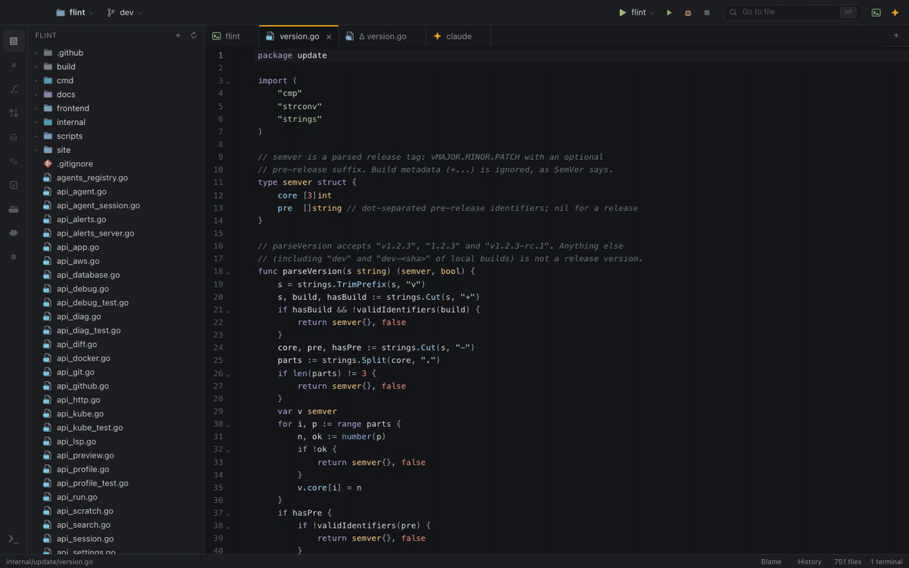

# Flint

Flint is a fast, AI-first IDE for macOS. Coding agents such as Claude Code and Codex write the code, in a built-in chat or in a terminal. Flint gives you the context and the control around them: you navigate and search the project, review what the agent changed, run and debug, and work with your databases, APIs and clusters, all in one window.

Flint is a single native process that uses the macOS system WebView (WKWebView) instead of Electron. It starts quickly and stays light on CPU and memory, and it uses the tools you already have installed (git, ripgrep, your agent CLIs) with the same `PATH` and logins as your terminal.

## Start here

- [Why Flint](why-flint.md): why another IDE, what it does differently, and when another tool is the better choice.
- [Install Flint](installation.md): download, first launch, the `flint` command and the optional tools.
- [First steps](first-steps.md): a 10-minute tour of the window and the shortcuts you will use every day.
- [Keyboard shortcuts](reference/keyboard-shortcuts.md): the full list.

## What you can do

### Write and navigate code

- Files, terminals, agent chats, SQL consoles and diffs share one tab area with back/forward history.
- Go to file with `⌘P`, search and replace across the project with `⇧⌘F` / `⇧⌘R`.
- Language servers for Go, Rust, TypeScript and Python: completion, hover, go to definition, find usages, rename, quick fixes, formatting and live diagnostics.
- Several projects in one window.

See [Editor and navigation](guides/editor-and-navigation.md) and [Terminals](guides/terminals.md).

### Work with AI agents

- Chat with Claude Code or Codex inside Flint, with streamed answers, tool calls, the plan and the list of changed files.
- Send a selection, a file, terminal output or a compiler error to the agent with one shortcut (`⌘L`).
- Let the agent write your commit message or resolve merge conflicts.

See [AI agents](guides/ai-agents.md) and [Build a feature with an agent](use-cases/build-a-feature-with-an-agent.md).

### Git and GitHub

- Commit panel, side-by-side diffs, blame, file history, stash, branches and worktrees.
- Review pull requests with your GitHub account (Sign in with GitHub): CI status, inline comments, replies and reviews.

See [Git and GitHub](guides/git-and-github.md).

### Run, test, debug and profile

- Run configurations, gutter buttons for Go and JavaScript tests, a Go debugger and a CPU/memory flame graph.

See [Run, debug and test](guides/run-debug-test.md).

### Databases and APIs

- PostgreSQL and ClickHouse consoles with schema browsing, query history, visual EXPLAIN and row editing.
- An HTTP client for `.http` files with environments and variables.

See [Databases](guides/databases.md) and [HTTP client](guides/http-client.md).

### Infrastructure

These come as [extensions](guides/extensions.md) from [flint-ide/extensions](https://github.com/flint-ide/extensions), which you install in **Settings ▸ Extensions**:

- Kubernetes apps with rollout state, pod problems, events and *Diagnose with AI*.
- AWS profiles with credential status and one-click refresh.
- Docker and Compose projects with logs, shells and lifecycle actions.

See [Kubernetes](guides/kubernetes.md), [AWS](guides/aws.md) and [Docker](guides/docker.md).

### Stay safe with unfamiliar code

- Folders you have not trusted yet open in [Restricted Mode](guides/restricted-mode.md), so opening a repository never runs its code on its own.

## Privacy

Flint has no telemetry. The only request it makes on its own is a daily check for a newer release, which you can turn off. See [Privacy and security](reference/privacy-and-security.md).

## Getting help

- [Troubleshooting](reference/troubleshooting.md) and the [FAQ](reference/faq.md) cover common problems.
- [Report a problem](how-to/report-a-problem.md) explains how to send a bug report with diagnostics.
